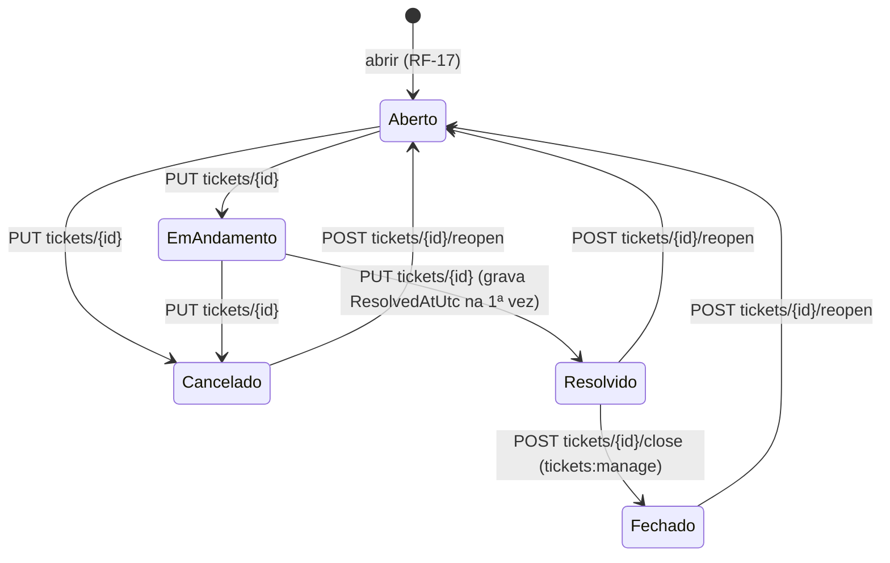
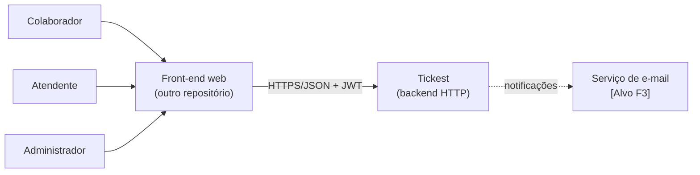
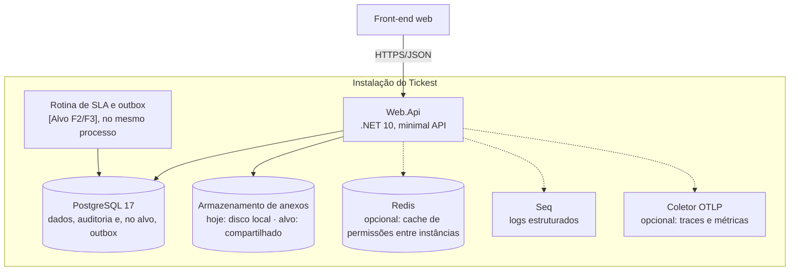
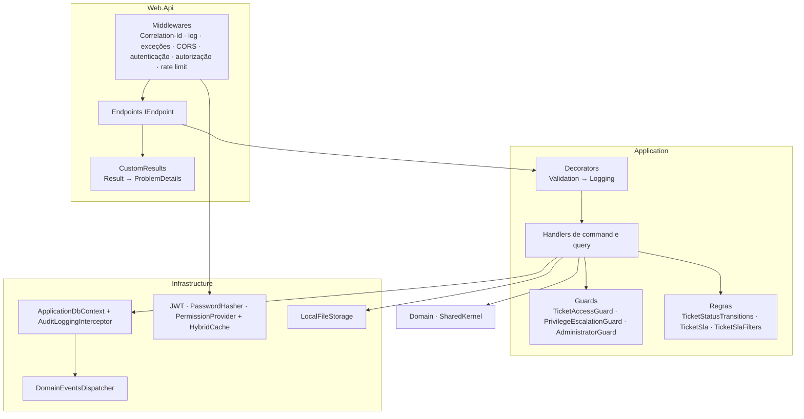
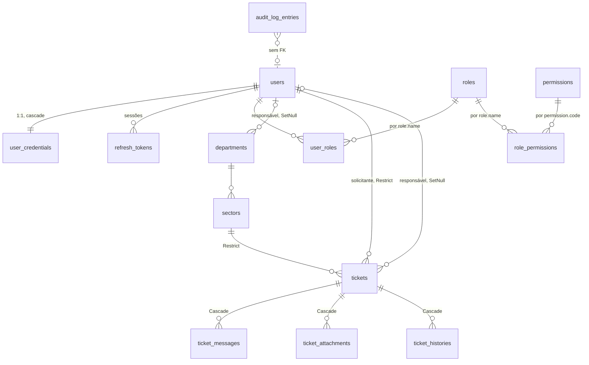

# SPEC-TICKEST — Especificação de Produto e Engenharia

| Campo | Valor |
|---|---|
| **Sistema** | TickestPristine (Tickest) — backend de chamados internos |
| **Versão do documento** | 0.5.0 — **Rascunho, com as decisões de produto de 24/10/2026 (DP-01 a DP-12 e DP-15 a DP-21)** |
| **Data** | 24/10/2026 |
| **Responsável** | Rafael Santos (produto e engenharia) |
| **Base técnica** | Código da `main` em `a4e7d8e` (23/10/2026), mais a spec 003 (branch `chore/BL-003-architecture-tests-permanent-rules`, `b8e79ad`) |
| **Stack** | .NET 10, C#, Clean Architecture, CQRS leve sem MediatR, Result pattern, EF Core 10 + Dapper, PostgreSQL 17 |

### Objetivo executivo

O **Tickest** organiza as demandas internas de uma empresa num lugar só. O colaborador abre um chamado para o setor que resolve, e o atendente trata esse chamado dentro de um prazo, conversando com o solicitante pelo próprio chamado. Tudo fica registrado: quem mudou o quê, quando e por quê.

O produto entrega três coisas que o e-mail e o chat não entregam: **um dono para cada demanda**, **um prazo medido** e **um histórico que não se perde**. O roadmap leva o prazo de horas corridas para o horário de expediente, com feriados, pausas, alertas e escalonamento, sem perder a simplicidade do fluxo atual.

Este documento é a referência de produto do Tickest. Cada mudança no código continua sendo especificada e aprovada numa spec própria, que cita os requisitos daqui.

### Princípio fundador

> **Nenhuma demanda sem dono, sem prazo ou sem rastro.**
> Todo chamado tem solicitante, setor e prazo desde a abertura. Toda mudança fica no histórico e na auditoria, e nada se apaga de verdade. Cada permissão é conferida no servidor, a cada requisição. Uma regra nova só entra no produto se preservar essas garantias.

---

## 0. Como ler este documento

### 0.1 Papel do documento

Este documento diz **o que o produto deve ser e por quê**. Ele não descreve como cada mudança é feita, nem acompanha o andamento do trabalho.

| Documento | Responde | Muda quando |
|---|---|---|
| **`SPEC-TICKEST.md` (este)** | O que o produto deve ser, as regras de negócio e os contratos que precisam ser respeitados | O responsável toma uma decisão de produto |
| `SYSTEM_SPECIFICATION.md` | O que o código faz hoje, com evidência `arquivo:linha` | Uma spec é verificada |
| `specs/NNN-slug/spec.md` | Como fazer **uma** mudança, e em que estado ela está | A cada trabalho |
| `CLAUDE.md` | Regras de código e o fluxo SDD | Muda uma convenção |
| Fora do repositório | Ideias e prioridades | Quando o responsável quiser |

### 0.2 Regras de manutenção

1. Este documento **não guarda status** de implementação. Para saber se um requisito já existe, valem o `SYSTEM_SPECIFICATION.md` e a spec que o implementou.
2. Toda spec `NNN` cita os IDs deste documento que atende (`RF-`, `RN-`, `RNF-`). Se a spec precisar contrariar um requisito daqui, este documento muda **antes**, com uma nova linha no histórico (seção 12).
3. Os IDs nunca são reaproveitados. Requisito removido fica marcado como ~~removido~~, com a data e o motivo.
4. As regras `RN-01` a `RN-23` usam a **mesma numeração** do `SYSTEM_SPECIFICATION.md` (seção 2.6). As novas começam em `RN-24`.
5. Marcadores usados: **[Vigente]** é um contrato que o código atual já cumpre e que precisa continuar cumprindo. **[Alvo]** é um requisito decidido que o código ainda não cumpre. **[Pendente]** depende de uma decisão ainda em aberto na seção 1.8.

---

## ⚠️ Análise de inconsistências e alertas

Pontos encontrados nas premissas do pedido e no estado do repositório. Os itens A-1 a A-5 já foram resolvidos no chat de 24/10/2026. Os demais continuam valendo.

| # | Ponto | Risco | Tratamento neste documento |
|---|---|---|---|
| A-1 | Os campos "O que muda", "Decisão de produto" e "Escopo" do pedido vieram sem preencher. | Inventar uma demanda | Resolvido: este é o SPEC **do produto inteiro**, e não de uma mudança. |
| A-2 | O pedido cita SQL Server e PostgreSQL. O código usa **só PostgreSQL** (`citext`, `xmin`, índices filtrados, SQL do Dapper em `GetTicketVolumeQueryHandler`). | Requisito de portabilidade sem base | Resolvido: PostgreSQL é o único banco suportado (RNF-01). Suportar SQL Server exigiria uma spec própria. |
| A-3 | O pedido cita DDD rico e "exceções de domínio". O código tem **domínio anêmico** (as regras ficam na Application) e usa **Result pattern** (sem exceção para regra de negócio). | Duas convenções no mesmo código | Resolvido: segue o código atual. O "catálogo de erros" (seção 4) substitui as exceções de domínio. |
| A-4 | O pedido chama esta SPEC de "contrato absoluto". No fluxo SDD, o contrato de cada mudança é a spec `NNN`, aprovada no chat. | Mudanças feitas direto a partir deste documento, sem spec | Este documento é o contrato **de produto**. A implementação continua exigindo a spec `NNN` aprovada (seção 0.1). |
| A-5 | O `BACKLOG.md` vai sair do repositório. | Este documento virar um backlog disfarçado | O roadmap (seção 1.7) traz fases e objetivos, sem ordem de execução nem status. |
| A-6 | **Não está decidido** se o Tickest é um helpdesk interno de uma organização ou um produto vendido a vários clientes (multi-tenant, planos, cobrança). | Muda o modelo de dados, a segurança e as metas não funcionais | Resolvido em 24/10/2026: **uma organização por instalação** (DP-01). |
| A-7 | O `SYSTEM_SPECIFICATION.md` está desatualizado: 79/811 testes em vez de 50/782 depois da DEC-9 da spec 003, 49 endpoints em vez de 51, contagens de eventos e o CI tratado como pendente. | Este documento herdar números errados | Este documento não usa contagens, só contratos. A correção do `SYSTEM_SPECIFICATION.md` precisa de uma tarefa própria. |
| A-8 | A spec 003 (testes de convenção em `Conventions/`) foi commitada na branch `chore/BL-003-architecture-tests-permanent-rules` (`b8e79ad`), mas ainda não está na `main`. | O RNF-10 ficar sem prova na `main` | O RNF-10 vale como contrato. A prova na `main` chega com o merge do PR do BL-003. |
| A-9 | O `CLAUDE.md` ainda usa o domínio de exemplo "Todos" (Q-09 do `SYSTEM_SPECIFICATION.md`). | O agente gerar código com nomes de exemplo | Decidido em 24/10/2026: o `CLAUDE.md` passa a descrever o domínio real (DP-09). A mudança é feita fora deste documento. |
| A-10 | O plano de SLA (`prompt-sla-tickest.md`) propõe métodos no domínio e proíbe construtores primários, o contrário do `CLAUDE.md`. | Duas convenções | Já decidido na DEC-2 da spec 004, a favor do `CLAUDE.md`. Este documento segue essa decisão (RNF-09). |
| A-11 | A abertura do chamado aceita como responsável qualquer usuário ativo, e a atribuição posterior exige `tickets:manage` (Q-05). | Regra de negócio inconsistente | Decidido em 24/10/2026: a regra da atribuição também vale na abertura (DP-02, RN-30). |
| A-12 | O RF-54 cita como exemplo de pausa "aguardando o solicitante", mas nenhum status do chamado representa espera (só Aberto, Em andamento, Resolvido, Fechado e Cancelado). | Pausa sem gatilho, ou uso indevido de Em andamento como pausa | Resolvido em 24/10/2026: sem pausa até existir o status "Aguardando solicitante" (DP-19, RN-44). |
| A-13 | O RF-52 e o RF-53 não definem as metas em minutos úteis, o que conta como "primeira resposta", nem o que acontece na reabertura e com os chamados já existentes. | Cada spec decidir sozinha uma regra de produto | Resolvido em 24/10/2026: RN-37 a RN-43 (DP-15 a DP-18). |

---

## 1. Visão geral e decisão de produto

### 1.1 Contexto

O Tickest é o backend HTTP de um **sistema de chamados internos (helpdesk)**. Um colaborador abre um chamado para um setor (TI, RH, Financeiro, Facilities...). Um atendente trata o chamado dentro de um prazo (SLA) e conversa com o solicitante pelo próprio chamado. Tudo fica registrado em histórico e auditoria.

O projeto nasceu de um template genérico de Clean Architecture e foi adaptado para o domínio de chamados. O front-end fica fora deste repositório.

### 1.2 Problema resolvido

Sem um sistema, as demandas internas chegam por e-mail, chat e corredor. Isso gera quatro problemas:

1. **Não se sabe quem está cuidando** de cada demanda.
2. **Não há prazo**, e a demanda urgente se perde no meio das outras.
3. **Não há histórico**: a decisão tomada ou o arquivo enviado se perdem.
4. **Não há medida**: o gestor não sabe o volume por setor nem quantas demandas atrasaram.

### 1.3 Valor entregue

| Para quem | Valor |
|---|---|
| **Colaborador** (solicitante) | Abre a demanda num lugar só, acompanha o andamento e conversa com quem atende. |
| **Atendente** | Fila única com prioridade e prazo, responsável definido e histórico completo. |
| **Gestor / administrador** | Painel de SLA, volume por período e por status, auditoria de quem mudou o quê, e controle de acesso por função. |

### 1.4 Atores

| Ator | Descrição | Permissões padrão |
|---|---|---|
| **Visitante anônimo** | Ainda sem sessão | Login, renovação de token e troca da senha provisória |
| **Colaborador** | Abre e acompanha os próprios chamados | `tickets:create`, `tickets:view-own`, `tickets:update-own`, `tickets:delete-own`, `tickets:reopen-own` |
| **Atendente** | Trata os chamados de todos | As do Colaborador mais `tickets:manage` |
| **Administrador** | Gerencia usuários, funções, estrutura e auditoria | Todas as 16 permissões do catálogo |
| **Participante do chamado** (papel contextual) | O solicitante e o responsável atual daquele chamado | Ver o chamado, as mensagens, os anexos e o histórico |

As funções (roles) são **fixas**: são criadas por migration e não podem ser criadas nem excluídas pela API. Só as permissões do Colaborador e do Atendente são editáveis.

### 1.5 Princípios do produto

1. **Toda demanda tem dono e prazo.** O prazo nasce na abertura e não muda depois.
2. **Nada se apaga de verdade.** Chamados, mensagens e anexos têm exclusão lógica. O histórico do chamado é imutável, e a auditoria sobrevive ao usuário.
3. **Autorização no servidor, a cada requisição.** As permissões não vão no token, então a revogação vale na requisição seguinte.
4. **Erro esperado não é exceção.** Regra de negócio violada volta como `Result` com um código estável (`Agregado.Motivo`).
5. **Português do Brasil no produto.** Mensagens, nomes de funções e permissões ficam em pt-BR. O fuso de negócio é `America/Sao_Paulo`.

### 1.6 Escopo

**Dentro do escopo (o produto como um todo):**

- Autenticação própria (e-mail e senha), sessões com refresh token, senha provisória.
- Controle de acesso por funções fixas e permissões (RBAC).
- Estrutura organizacional: departamentos e setores.
- Ciclo de vida completo do chamado: abrir, tratar, atribuir, remover o responsável, fechar, reabrir e excluir.
- Conversa (mensagens) e anexos dentro do chamado.
- Histórico do chamado e auditoria de entidades.
- SLA de resolução e painéis (hoje em horas corridas; no alvo, com calendário útil e pausas).
- Observabilidade: logs estruturados, Correlation-Id, tracing e métricas técnicas.

**Fora do escopo (até uma nova decisão):**

- Front-end (fica em outro repositório).
- Multi-tenancy, planos e cobrança (decidido na DP-01: uma organização por instalação).
- Login por SSO, OAuth ou provedores externos.
- Recuperação de senha esquecida **por e-mail** (DP-10: por enquanto, o administrador redefine a senha; o e-mail só depois da Fase F3).
- Atendimento a clientes externos, portal público e abertura por e-mail.
- Base de conhecimento, pesquisa de satisfação e chat em tempo real.
- Suporte a SQL Server ou a outro banco além do PostgreSQL.
- Criação ou exclusão de funções pela API.
- Exclusão definitiva de usuários (existe só a desativação).
- Implantação com várias instâncias (DP-08: uma instância).

### 1.7 Roadmap por fases

As fases dizem **o que** o produto passa a fazer. A ordem dentro de cada fase, as prioridades e o andamento ficam fora deste documento (seção 0.1).

| Fase | Objetivo | Requisitos | Critério de saída |
|---|---|---|---|
| **F0 — Núcleo do helpdesk** | Fluxo completo de um chamado com controle de acesso | RF-01 a RF-40 | Um chamado percorre abrir → tratar → resolver → fechar → reabrir, com histórico e auditoria, e os testes de integração passam contra o PostgreSQL |
| **F1 — Governança e ajustes do núcleo** | Garantir as regras de arquitetura e o fluxo SDD de forma automática, e aplicar as regras de produto decididas em 24/10/2026 | RNF-10, RNF-11, RF-41 a RF-43, RN-30 a RN-36 | Os testes de arquitetura e a auditoria SDD barram o PR no CI, e as regras novas têm testes de aceite (AC-19 a AC-27) |
| **F2 — SLA útil** | O prazo passa a contar só o horário de expediente, com feriados, pausas e monitoramento | RF-50 a RF-55, RF-65, RF-66, RN-37 a RN-44 | O prazo de um chamado aberto na sexta às 17h respeita o calendário e os feriados, e o painel mostra a situação correta |
| **F3 — Confiabilidade e notificação** | Os efeitos colaterais não se perdem, e as pessoas são avisadas | RF-56 a RF-58, RNF-12 | Um evento gravado no commit é entregue mesmo depois de uma queda do processo |
| **F4 — SLA avançado** | Matriz impacto × urgência, calendários por setor, políticas configuráveis, escalonamento, próxima resposta e relatórios | RF-59 a RF-64 | Definido em cada spec da fase |
| **F5 — Pronto para produção** | Implantação fora de Development: uma instância atrás de proxy com TLS, anexos em armazenamento externo, retenção LGPD | RNF-13 a RNF-15, RNF-17 a RNF-24, RN-36 | A API sobe em produção com migração controlada, anexos fora do disco local e rate limit correto atrás do proxy, e a remoção dos anexos excluídos roda no prazo |

### 1.8 Decisões de produto

Decididas por Rafael Santos no chat em 24/10/2026, aceitando as sugestões apresentadas, salvo onde indicado. As DP-15 a DP-21 foram aceitas na mesma data ("Aceito todas"). Até a spec de cada uma ser entregue, o código continua com o comportamento da coluna "Antes".

| # | Pergunta | Antes | Decisão | Onde virou requisito |
|---|---|---|---|---|
| **DP-01** | Helpdesk interno ou produto para vários clientes? | Uma organização | **Uma organização por instalação**, sem multi-tenancy | RNF-02; seção 1.6 |
| **DP-02** | Na abertura, o responsável precisa ser ativo e ter `tickets:manage`? | Qualquer usuário ativo | **Sim**, a mesma regra da atribuição | RN-30 |
| **DP-03** | O solicitante pode mudar o status do próprio chamado? | Pode tudo | **Só cancelar.** Em andamento e Resolvido exigem `tickets:manage` | RN-32 |
| **DP-04** | O responsável sem `tickets:manage` pode tratar o chamado? | Só ver e conversar | **Manter assim.** Com a DP-02, todo responsável tem `tickets:manage` | Sem mudança |
| **DP-05** | Título, prioridade e setor podem ser editados? | Nada editável | **Prioridade e setor editáveis por quem tem `tickets:manage`, recalculando o prazo.** O título continua fixo | RF-43, RN-33 |
| **DP-06** | Bloquear mensagens e anexos em chamado encerrado? | Permite sempre | **Bloquear em Fechado e Cancelado.** Em Resolvido continua permitido | RN-31 |
| **DP-07** | Retenção (LGPD) | Nada é removido | **Anexo excluído: arquivo removido em 30 dias. Auditoria: guardada por 5 anos.** Chamados excluídos logicamente: **ainda sem prazo** (continua em aberto) | RN-36; RNF-21 |
| **DP-08** | Modelo de implantação | Uma instância, disco local | **Uma instância atrás de um proxy reverso com TLS, com os anexos num armazenamento externo** | RNF-14, RNF-15; seções 4.7 e 8 |
| **DP-09** | O `CLAUDE.md` descreve o domínio real? | Exemplos de Todos | **Domínio real** | Seção 11 |
| **DP-10** | Recuperação de senha esquecida? | Nenhuma | **O administrador redefine**, gerando uma senha provisória. Recuperação por e-mail só depois da F3 | RF-42 |
| **DP-11** | Reativar departamentos e setores? Responsável do departamento ativo? | Sem reativação; responsável pode estar inativo | **Sim e sim** | RF-41, RN-35 |
| **DP-12** | Chamado Em andamento que fica sem responsável | Fica como está | **Volta a Aberto** | RN-34 |
| **DP-15** | O que conta como primeira resposta? | Não há primeira resposta | **A primeira mensagem de quem não é o solicitante e tem `tickets:manage`; resolver também conta.** Mensagem do solicitante não conta | RN-37 |
| **DP-16** | Metas padrão do SLA útil | 4/8/24/72 h corridas, só resolução (RN-01) | **Em minutos úteis (1ª resposta / resolução): Urgente 30 / 240, Alta 120 / 600, Média 240 / 1.200, Baixa 600 / 3.000; alerta aos 75%** | RN-38 |
| **DP-17** | Reabrir abre um novo ciclo de resolução? | SLA congelado na primeira resolução (RN-26) | **Sim, com a meta integral; o primeiro ciclo continua congelado** | RN-42 |
| **DP-18** | Chamados abertos antes do SLA útil | — | **Mantêm o prazo em horas corridas já gravado, sem primeira resposta** | RN-43 |
| **DP-19** | Pausa do SLA (RF-54) | Não há pausa | **Só com um status novo "Aguardando solicitante", numa spec própria; até lá, sem pausa** | RN-44 |
| **DP-20** | Precedência das políticas configuráveis (F4) | Política única em código | **Setor, depois departamento, depois a padrão; empate pela ordem configurada** | RN-45 |
| **DP-21** | O solicitante vê o plano de SLA? | Vê prazo e situação | **Sim: todo participante vê o SLA inteiro do chamado, inclusive política e metas** | RF-65 |

**Ainda em aberto:**

| # | Pergunta | Comportamento atual |
|---|---|---|
| **DP-13** | Por quanto tempo um chamado excluído logicamente (e as mensagens e os anexos dele) fica guardado, e o que acontece depois: remoção física ou anonimização? | Nada é removido |
| **DP-14** | Qual é o canal das notificações da F3 (e-mail, notificação no front-end ou os dois)? | Não há notificações |

### 1.9 Análise de impacto deste documento

- **O que muda:** a intenção do produto passa a ter um registro único. As specs `NNN` passam a citar os IDs daqui, e as perguntas abertas do `SYSTEM_SPECIFICATION.md` (seção 9.5) passam a ser respondidas na seção 1.8.
- **O que permanece intocado:** nenhum arquivo de `src/` ou `tests/` muda por causa deste documento. O fluxo SDD, o portão, o CI, as convenções do `CLAUDE.md` e o `SYSTEM_SPECIFICATION.md` continuam como estão.

---

## 2. Regras de negócio e casos de uso

### 2.1 Requisitos funcionais

#### Autenticação e sessão [Vigente]

| ID | Requisito |
|---|---|
| RF-01 | O usuário entra com e-mail e senha e recebe um access token (JWT) e um refresh token. |
| RF-02 | O refresh token gera um novo par de tokens e é trocado a cada uso (rotação). |
| RF-03 | O logout revoga o refresh token da sessão. |
| RF-04 | O usuário troca a própria senha informando a atual. A troca encerra todas as sessões dele. |
| RF-05 | Quem tem senha provisória só entra depois de trocá-la (`POST users/login/new-password`). |
| RF-06 | O primeiro administrador é criado pelo seed, com senha provisória, a partir da configuração `Admin:*`. |

#### Usuários, funções e permissões [Vigente]

| ID | Requisito |
|---|---|
| RF-07 | Quem tem `users:create` cadastra usuários. O usuário novo recebe a função Colaborador. Não existe auto-cadastro. |
| RF-08 | Quem tem `users:read` lista e consulta usuários (por id e por e-mail). Qualquer usuário consulta o próprio cadastro (`users/me`). |
| RF-09 | O próprio usuário, ou quem tem `users:update`, edita nome e sobrenome. |
| RF-10 | Quem tem `users:deactivate` ativa e desativa usuários. |
| RF-11 | Quem tem `users:assign-roles` define as funções de um usuário. |
| RF-12 | Quem tem `roles:read` lista as funções. Quem tem `roles:manage` define as permissões do Colaborador e do Atendente. |
| RF-13 | Qualquer usuário ativo lista o catálogo de permissões. |

#### Estrutura organizacional [Vigente]

| ID | Requisito |
|---|---|
| RF-14 | Quem tem `departments:manage` cria, edita e desativa departamentos, com responsável opcional. |
| RF-15 | Quem tem `sectors:manage` cria, edita e desativa setores dentro de um departamento. |
| RF-16 | Qualquer usuário ativo lista e consulta departamentos e setores. |

#### Chamados [Vigente]

| ID | Requisito |
|---|---|
| RF-17 | Quem tem `tickets:create` abre um chamado com título, descrição, prioridade e setor, e opcionalmente com responsável. |
| RF-18 | Quem tem `tickets:manage` abre um chamado **em nome de outra pessoa** (campo `requesterId`). |
| RF-19 | O dono com `tickets:update-own`, ou quem tem `tickets:manage`, altera a descrição e o status de um chamado ativo. |
| RF-20 | Quem tem `tickets:manage` atribui ou troca o responsável de um chamado ativo. |
| RF-21 | Quem tem `tickets:manage` remove o responsável de um chamado ativo. |
| RF-22 | Quem tem `tickets:manage` fecha um chamado Resolvido. |
| RF-23 | O dono com `tickets:reopen-own`, ou quem tem `tickets:manage`, reabre um chamado inativo. |
| RF-24 | O dono com `tickets:delete-own`, ou quem tem `tickets:manage`, exclui (logicamente) um chamado ativo. |
| RF-25 | Quem tem `tickets:view-own` lista os próprios chamados e vê o resumo deles. |
| RF-26 | Quem tem `tickets:manage` lista todos os chamados, com filtros por status, prioridade, setor, solicitante, responsável, "sem responsável", situação do SLA e busca no título, ordenando pelos mais recentes ou pelo prazo. |
| RF-27 | O participante, ou quem tem `tickets:manage`, consulta o detalhe de um chamado. |

#### Conversa, anexos e histórico [Vigente]

| ID | Requisito |
|---|---|
| RF-28 | O participante, ou quem tem `tickets:manage`, lista e publica mensagens no chamado. |
| RF-29 | Só o autor edita a própria mensagem. O autor, ou quem tem `tickets:manage`, exclui a mensagem. |
| RF-30 | O participante, ou quem tem `tickets:manage`, lista, envia e baixa anexos. |
| RF-31 | Quem enviou o anexo, ou quem tem `tickets:manage`, exclui o anexo. |
| RF-32 | O participante, ou quem tem `tickets:manage`, consulta o histórico do chamado. |
| RF-33 | Cada ação relevante sobre o chamado grava uma linha no histórico (seção 2.4). |

#### Painéis e SLA [Vigente]

| ID | Requisito |
|---|---|
| RF-34 | Todo chamado tem prazo de resolução (`DueAtUtc`) e momento de alerta (`SlaWarningAtUtc`), calculados na abertura. |
| RF-35 | Todo chamado expõe a situação do SLA: no prazo, em risco, violado, cumprido, perdido ou não se aplica. |
| RF-36 | Quem tem `tickets:manage` vê o resumo do SLA, opcionalmente por setor. |
| RF-37 | Quem tem `tickets:manage` vê a contagem por status e o volume por período (dia, semana ou mês, no fuso de Brasília). |

#### Auditoria e operação [Vigente]

| ID | Requisito |
|---|---|
| RF-38 | Toda inclusão, alteração ou exclusão de uma entidade auditável gera um registro de auditoria na mesma transação. |
| RF-39 | Quem tem `audit:read` consulta a auditoria de uma entidade. |
| RF-40 | `GET health` informa se a API e o banco estão disponíveis, sem autenticação. |

#### Ajustes decididos em 24/10/2026 — Fase F1 [Alvo]

| ID | Requisito | Decisão |
|---|---|---|
| RF-41 | Quem tem `departments:manage` reativa um departamento, e quem tem `sectors:manage` reativa um setor. Reativar um setor exige o departamento ativo. Reativar um departamento **não** reativa os setores dele. | DP-11 |
| RF-42 | O administrador redefine a senha de outro usuário. O sistema gera uma senha provisória, marca a troca obrigatória (RF-05), encerra todas as sessões do usuário e devolve a senha provisória uma única vez. A operação aplica a RN-17 (ninguém redefine a senha de quem tem permissão administrativa que ele não tem). A permissão exigida é definida na spec. | DP-10 |
| RF-43 | Quem tem `tickets:manage` altera a prioridade e o setor de um chamado ativo. O título não é editável. | DP-05 |

#### SLA útil — Fase F2 [Alvo]

| ID | Requisito | Fonte |
|---|---|---|
| RF-50 | O SLA usa calendários de expediente (fuso IANA, faixas por dia da semana, opção 24x7) e feriados nacionais calculados por ano. | Spec 004 (REQ-1 a REQ-8) |
| RF-51 | Existe um calendário padrão "Expediente" (segunda a sexta, 08:00–18:00, `America/Sao_Paulo`) definido em código. | Spec 004 (REQ-2) |
| RF-52 | O prazo de resolução passa a ser calculado em minutos úteis, mantendo os campos `DueAtUtc`, `SlaWarningAtUtc` e a situação do SLA no contrato atual. | Spec 004 (DEC-3); spec 005 (planejada) |
| RF-53 | O SLA mede o tempo da primeira resposta, além do tempo de resolução. | `prompt-sla-tickest.md`, Fase 1 |
| RF-54 | O relógio do SLA pausa nos status definidos pela política (ex.: aguardando o solicitante). | `prompt-sla-tickest.md`, Fase 1 |
| RF-55 | Uma rotina periódica atualiza a situação do SLA e dispara os eventos de alerta e de violação, com execução única mesmo com várias instâncias. | Spec 006 (planejada); depende de DP-08 |
| RF-65 | O detalhe do chamado mostra o SLA de cada objetivo e ciclo: meta, início, alerta, prazo, conclusão ou parada, tempo útil consumido e restante, e o estado oficial (RN-40), além do plano aplicado e do instante do servidor usado no cálculo. Os campos atuais (`DueAtUtc`, `SlaWarningAtUtc`, situação do SLA) continuam com o mesmo significado. | Spec refinada de SLA de 24/10/2026; spec 005; DP-21 |
| RF-66 | Existe uma consulta só do SLA de um chamado, com as mesmas regras de acesso do detalhe, para a tela atualizar o SLA sem recarregar o chamado. | Spec refinada de SLA de 24/10/2026 |

#### Confiabilidade e notificação — Fase F3 [Alvo]

| ID | Requisito | Fonte |
|---|---|---|
| RF-56 | Os eventos de domínio são gravados na mesma transação da mudança (outbox) e entregues depois, com nova tentativa em caso de falha. | `prompt-sla-tickest.md`, Fase 0; DEC-4 da spec 004 |
| RF-57 | O responsável é avisado quando recebe um chamado e quando o SLA entra em risco ou é violado. | C-21 do `SYSTEM_SPECIFICATION.md`; canal a definir |
| RF-58 | O solicitante é avisado quando o chamado é resolvido ou recebe uma mensagem. | Canal a definir |

#### SLA avançado — Fase F4 [Alvo]

| ID | Requisito | Fonte |
|---|---|---|
| RF-59 | A prioridade é derivada de uma matriz impacto × urgência. | `prompt-sla-tickest.md`, Fase 2 |
| RF-60 | Cada setor pode ter o próprio calendário. | Fase 3 |
| RF-61 | As políticas de SLA (prazos por prioridade, pausas) são configuráveis pela API, com auditoria. | Fase 4 |
| RF-62 | O chamado em risco ou violado é escalado em vários níveis. | Fase 5; depende de RF-56 |
| RF-63 | O SLA mede a próxima resposta e a atualização periódica. | Fase 6 |
| RF-64 | Há relatórios de cumprimento do SLA por setor, prioridade e período. | Fase 7 |

### 2.2 Regras de negócio

As regras RN-01 a RN-23 são **[Vigente]** e têm evidência no `SYSTEM_SPECIFICATION.md` (seção 2.6). Elas aparecem aqui como contrato.

| ID | Regra |
|---|---|
| RN-01 | O SLA de resolução é contado em horas corridas desde a abertura: Urgente 4 h, Alta 8 h, Média 24 h, Baixa 72 h. O alerta "em risco" dispara aos 75% da janela. *(Substituída por RF-52 na Fase F2.)* |
| RN-02 | `DueAtUtc` e `SlaWarningAtUtc` são gravados na abertura e não mudam depois. |
| RN-03 | Situação do SLA: com resolução, `Met` se resolvido até o prazo e `Missed` se depois; sem resolução, cancelado é `NotApplicable`, depois do prazo é `Breached`, depois do alerta é `AtRisk`, senão `OnTime`. O cálculo em memória e o filtro em SQL dão o mesmo resultado. |
| RN-04 | Abrir um chamado em nome de outra pessoa exige `tickets:manage`. |
| RN-05 | O solicitante, o responsável e o setor informados na abertura precisam existir e estar ativos. |
| RN-06 | Editar, excluir ou reabrir exige ser o dono, com a permissão `*-own` correspondente, ou ter `tickets:manage`. |
| RN-07 | Ver o chamado, as mensagens, os anexos e o histórico é permitido ao solicitante, ao responsável atual ou a quem tem `tickets:manage`. |
| RN-08 | Só o autor edita a própria mensagem. O autor, ou quem tem `tickets:manage`, a exclui. |
| RN-09 | O anexo tem até 10 MB, um tipo permitido (imagens, PDF, Office, txt, zip) e uma extensão coerente com o tipo declarado. A requisição de upload tem até 11 MB. |
| RN-10 | Um departamento ou setor não pode ser desativado com chamados ativos. Desativar o departamento desativa os setores dele. |
| RN-11 | O nome do departamento é único entre os ativos, sem diferenciar maiúsculas. O nome do setor é único dentro do departamento, entre os ativos. |
| RN-12 | O e-mail do usuário é único, sem diferenciar maiúsculas. |
| RN-13 | A senha tem pelo menos 6 caracteres, uma maiúscula e um caractere especial. Na troca, a nova senha é diferente da atual. |
| RN-14 | Cinco senhas erradas seguidas bloqueiam a conta por 15 minutos. Durante o bloqueio, a senha nem é conferida. |
| RN-15 | A sessão dura no máximo 30 dias a partir do login. O refresh token é trocado a cada renovação. Reusar um token já trocado depois de 30 s revoga todas as sessões. Trocar a senha revoga todas as sessões. |
| RN-16 | O administrador inicial nasce com senha provisória. O login devolve 403 até a troca. |
| RN-17 | Ninguém concede nem remove uma permissão administrativa que não possui, e ninguém ativa ou desativa quem tem uma permissão administrativa que ele não tem. |
| RN-18 | Sempre existe ao menos um administrador ativo, com proteção contra duas remoções simultâneas. |
| RN-19 | Ninguém desativa a própria conta. O usuário desativado perde o acesso na requisição seguinte; só `users/me` e o logout continuam aceitos. |
| RN-20 | O perfil (nome e sobrenome) é editado pelo próprio usuário ou por quem tem `users:update`. |
| RN-21 | Só quem tem `tickets:manage` fecha um chamado, e só se ele estiver Resolvido. O fechamento grava o histórico `StatusChanged` e não altera `ResolvedAtUtc`. |
| RN-22 | Só quem tem `tickets:manage` atribui o responsável, e só em chamado ativo. O responsável precisa estar ativo e ter `tickets:manage`. Atribuir a quem já é o responsável não grava nada. |
| RN-23 | Só quem tem `tickets:manage` remove o responsável, e só em chamado ativo. A inatividade é conferida antes do responsável. Remover de um chamado já sem responsável responde `204` sem gravar nada. O status não muda. A remoção grava o histórico `Unassigned` e tira o acesso de participante de quem foi removido. *(A parte "o status não muda" será substituída pela RN-34.)* |
| RN-24 | **[Vigente]** As transições de status permitidas são exatamente as da tabela da seção 2.3. Qualquer outra devolve `Tickets.InvalidStatusTransition`. |
| RN-25 | **[Vigente]** "Ativo" significa Aberto ou Em andamento. Alterar, excluir, atribuir e remover o responsável exigem chamado ativo; reabrir exige chamado inativo. |
| RN-26 | **[Vigente]** A primeira ida a Resolvido grava `ResolvedAtUtc`. Reabrir não limpa esse campo, então a situação do SLA fica congelada na primeira resolução. |
| RN-27 | **[Vigente]** A alteração da descrição é detectada por comparação exata (ordinal) e grava `DescriptionChanged` com o texto anterior e o novo. |
| RN-28 | **[Vigente]** O título tem até 200 caracteres. A descrição do chamado tem de 10 a 500 caracteres e é obrigatória também no `PUT tickets/{id}`. A mensagem tem até 4000 caracteres. O nome de departamento e de setor tem até 100 caracteres, e a descrição, até 500 (no setor, a descrição é opcional). |
| RN-29 | **[Vigente]** A role Administrador tem todas as permissões e não é editável. |
| RN-30 | **[Alvo — DP-02]** Na abertura, o responsável informado precisa estar ativo e ter `tickets:manage`; senão, `400 Tickets.AssigneeCannotManageTickets`. |
| RN-31 | **[Alvo — DP-06]** Publicar, editar ou excluir mensagens, e enviar ou excluir anexos, é recusado em chamado Fechado ou Cancelado. Ler e baixar continua permitido. Em Resolvido, tudo continua permitido. O código do erro é definido na spec. |
| RN-32 | **[Alvo — DP-03]** Sem `tickets:manage`, o dono só pode mudar o status do próprio chamado para Cancelado. As idas para Em andamento e Resolvido exigem `tickets:manage`; senão, `403`. A alteração da descrição continua permitida ao dono com `tickets:update-own`. |
| RN-33 | **[Alvo — DP-05]** Ao mudar a prioridade, `DueAtUtc` e `SlaWarningAtUtc` são recalculados **a partir da abertura** (`CreatedAtUtc`) com a janela da nova prioridade, e não a partir do momento da mudança. A mudança grava histórico com o valor anterior e o novo. Ao mudar o setor, o novo setor precisa estar ativo. Isso substitui, para esses dois campos, a parte "não mudam depois" da RN-02. |
| RN-34 | **[Alvo — DP-12]** Remover o responsável de um chamado Em andamento muda o status para Aberto e grava os históricos `Unassigned` e `StatusChanged`. Em chamado Aberto, o status não muda. |
| RN-35 | **[Alvo — DP-11]** O responsável indicado para um departamento precisa estar ativo. Desativar um usuário que é responsável por um departamento deixa o departamento sem responsável. |
| RN-36 | **[Alvo — DP-07]** O arquivo de um anexo excluído é removido do armazenamento 30 dias depois da exclusão; o registro do anexo continua, para o histórico. O registro de auditoria é guardado por 5 anos e removido depois disso. A retenção dos chamados excluídos depende da DP-13. |
| RN-37 | **[Alvo — DP-15]** A primeira mensagem publicada por quem não é o solicitante e tem `tickets:manage` naquele instante conclui a primeira resposta. Resolver o chamado também conclui. Mensagem do solicitante não conta, e editar ou excluir a mensagem depois não reabre o objetivo. |
| RN-38 | **[Alvo — DP-16]** Metas padrão, em minutos úteis do calendário "Expediente" (primeira resposta / resolução): Urgente 30 / 240, Alta 120 / 600, Média 240 / 1.200, Baixa 600 / 3.000. O alerta "em risco" dispara aos 75% do tempo útil da meta. |
| RN-39 | **[Alvo — RF-52, RN-02]** Na abertura, o chamado guarda o plano de SLA aplicado (política, versão, calendário e metas). Mudar a política depois não altera os chamados existentes. Só a mudança de prioridade ou de setor (RN-33) refaz o plano, e só para os objetivos ainda abertos, contando da abertura; objetivo encerrado não muda. |
| RN-40 | **[Alvo]** O estado oficial de cada objetivo (no prazo, em risco, violado, cumprido, perdido, parado, não se aplica) é calculado pelo servidor, com um único instante por requisição, devolvido junto. O relógio do navegador nunca decide se um prazo foi cumprido, e o estado não depende da rotina periódica (RF-55) para estar certo. |
| RN-41 | **[Alvo — RN-03]** Cancelar o chamado encerra os objetivos ainda abertos sem avaliação: eles não contam como cumpridos nem como violados. |
| RN-42 | **[Alvo — DP-17]** Reabrir abre um novo ciclo do objetivo de resolução, com a meta integral, a partir da reabertura. O primeiro ciclo continua congelado e é ele que alimenta `DueAtUtc`, `SlaWarningAtUtc` e a situação atual (RN-26). A primeira resposta não reabre. |
| RN-43 | **[Alvo — DP-18]** Os chamados abertos antes do SLA útil mantêm o prazo em horas corridas já gravado e não ganham objetivo de primeira resposta, que aparece como "não se aplica". |
| RN-44 | **[Alvo — DP-19]** A pausa só existe quando houver um status que represente espera pelo solicitante. O tempo pausado não conta, e pausar ou retomar não muda ciclos já encerrados. |
| RN-45 | **[Alvo — DP-20]** Políticas configuráveis (RF-61): vale a política ativa do setor do chamado; sem ela, a do departamento; sem ela, a padrão; no empate, a ordem configurada. Existe sempre exatamente uma política padrão ativa. Política não é excluída, só desativada, e cada alteração gera uma nova versão. Configurar exige a permissão administrativa `sla:manage`. |


### 2.3 Ciclo de vida do chamado



| De \ Para | Aberto | Em andamento | Resolvido | Fechado | Cancelado |
|---|---|---|---|---|---|
| **Aberto** | — | ✅ | ❌ | ❌ | ✅ |
| **Em andamento** | ❌ | — | ✅ | ❌ | ✅ |
| **Resolvido** | ✅ (reabrir) | ❌ | — | ✅ (fechar) | ❌ |
| **Fechado** | ✅ (reabrir) | ❌ | ❌ | — | ❌ |
| **Cancelado** | ✅ (reabrir) | ❌ | ❌ | ❌ | — |

### 2.4 Histórico do chamado

O histórico é imutável e é gravado pelo handler do command, na mesma transação da mudança. O texto exibido é derivado na leitura, a partir da ação.

| Ação (`TicketHistoryAction`) | Valor | Quando | `oldValue` → `newValue` |
|---|---|---|---|
| `Created` | 1 | Abertura | — |
| `StatusChanged` | 2 | Mudança de status (inclui o fechamento) | nome do status anterior → nome do novo |
| `Reassigned` | 3 | Atribuição ou troca de responsável | id do anterior (ou nulo) → id do novo |
| `Reopened` | 4 | Reabertura | status anterior → `Open` |
| `Deleted` | 5 | Exclusão lógica | — |
| `MessageAdded` | 6 | Mensagem publicada | — |
| `AttachmentAdded` | 7 | Anexo enviado | — |
| `AttachmentRemoved` | 8 | Anexo excluído | — |
| `MessageEdited` | 9 | Mensagem editada | — |
| `MessageRemoved` | 10 | Mensagem excluída | — |
| `Unassigned` | 11 | Responsável removido | id do anterior → nulo |
| `DescriptionChanged` | 12 | Descrição alterada | texto anterior → texto novo |

Os valores numéricos são o contrato da API. No banco, os enums ficam gravados **pelo nome**. Um valor novo entra sempre no fim, sem reaproveitar números.

### 2.5 Casos de uso

Cada caso de uso passa pela mesma cadeia: endpoint → autorização da rota → `ValidationDecorator` (só em commands) → `LoggingDecorator` → handler → guard de acesso → regras → `SaveChangesAsync` (uma transação, com auditoria) → despacho dos eventos de domínio em memória, depois do commit.

#### UC-01 — Abrir chamado (RF-17, RF-18)

- **Principal:** o colaborador envia título, descrição, prioridade e setor. O sistema confere o setor ativo, calcula o prazo (RN-01, RN-02), grava o chamado como Aberto com o histórico `Created`, dispara `TicketCreatedDomainEvent` e devolve `200` com o id.
- **Alternativo A1, em nome de outra pessoa:** com `requesterId` diferente do autor, o sistema exige `tickets:manage` (RN-04) e confere se o solicitante está ativo (RN-05).
- **Alternativo A2, com responsável:** com `assignedToUserId`, o sistema confere se o responsável existe e está ativo (RN-05). Pela RN-30 [Alvo], ele também precisa ter `tickets:manage`.
- **Exceções:** validação → `400 Validation.General` com `errors[]`; `requesterId` sem `tickets:manage` → `403`; setor, solicitante ou responsável inexistente ou inativo → `404` (`Sectors.NotFound`, `Users.NotFound`); sem token → `401`; sem `tickets:create` → `403`.

#### UC-02 — Tratar chamado (RF-19)

- **Principal:** o dono ou o atendente envia a descrição e o status. O sistema confere o acesso (RN-06) e, pela RN-32 [Alvo], só aceita do dono sem `tickets:manage` a ida para Cancelado. Depois confere se o chamado está ativo (RN-25) e se a transição é válida (RN-24), grava `ResolvedAtUtc` na primeira resolução (RN-26), grava o histórico (`StatusChanged` e/ou `DescriptionChanged`, RN-27) e devolve `204`.
- **Alternativo A1, nada mudou:** a mesma descrição e o mesmo status → `204` sem histórico.
- **Exceções:** chamado inexistente ou excluído → `404 Tickets.NotFound`; sem acesso → `403`; inativo → `400 Tickets.NotActive`; transição inválida → `400 Tickets.InvalidStatusTransition`; alteração simultânea → `409`.

#### UC-03 — Atribuir e remover o responsável (RF-20, RF-21)

- **Atribuir:** `PUT tickets/{id}/assignee` com `assignedToUserId`. Aplica a RN-22, grava `Reassigned`, dispara `TicketReassignedDomainEvent` e devolve `204`.
- **Remover:** `DELETE tickets/{id}/assignee`. Aplica a RN-23, grava `Unassigned`, dispara `TicketUnassignedDomainEvent` e devolve `204`. Pela RN-34 [Alvo], um chamado Em andamento volta a Aberto.
- **Alternativos:** já é o responsável (atribuir) ou já está sem responsável (remover) → `204` sem gravar nada.
- **Exceções:** inativo → `400 Tickets.NotActive`; responsável sem `tickets:manage` → `400 Tickets.AssigneeCannotManageTickets`; usuário inexistente ou inativo → `404 Users.NotFound`; chamado inexistente → `404 Tickets.NotFound`; sem `tickets:manage` → `403`; concorrência → `409`.

#### UC-04 — Fechar chamado (RF-22)

- **Principal:** o atendente fecha um chamado Resolvido (RN-21). O sistema grava `StatusChanged` (`Resolved` → `Closed`) e devolve `204`.
- **Exceções:** status diferente de Resolvido → `400 Tickets.InvalidStatusTransition`; inexistente → `404`; sem `tickets:manage` → `403`; concorrência → `409`.

#### UC-05 — Reabrir chamado (RF-23)

- **Principal:** o dono ou o atendente reabre um chamado Resolvido, Fechado ou Cancelado. O status volta a Aberto, o histórico `Reopened` é gravado e o SLA **não** é recalculado (RN-26).
- **Exceções:** chamado ativo → `409 Tickets.AlreadyActive`; sem acesso → `403`; inexistente → `404`.

#### UC-06 — Conversar e anexar (RF-28 a RF-31)

- **Mensagem:** o participante publica até 4000 caracteres. O sistema grava `MessageAdded` e devolve `200` com o id. Editar e excluir seguem a RN-08.
- **Anexo:** o participante envia um `multipart/form-data`. O sistema valida o arquivo (RN-09), confere o acesso, grava o arquivo no armazenamento, grava o registro e o histórico `AttachmentAdded` e, se o banco falhar, apaga o arquivo gravado.
- **Exceções:** chamado Fechado ou Cancelado (RN-31 [Alvo]) → recusado, com o código definido na spec; mensagem ou anexo inexistente → `404 TicketMessages.NotFound` / `TicketAttachments.NotFound`; arquivo inválido → `400`; requisição acima de 11 MB → `413`; sem acesso → `403`.

#### UC-07 — Primeiro acesso e sessão (RF-01 a RF-06)

- **Principal:** o login confere a senha (RN-14), depois a situação da conta, e devolve os tokens. A renovação aplica a RN-15.
- **Exceções:** credenciais inválidas → `400 Users.InvalidCredentials`; conta bloqueada → `403 Users.LockedOut`; desativada → `403 Users.Deactivated`; troca pendente → `403 Users.PasswordChangeRequired`; token de renovação inválido → `400 Users.InvalidRefreshToken`; renovação simultânea → `409`; excesso de tentativas → `429`.

#### UC-08 — Gestão de acesso (RF-10 a RF-12)

- **Principal:** o administrador define funções ou permissões. O sistema aplica a RN-17 e a RN-18, grava, e **depois do commit** invalida o cache de permissões dos usuários afetados.
- **Exceções:** escalada de privilégio → `403 Roles.PrivilegeEscalation` ou `Users.CannotManagePrivilegedUser`; role Administrador → `409 Roles.AdministratorRoleIsManaged`; último administrador → `409 Roles.LastAdministrator`; desativar a si mesmo → `400 Users.CannotDeactivateSelf`.

### 2.6 Invariantes

Estas condições valem em qualquer estado gravado. Toda spec que mexer nessas entidades precisa preservá-las.

| # | Invariante | Onde é garantida |
|---|---|---|
| INV-01 | Todo chamado tem solicitante e setor. | FK `Restrict` e validação |
| INV-02 | `DueAtUtc` > `CreatedAtUtc` e `SlaWarningAtUtc` fica entre os dois. | `TicketSla` na abertura |
| INV-03 | `ResolvedAtUtc` só é preenchido na primeira resolução e nunca é limpo. | `UpdateTicketCommandHandler` |
| INV-04 | O chamado excluído (`DeletedAtUtc`) não aparece em nenhuma leitura. | Filtro global do EF |
| INV-05 | Uma linha de histórico nunca é alterada nem excluída. | Sem rota de alteração; sem filtro de exclusão |
| INV-06 | Existe ao menos um administrador ativo. | `AdministratorGuard` com token de concorrência |
| INV-07 | O e-mail e o código público (`usr_<ULID>`) do usuário são únicos. | Índices únicos (`citext`) |
| INV-08 | A senha nunca é gravada em texto. Só o hash PBKDF2 e o hash do refresh token vão para o banco. | `PasswordHasher`, `RefreshTokenHasher` |
| INV-09 | A auditoria nunca grava `PasswordHash` nem `SecurityStamp`. | `AuditLoggingInterceptor` |
| INV-10 | O caminho do anexo no armazenamento é gerado pelo servidor e fica contido na pasta raiz. | `LocalFileStorage` |

---

## 3. Arquitetura e modelagem técnica

### 3.1 Estilo arquitetural [Vigente]

- **Clean Architecture em 5 projetos**: `SharedKernel` ← `Domain` ← `Application` ← `Infrastructure` ← `Web.Api`. A direção é garantida por testes de arquitetura.
- **Slices verticais** dentro da Application: uma pasta por caso de uso, com `{UseCase}Command|Query.cs`, `...Handler.cs` (`internal sealed`, construtor primário) e `...Validator.cs` (obrigatório para todo command).
- **CQRS lógico**: commands e queries usam o mesmo `ApplicationDbContext`. Dapper só quando o SQL expressa a consulta melhor que o LINQ.
- **Sem MediatR**: handlers próprios, decorados via Scrutor (Validation → Logging → handler).
- **Domínio anêmico** (decisão consciente, RNF-09): as entidades só têm propriedades; as regras ficam na Application, em handlers e classes estáticas (`TicketStatusTransitions`, `TicketSla`, guards).

### 3.2 Agregados e entidades

| Agregado | Raiz | Filhos | Exclusão | Concorrência |
|---|---|---|---|---|
| **Chamado** | `Ticket` | `TicketMessage`, `TicketAttachment`, `TicketHistory` | Lógica (`DeletedAtUtc`); o histórico não se exclui | `xmin` (sombra) |
| **Usuário** | `User` | `UserCredential` (1:1), `RefreshToken`, `UserRole` | Desativação (`IsActive`) | `TokenHash` no `RefreshToken` |
| **Função** | `Role` | `RolePermission` | Não se exclui | `Version` (sombra) na role Administrador |
| **Permissão** | `Permission` | — | Catálogo fixo | — |
| **Departamento** | `Department` | — | Desativação | — |
| **Setor** | `Sector` | — | Desativação | — |
| **Auditoria** | `AuditLogEntry` | — | Imutável, sem FK para o usuário | — |

**Campos das entidades principais:**

| Entidade | Campos |
|---|---|
| `Ticket` | `Id: Guid`, `Title: string`, `Description: string`, `Priority: TicketPriority`, `Status: TicketStatus`, `CreatedByUserId: Guid`, `AssignedToUserId: Guid?`, `SectorId: Guid`, `CreatedAtUtc: DateTime`, `DueAtUtc: DateTime`, `SlaWarningAtUtc: DateTime`, `ResolvedAtUtc: DateTime?`, `DeletedAtUtc: DateTime?` |
| `TicketMessage` | `Id`, `TicketId`, `AuthorUserId`, `Content: string`, `CreatedAtUtc`, `EditedAtUtc?`, `DeletedAtUtc?` |
| `TicketAttachment` | `Id`, `TicketId`, `UploadedByUserId`, `FileName: string`, `ContentType: string`, `FileSizeBytes: long`, `StorageKey: string`, `UploadedAtUtc`, `DeletedAtUtc?` |
| `TicketHistory` | `Id`, `TicketId`, `ChangedByUserId: Guid?`, `Action: TicketHistoryAction`, `OldValue: string?`, `NewValue: string?`, `OccurredAtUtc` |
| `User` | `Id`, `Email: string`, `FirstName: string`, `LastName: string`, `Code: string`, `IsActive: bool`, `CreatedAtUtc`, `DeactivatedAtUtc?` |
| `Department` | `Id`, `Name: string`, `Description: string`, `IsActive: bool`, `ResponsibleUserId: Guid?` |
| `Sector` | `Id`, `Name: string`, `Description: string?`, `IsActive: bool`, `DepartmentId: Guid` |

**Value Objects:** não existem. E-mail, prazos e nomes são tipos primitivos, e as regras ficam nos validators e nas classes de regra. Introduzir Value Objects contraria o RNF-09 e exige uma decisão registrada aqui antes da spec.

### 3.3 Enums

| Enum | Valores (o número é o contrato da API) |
|---|---|
| `TicketStatus` | `Open = 1`, `InProgress = 2`, `Resolved = 3`, `Closed = 4`, `Canceled = 5` |
| `TicketPriority` | `Low = 1`, `Medium = 2`, `High = 3`, `Urgent = 4` |
| `TicketSlaStatus` | `OnTime = 1`, `AtRisk = 2`, `Breached = 3`, `Met = 4`, `Missed = 5`, `NotApplicable = 6` |
| `TicketHistoryAction` | 1 a 12 (seção 2.4) |
| `TicketSortOrder` | `Newest = 0`, `DueDate = 1` |
| `ErrorType` | `Failure`, `Validation`, `Problem`, `NotFound`, `Conflict`, `Forbidden` |

### 3.4 Contratos HTTP do núcleo de chamados

Todas as rotas exigem um JWT `Bearer`, salvo indicação contrária. O inventário completo de rotas e autorização está no `SYSTEM_SPECIFICATION.md` (seção 4.3.1) e é contrato **[Vigente]**.

**`POST tickets` — abrir (RF-17)**

```json
// Requisição
{
  "title": "Notebook não liga",
  "description": "O notebook não liga desde hoje cedo, mesmo na tomada.",
  "priority": 3,
  "sectorId": "6f1c2a9e-3b7d-4e1a-9c2f-1a2b3c4d5e6f",
  "requesterId": null,
  "assignedToUserId": null
}
// Resposta 200
"0b9d6c3e-7a41-4f2e-8d5a-2c1b0e9f8a7d"
```

**`PUT tickets/{id}` — tratar (RF-19)**

```json
// Requisição
{
  "description": "O notebook não liga desde hoje cedo, mesmo na tomada.",
  "status": 2
}
// Resposta 204 (sem corpo)
```

**`PUT tickets/{id}/assignee` — atribuir (RF-20)**

```json
// Requisição
{ "assignedToUserId": "2e7f4b1c-9d3a-4c6e-b8f2-5a1d0c9e8b7a" }
// Resposta 204 (sem corpo)
```

**`DELETE tickets/{id}/assignee`, `POST tickets/{id}/close`, `POST tickets/{id}/reopen`, `DELETE tickets/{id}`** — sem corpo; resposta `204`.

**`GET tickets/{id}` — detalhe (RF-27), resposta 200 (`TicketResponse`)**

```json
{
  "id": "0b9d6c3e-7a41-4f2e-8d5a-2c1b0e9f8a7d",
  "title": "Notebook não liga",
  "description": "O notebook não liga desde hoje cedo, mesmo na tomada.",
  "priority": 3,
  "status": 2,
  "openedByUserId": "9a8b7c6d-5e4f-4a3b-2c1d-0e9f8a7b6c5d",
  "openedByName": "Ana Souza",
  "assignedToUserId": "2e7f4b1c-9d3a-4c6e-b8f2-5a1d0c9e8b7a",
  "assignedToName": "Bruno Lima",
  "sectorId": "6f1c2a9e-3b7d-4e1a-9c2f-1a2b3c4d5e6f",
  "sectorName": "Suporte de TI",
  "createdAtUtc": "2026-10-24T12:00:00Z",
  "dueAtUtc": "2026-10-24T20:00:00Z",
  "slaWarningAtUtc": "2026-10-24T18:00:00Z",
  "resolvedAtUtc": null,
  "slaStatus": 1
}
```

**`GET tickets` — listagem (RF-26), resposta 200 (`PagedResponse<TicketSummaryResponse>`)**

- Filtros (query string): `status` (repetível, ex.: `?status=1&status=2`), `priority`, `sectorId`, `requesterId`, `assignedToUserId`, `unassignedOnly` (ignora `assignedToUserId` quando ligado), `slaStatus`, `search` (título), `sort` (`Newest` ou `DueDate`), e a paginação `page` e `pageSize` (padrão 20, máximo 100; valores fora da faixa são ajustados, sem erro).
- Cada item tem: `id`, `title`, `priority`, `status`, `requesterId`, `requesterName`, `requesterEmail`, `assignedToUserId`, `assignedToName`, `sectorId`, `sectorName`, `createdAtUtc`, `dueAtUtc`, `slaWarningAtUtc`, `resolvedAtUtc`, `slaStatus`.

**Subrecursos do chamado (paginação por cursor: data + id)**

| Rota | Item da resposta |
|---|---|
| `GET tickets/{id}/messages` | `TicketMessageResponse`: `id`, `ticketId`, `authorUserId`, `content`, `createdAtUtc`, `editedAtUtc` |
| `GET tickets/{id}/attachments` | `TicketAttachmentResponse`: `id`, `ticketId`, `uploadedByUserId`, `fileName`, `contentType`, `fileSizeBytes`, `uploadedAtUtc` |
| `GET tickets/{id}/history` | `TicketHistoryResponse`: `id`, `ticketId`, `changedByUserId`, `action`, `description`, `oldValue`, `newValue`, `occurredAtUtc` |

### 3.5 Commands, queries e eventos

**Commands do módulo de chamados** (todos com validator):

| Command | Propriedades | Retorno |
|---|---|---|
| `CreateTicketCommand` | `Title`, `Description`, `Priority`, `RequesterId?`, `AssignedToUserId?`, `SectorId` | `Result<Guid>` |
| `UpdateTicketCommand` | `TicketId`, `Description`, `Status` | `Result` |
| `AssignTicketCommand` | `TicketId`, `AssignedToUserId` | `Result` |
| `UnassignTicketCommand` | `TicketId` | `Result` |
| `CloseTicketCommand` | `TicketId` | `Result` |
| `ReopenTicketCommand` | `TicketId` | `Result` |
| `DeleteTicketCommand` | `TicketId` | `Result` |
| `PostTicketMessageCommand` | `TicketId`, `Content` | `Result<Guid>` |

**Queries do módulo de chamados:** `GetTickets`, `GetTicketById`, `GetOwnTickets`, `GetOwnTicketsSummary`, `GetTicketSlaSummary`, `GetTicketStatusCounts`, `GetTicketVolume`, `GetTicketMessages`, `GetTicketAttachments`, `GetTicketHistory`. Queries não passam por validação (o `ValidationDecorator` só decora commands).

**Eventos de domínio do chamado** (disparados pelo handler, depois do commit; hoje sem consumidores):

| Evento | Dados |
|---|---|
| `TicketCreatedDomainEvent` | `TicketId`, `OpenedByUserId` |
| `TicketUpdatedDomainEvent` | `TicketId` |
| `TicketStatusChangedDomainEvent` | `TicketId`, `OldStatus`, `NewStatus`, `ChangedByUserId?` |
| `TicketReassignedDomainEvent` | `TicketId`, `PreviousAssignedToUserId?`, `AssignedToUserId`, `ChangedByUserId?` |
| `TicketUnassignedDomainEvent` | `TicketId`, `PreviousAssignedToUserId`, `ChangedByUserId?` |
| `TicketReopenedDomainEvent` | `TicketId`, `ReopenedByUserId?` |
| `TicketDeletedDomainEvent` | `TicketId` |
| `TicketMessagePostedDomainEvent` / `...EditedDomainEvent` | `MessageId`, `TicketId`, `AuthorUserId` |
| `TicketMessageDeletedDomainEvent` | `MessageId`, `TicketId` |
| `TicketAttachmentUploadedDomainEvent` | `AttachmentId`, `TicketId`, `UploadedByUserId`, `FileName` |
| `TicketAttachmentDeletedDomainEvent` | `AttachmentId`, `TicketId` |

`TicketHistoryRecordedDomainEvent` é declarado e nunca disparado. Ele deve ser removido ou passar a ser disparado (GAP-04).

### 3.6 Onde cada artefato fica

| Artefato | Projeto e pasta | Regra |
|---|---|---|
| Entidade, enum, evento, `{Entity}Errors` | `TickestPristine.Domain/{Agregado}/` | Sem dependência de EF nem de outro projeto além do `SharedKernel` |
| `Result`, `Error`, `IDomainEvent`, `IDateTimeProvider`, `IAuditable` | `TickestPristine.SharedKernel/` | Sem dependências externas |
| Command, query, handler, validator, response | `TickestPristine.Application/{Módulo}/{UseCase}/` | Handler `internal sealed` com construtor primário; um validator por command |
| Regras compartilhadas, guards | `TickestPristine.Application/{Módulo}/` e `Application/Authorization/` | Classes estáticas ou serviços sem estado |
| Abstrações (`IApplicationDbContext`, `IFileStorage`, `ITokenProvider`...) | `TickestPristine.Application/Abstractions/` | Implementadas na Infrastructure |
| Configuração EF, migration, seed, JWT, hash, cache, armazenamento, despacho de eventos | `TickestPristine.Infrastructure/` | Pode usar tipos da Application |
| Endpoint (`IEndpoint`), `Permissions.cs` da pasta, tags | `TickestPristine.Web.Api/Endpoints/{Módulo}/` | `internal sealed`, `.WithTags(Tags.…)`, autorização declarada na rota |
| Testes unitários | `tests/TickestPristine.Application.UnitTests/` | EF InMemory + NSubstitute |
| Testes de integração | `tests/TickestPristine.IntegrationTests/` | HTTP contra PostgreSQL real (Testcontainers) |
| Testes de arquitetura | `tests/TickestPristine.ArchitectureTests/` | `Layers/` e `Conventions/` |

### 3.7 Requisitos não funcionais

| ID | Requisito | Marcador |
|---|---|---|
| RNF-01 | PostgreSQL é o único banco suportado (17 nos testes e no compose). | [Vigente] |
| RNF-02 | Uma instalação atende **uma** organização, sem identificador de tenant. | [Vigente]; decidido na DP-01 |
| RNF-03 | Cada caso de uso grava numa única transação (`SaveChangesAsync`). A exceção conhecida é a contagem de senhas erradas, gravada antes. | [Vigente] |
| RNF-04 | Concorrência otimista nas entidades críticas; o conflito vira `409`. | [Vigente] |
| RNF-05 | Senhas com PBKDF2-SHA512 (500.000 iterações, salt de 16 bytes). JWT HMAC-SHA256 com segredo ≥ 32 caracteres, `ClockSkew` zero e expiração de 1 a 1440 min. | [Vigente] |
| RNF-06 | Rate limit global de 100 requisições por 60 s por usuário ou IP, e 10 por 60 s nas rotas de autenticação. | [Vigente] |
| RNF-07 | Build sem avisos (`TreatWarningsAsErrors`, `AnalysisMode=All`, SonarAnalyzer). | [Vigente] |
| RNF-08 | Segredos fora dos arquivos versionados (user-secrets em Development). | [Vigente] |
| RNF-09 | Domínio anêmico, construtores primários, sem MediatR, `IDateTimeProvider` no lugar do relógio do sistema na Application. | [Vigente] (`CLAUDE.md`; DEC-2 da spec 004) |
| RNF-10 | As regras do RNF-09 e da seção 3.6 são verificadas por testes de arquitetura: camadas, sem relógio do sistema na Application, handler `internal sealed`, command com validator e endpoint com tag. | [Vigente] (spec 003). A regra "sem MediatR" ficou só no `CLAUDE.md` (DEC-9) |
| RNF-11 | Mudança em `src/` ou `tests/` só com spec aprovada (portão SDD) e PR para a `main` com o check `build` verde. | [Vigente] |
| RNF-12 | Efeitos colaterais (notificação, escalonamento) não se perdem em queda do processo (outbox). | [Alvo F3] |
| RNF-13 | Migrações e seed fora de Development seguem um procedimento documentado ou automatizado. | [Alvo F5] (GAP-10) |
| RNF-14 | Anexos num armazenamento externo ao servidor da API, com remoção física 30 dias depois da exclusão (RN-36). | [Alvo F5] (GAP-08, GAP-09; DP-07, DP-08) |
| RNF-15 | A API roda atrás de um proxy reverso com TLS. O rate limit usa o IP real (`ForwardedHeaders`, só de proxies confiáveis), e o HSTS fica ligado. | [Alvo F5] (GAP-11; DP-08) |
| RNF-16 | ~~O cache de permissões funciona com várias instâncias (Redis como segundo nível), com invalidação validada.~~ **Fora do roadmap** pela DP-08 (uma instância); volta se a decisão mudar. | — |
| RNF-17 | O conteúdo real do anexo é conferido (assinatura do arquivo), além do tipo e da extensão declarados. | [Alvo F5] (GAP-09) |

**Metas mensuráveis [Alvo F5].** Confirmadas por Rafael Santos em 24/10/2026. Nenhuma delas é medida hoje.

| ID | Categoria | Requisito | Meta proposta | Como medir |
|---|---|---|---|---|
| RNF-18 | Desempenho | Tempo de resposta das leituras (listagens, detalhe, painéis) | p95 < 300 ms com o volume da seção 3.7.1 | Métrica `http.server.request.duration` do OpenTelemetry |
| RNF-19 | Desempenho | Tempo de resposta das escritas (exceto upload) | p95 < 500 ms | Mesma métrica, por rota |
| RNF-20 | Disponibilidade | Tempo no ar em horário de expediente | 99% ao mês | `GET health` monitorado de fora |
| RNF-21 | Privacidade | LGPD: retenção dos dados pessoais | Arquivo de anexo excluído removido em 30 dias; auditoria por 5 anos (RN-36); chamados excluídos na DP-13 | Teste de integração por regra |
| RNF-22 | Observabilidade | Correlation-Id em todas as requisições e rotinas | 100% | Teste de integração (já existe para requisições) |
| RNF-23 | Portabilidade | Execução 100% em contêiner | API, banco e Seq no `docker compose` | Build da imagem no CI |
| RNF-24 | Recuperação | Backup do banco e restauração testada | Backup diário, restauração testada por trimestre | Registro do teste de restauração |

### 3.7.1 Metas de capacidade (dimensionamento inicial)

Estes números orientam índices, paginação, cache e custos. Confirmados por Rafael Santos em 24/10/2026.

| Item | Valor proposto | Por que importa |
|---|---|---|
| Usuários cadastrados | até 500 | Tamanho do cache de permissões e da listagem de usuários |
| Usuários simultâneos | até 50 | Limite de requisições (RNF-06) e conexões com o banco |
| Chamados novos por dia | até 200 | Crescimento das tabelas `tickets`, `ticket_histories` e `audit_log_entries` |
| Mensagens por chamado | média de 5 | Paginação por cursor das mensagens |
| Anexos | média de 1 por chamado, até 10 MB cada | Cerca de 2 GB por mês no pior caso (200 × 10 MB); define o armazenamento (RNF-14) |
| Retenção | anexos excluídos: 30 dias; auditoria: 5 anos; chamados excluídos: DP-13 | Limita o crescimento do armazenamento e da auditoria em `jsonb` |
| Instâncias da API | 1 (DP-08) | Mais de uma exigiria Redis e rate limit compartilhado |

### 3.8 Diagramas da arquitetura (C4)

**Nível 1 — Contexto**



**Nível 2 — Containers**



**Nível 3 — Componentes da Web.Api**



### 3.9 Modelagem de dados

Banco PostgreSQL único, schema `public`, nomes em snake_case e extensão `citext`. Um único `NpgsqlDataSource` atende o EF Core e o Dapper.



| Tabela | Colunas e tipos relevantes | Índices | Observações |
|---|---|---|---|
| `tickets` | `title` `citext` (200), `description` (500), `priority` e `status` como texto (20) | `(status, due_at_utc)`; `(created_at_utc, id)`; `(created_by_user_id, created_at_utc, id)` | Filtro de exclusão lógica; concorrência por `xmin` |
| `ticket_messages` | `content` (4000) | `(ticket_id, created_at_utc, id)` | Filtro de exclusão lógica |
| `ticket_attachments` | `file_name` (260), `content_type` (100), `storage_key` (500) | `(ticket_id, uploaded_at_utc, id)` | Filtro de exclusão lógica |
| `ticket_histories` | `action` como texto (30), `old_value` e `new_value` (500) | `(ticket_id, occurred_at_utc, id)` | Imutável, sem filtro |
| `users` | `email`, `first_name`, `last_name` em `citext`; `code` (30) | `email` único; `code` único; `(first_name, last_name, id)` | — |
| `user_credentials` | hash da senha (500), `security_stamp` | `user_id` único | — |
| `refresh_tokens` | `token_hash` e `previous_token_hash` (64) | `token_hash` único; `previous_token_hash` | `token_hash` é token de concorrência |
| `roles` | `name` (50) | chave alternativa por `name` | `version` (sombra) na role Administrador |
| `permissions` | `code` (100), `name` (100), `description` (500), `group` (100) | chave alternativa por `code` | Catálogo fixo |
| `role_permissions`, `user_roles` | — | únicos por `(role_name, permission_code)` e `(user_id, role_name)` | — |
| `departments` | `name` `citext` (100), `description` (500) | `name` único **entre os ativos** | — |
| `sectors` | `name` `citext` (100), `description` (500) | `(department_id, name)` único **entre os ativos** | — |
| `audit_log_entries` | valores antigos e novos em `jsonb` | `timestamp`; `(entity_name, entity_id, timestamp, id)` | Sem FK para o usuário |

**Regras de evolução do esquema:**

1. Toda mudança de modelo vem numa migration do EF Core, com o snapshot atualizado. O teste `MigrationsTests` falha se houver mudança sem migration.
2. Os enums são gravados **pelo nome**. Renomear um valor exige migration de dados.
3. Uma migration que não possa ser revertida com segurança diz isso na spec (como o R-1 da spec 001).
4. Fora de Development, a migration é aplicada pelo procedimento do RNF-13, nunca pela inicialização da API.

### 3.10 Segurança

| Tema | Regra [Vigente] | Alvo |
|---|---|---|
| **Senha** | PBKDF2-SHA512, 500.000 iterações, salt de 16 bytes, comparação em tempo constante; login com e-mail inexistente gasta o mesmo tempo de um hash | — |
| **Política de senha** | RN-13 | — |
| **Bloqueio** | RN-14 | — |
| **Access token** | JWT HMAC-SHA256, só com `sub`, `email` e `name`; segredo ≥ 32 caracteres validado na inicialização; `ClockSkew` zero | Prazo curto em produção (GAP-14) |
| **Refresh token** | 32 bytes aleatórios; só o hash SHA-256 vai para o banco; rotação e detecção de reuso (RN-15); ligado ao `SecurityStamp` | — |
| **Revogação** | Logout e troca de senha revogam o refresh token; o access token vale até expirar, mas o usuário desativado perde o acesso na hora (RN-19) | Lista de bloqueio só se surgir requisito |
| **Autorização** | Permissões resolvidas no servidor a cada requisição, com cache invalidado depois de cada mudança; regras por recurso nos guards | — |
| **Escalada de privilégio** | RN-17 e RN-18 | — |
| **Anexos** | Chave de armazenamento gerada pelo servidor, extensão saneada, proteção contra path traversal, limite de tamanho e lista de tipos | Conferir o conteúdo real e passar antivírus (RNF-17) |
| **Erros** | Erro 500 mascarado; código e descrição só para erros esperados | — |
| **Abuso** | Rate limit global e de autenticação (RNF-06) | IP real atrás do proxy (RNF-15) |
| **Transporte** | Sem `UseHttpsRedirection` nem HSTS no código | TLS no proxy reverso e HSTS ligado (RNF-15) |
| **Segredos** | Fora dos arquivos versionados; user-secrets em Development; `.env` no `.gitignore` | Cofre de segredos em produção |
| **Auditoria** | RF-38 e INV-09 | Retenção (DP-07) |
| **LGPD** | Dados pessoais: nome, e-mail, conteúdo de mensagens e anexos | Retenção da RN-36; chamados excluídos na DP-13 |

### 3.11 Integração com o front-end

O front-end fica fora deste repositório, mas depende destes contratos. Mudar qualquer um deles exige uma spec que trate a compatibilidade.

| Tema | Contrato [Vigente] |
|---|---|
| **Formato** | JSON com nomes em camelCase; datas em UTC (ISO 8601, sufixo `Z`); enums como **números** (seção 3.3) |
| **CORS** | Só as origens de `Cors:AllowedOrigins` (ou loopback, com `Cors:AllowLoopbackOrigins`); qualquer cabeçalho e método; o cabeçalho `Correlation-Id` fica exposto ao navegador |
| **Autenticação** | `Authorization: Bearer <accessToken>` em todas as rotas protegidas |
| **Renovação** | Ao receber `401`, o front chama `POST users/refresh-token` com o refresh token **uma vez**. Se falhar, volta para o login. Duas renovações simultâneas com o mesmo token geram `409` ou revogação (RN-15), então o front precisa serializar a renovação |
| **Senha provisória** | Login com `403 Users.PasswordChangeRequired` leva à tela de troca, que chama `POST users/login/new-password` e já recebe os tokens |
| **Usuário atual** | `GET users/me` traz os dados e as permissões do usuário, para o front decidir o que mostrar. A decisão final é sempre do servidor |
| **Erros** | O front decide pelo `status` e pelo `title` (código estável da seção 4.3), e mostra o `detail`. Em `400` de validação, usa `errors[]` para marcar os campos |
| **Paginação por página** | Listagens: `page` e `pageSize` → `{ items, page, pageSize, totalCount, totalPages, hasNextPage, hasPreviousPage }` |
| **Paginação por cursor** | Mensagens, anexos, histórico e auditoria: `cursorDate`, `cursorId` e `pageSize` → `{ items, nextCursorDate, nextCursorId, hasNextPage }` |
| **Upload** | `multipart/form-data`, até 11 MB por requisição; `413` acima disso |
| **Rastreio** | O front pode enviar `Correlation-Id` (até 64 caracteres, `[A-Za-z0-9._-]`); a resposta sempre devolve o cabeçalho, que deve aparecer na tela de erro |
| **Limite de requisições** | `429` ao passar do limite; o front espera antes de tentar de novo |

---

## 4. Erros, resiliência e observabilidade

### 4.1 Modelo de erro

- Regra de negócio violada **não lança exceção**: o handler devolve `Result.Failure(Error)`. Cada `Error` tem um `Code` estável (`Agregado.Motivo`), uma `Description` em pt-BR e um `ErrorType`.
- A Web.Api converte o `Result` em **ProblemDetails** (RFC 7807) em `CustomResults.Problem`.
- Os códigos de erro são **contrato público**: o front-end pode depender deles. Renomear um código exige uma spec que trate a compatibilidade.

### 4.2 Mapeamento para HTTP [Vigente]

| `ErrorType` | HTTP | `title` | `detail` |
|---|---|---|---|
| `Validation` | 400 | `Error.Code` | `Error.Description`, mais `errors[]` |
| `Problem` | 400 | `Error.Code` | `Error.Description` |
| `NotFound` | 404 | `Error.Code` | `Error.Description` |
| `Conflict` | 409 | `Error.Code` | `Error.Description` |
| `Forbidden` | 403 | `Error.Code` | `Error.Description` |
| `Failure` | 500 | "Falha no servidor" (mascarado) | "Ocorreu um erro inesperado" (mascarado) |

Exemplo de resposta de erro de negócio:

```json
{
  "type": "https://tools.ietf.org/html/rfc7231#section-6.5.1",
  "title": "Tickets.InvalidStatusTransition",
  "status": 400,
  "detail": "A mudança de status não é permitida a partir do status atual."
}
```

O texto do `detail` acima é ilustrativo. O texto real vem de `TicketErrors`.

**Exceções inesperadas** (`GlobalExceptionHandler`):

| Exceção | HTTP |
|---|---|
| `DbUpdateConcurrencyException` | 409 |
| Violação de unicidade (PostgreSQL `23505`) | 409 |
| `BadHttpRequestException` | o status dela (400 ou 413) |
| `UserContextUnavailableException` | 401 |
| Qualquer outra | 500, mascarado |

### 4.3 Catálogo de erros [Vigente]

| Agregado | Código | Tipo → HTTP |
|---|---|---|
| Tickets | `Tickets.NotFound` | NotFound → 404 |
| | `Tickets.NotActive` | Problem → 400 |
| | `Tickets.AlreadyActive` | Conflict → 409 |
| | `Tickets.InvalidStatusTransition` | Problem → 400 |
| | `Tickets.AssigneeCannotManageTickets` | Problem → 400 |
| TicketMessages | `TicketMessages.NotFound` | NotFound → 404 |
| TicketAttachments | `TicketAttachments.NotFound` | NotFound → 404 |
| Departments | `Departments.NotFound` | NotFound → 404 |
| | `Departments.NameNotUnique` | Conflict → 409 |
| | `Departments.HasActiveTickets` | Conflict → 409 |
| | `Departments.AlreadyDeactivated` | Conflict → 409 |
| Sectors | `Sectors.NotFound` | NotFound → 404 |
| | `Sectors.NameNotUnique` | Conflict → 409 |
| | `Sectors.HasActiveTickets` | Conflict → 409 |
| | `Sectors.AlreadyDeactivated` | Conflict → 409 |
| Roles | `Roles.NotFound` | NotFound → 404 |
| | `Roles.PrivilegeEscalation` | Forbidden → 403 |
| | `Roles.AdministratorRoleIsManaged` | Conflict → 409 |
| | `Roles.LastAdministrator` | Conflict → 409 |
| Users | `Users.NotFound`, `Users.NotFoundByEmail` | NotFound → 404 |
| | `Users.Unauthorized`, `Users.CannotManagePrivilegedUser`, `Users.LockedOut`, `Users.Deactivated`, `Users.PasswordChangeRequired` | Forbidden → 403 |
| | `Users.InvalidCredentials`, `Users.InvalidCurrentPassword`, `Users.InvalidRefreshToken`, `Users.CannotDeactivateSelf` | Problem → 400 |
| | `Users.EmailNotUnique`, `Users.AlreadyDeactivated`, `Users.AlreadyActive`, `Users.PasswordChangeNotRequired` | Conflict → 409 |

**Regra para erros novos:** todo erro novo entra na classe `{Entity}Errors` do agregado, com o código no formato `Agregado.Motivo`, e é acrescentado a esta tabela pela spec que o criou.

### 4.4 Resiliência

| Tema | Hoje [Vigente] | Alvo |
|---|---|---|
| Eventos de domínio | Despachados em memória depois do commit; a falha de um handler é registrada e engolida; podem se perder numa queda | Outbox com nova tentativa (RF-56, RNF-12) |
| Banco | Sem retry automático (`EnableRetryOnFailure` desligado) | Decidir junto com o DP-08 |
| Upload | Arquivo gravado antes da transação e apagado se ela falhar; pode ficar órfão numa queda | Rotina de limpeza, com o RNF-14 |
| Cache de permissões | Invalidação depois do commit; se falhar, expira em até 5 min | Validar com várias instâncias (RNF-16) |
| Download de arquivo ausente no disco | `FileNotFoundException` → 500 (não testado) | Devolver `404 TicketAttachments.NotFound` |

### 4.5 Logs e observabilidade [Vigente]

- **Serilog** configurado por `appsettings`. Em Development, os logs vão para o Seq.
- **Correlation-Id**: aceito do cliente se casar com `^[A-Za-z0-9._-]{1,64}$`; senão, usa o TraceId. É devolvido no header `Correlation-Id`, inclusive nas respostas de erro.
- **`LoggingDecorator`**: registra o início, o fim e a falha de cada command e query, com o `Error` no escopo.
- **OpenTelemetry**: tracing (ASP.NET Core, HttpClient, Npgsql) e métricas (ASP.NET Core, HttpClient, Runtime), exportados por OTLP quando `OTEL_EXPORTER_OTLP_ENDPOINT` está definido.
- **Health check** em `GET health`, com detalhe só em Development.

**Requisitos de log para código novo:**

1. Não registrar senha, token, `SecurityStamp`, nem o conteúdo de mensagens e anexos.
2. Usar mensagens estruturadas com propriedades nomeadas (`{TicketId}`), sem interpolar strings.
3. Rotina em segundo plano (Fase F2 em diante) registra o início, o fim, a quantidade processada e as falhas, com o seu próprio Correlation-Id.
4. **[Alvo]** Erro esperado (404, 409, validação) registrado como `Warning`, e não como `Error` (GAP-17).

### 4.6 Auditoria [Vigente]

- Toda entidade que implementa `IAuditable` gera um `AuditLogEntry` em cada inclusão, alteração ou exclusão, na mesma transação.
- `TicketHistory`, `RefreshToken`, `Role` e `Permission` não são auditáveis. Uma entidade nova é auditável, salvo justificativa registrada na spec que a criou.
- **[Alvo — DP-07]** A auditoria é guardada por 5 anos (RN-36). A consulta por usuário ou por período continua fora do roadmap.

### 4.7 CI/CD e implantação

**Integração contínua [Vigente]** (`.github/workflows/build.yml`, runner Ubuntu):

| Gatilho | Passos |
|---|---|
| Pull request para a `main` | checkout com histórico completo → .NET 10 → Python 3.12 → testes do portão SDD → auditoria SDD (nota mínima 70) → restore → build Release → testes (arquitetura, unitários e integração com Testcontainers) |
| Push na `main` e disparo manual | Os mesmos passos, mais o `publish` |

**Regras de entrega [Vigente]:**

1. Toda mudança chega à `main` por pull request. A `main` exige o check `build` verde, vale também para administradores e bloqueia force push e exclusão.
2. Cada trabalho tem a sua branch, que parte da `main` atualizada.
3. O modelo de PR pede o caminho da spec, o status `Verificada`, os critérios cobertos, as evidências de verificação e a informação de migration.
4. O Dependabot propõe atualizações de NuGet diariamente.
5. `CODEOWNERS` pede a revisão do responsável. A revisão obrigatória entra quando houver um segundo revisor.

**Implantação [Alvo F5 — DP-08: uma instância, proxy com TLS, anexos externos]:**

| Etapa | Proposta |
|---|---|
| Artefato | Imagem Docker da API (o `Dockerfile` já existe, com 4 estágios e usuário não root), publicada num registro de imagens pelo CI a cada push na `main` |
| Ambiente inicial | Um servidor com Docker Compose: API, PostgreSQL e Seq, atrás de um proxy reverso com TLS; anexos num armazenamento externo ao servidor |
| Migração | Passo separado e explícito (bundle de migration do EF Core ou `dotnet ef database update`), executado antes de subir a versão nova (RNF-13) |
| Primeiro administrador | Seed executado uma vez, com `Admin:*` vindo do cofre de segredos |
| Configuração | Variáveis de ambiente para `ConnectionStrings`, `Jwt`, `Cors`, `FileStorage` e `OTEL_EXPORTER_OTLP_ENDPOINT`; nada sensível em arquivo versionado |
| Backup | Backup diário do PostgreSQL e dos anexos, com restauração testada (RNF-24) |
| Reversão | Voltar a imagem anterior; uma migration sem reversão segura exige backup imediatamente antes |
| Escala | Uma instância (DP-08). Mais de uma exige uma nova decisão |

---

## 5. Critérios de aceite e matriz de testes

### 5.1 Critérios de aceite do produto

Estes critérios valem para o produto como um todo. Uma spec que mexer na área correspondente precisa continuar cumprindo-os.

| ID | Dado | Quando | Então | Requisitos |
|---|---|---|---|---|
| AC-01 | um colaborador ativo e um setor ativo | ele abre um chamado de prioridade Alta | recebe `200` com o id, o chamado fica Aberto, o prazo é de 8 h, e o histórico tem `Created` | RF-17, RN-01, RN-02 |
| AC-02 | um colaborador sem `tickets:manage` | ele abre um chamado com `requesterId` de outra pessoa | recebe `403` e nada é gravado | RN-04 |
| AC-03 | um chamado Aberto | o atendente muda para Resolvido | recebe `400 Tickets.InvalidStatusTransition` | RN-24 |
| AC-04 | um chamado Em andamento | o atendente muda para Resolvido | recebe `204`, `ResolvedAtUtc` é preenchido e o histórico tem `StatusChanged` | RF-19, RN-26 |
| AC-05 | um chamado Resolvido | o atendente fecha | recebe `204`, o status vira Fechado e `ResolvedAtUtc` não muda | RF-22, RN-21 |
| AC-06 | um chamado Resolvido | o solicitante tenta fechar | recebe `403` | RN-21 |
| AC-07 | um chamado Fechado | o solicitante reabre | recebe `204`, o status volta a Aberto e a situação do SLA continua congelada | RF-23, RN-26 |
| AC-08 | um chamado ativo | o atendente atribui a um usuário sem `tickets:manage` | recebe `400 Tickets.AssigneeCannotManageTickets` | RN-22 |
| AC-09 | um chamado com responsável | o atendente remove o responsável | recebe `204`, o histórico tem `Unassigned`, e o ex-responsável recebe `403` ao abrir o chamado | RF-21, RN-23 |
| AC-10 | um usuário que não é participante nem tem `tickets:manage` | ele consulta o chamado, as mensagens ou o histórico | recebe `403` | RN-07 |
| AC-11 | um chamado | o autor edita a descrição para o mesmo texto | recebe `204` e nada vai para o histórico | RN-27 |
| AC-12 | um anexo de 12 MB | ele é enviado | recebe `413` e nenhum arquivo fica no armazenamento | RN-09 |
| AC-13 | um usuário | ele erra a senha 5 vezes | a sexta tentativa, mesmo com a senha certa, recebe `403 Users.LockedOut` | RN-14 |
| AC-14 | um refresh token já trocado há mais de 30 s | ele é usado de novo | todas as sessões do usuário são revogadas | RN-15 |
| AC-15 | só um administrador ativo | ele tenta tirar de si mesmo a função Administrador (`PUT users/{id}/roles`) | recebe `409 Roles.LastAdministrator` e a função continua | RN-18 |
| AC-16 | um departamento com chamado ativo | o administrador tenta desativá-lo | recebe `409 Departments.HasActiveTickets` | RN-10 |
| AC-17 | uma alteração que provoca erro inesperado | a API responde | o corpo é `500` com título e detalhe mascarados, e o Correlation-Id vem no header | seção 4.2 |
| AC-18 | qualquer PR para a `main` | o CI roda | os testes de arquitetura, unitários e de integração e a auditoria SDD precisam passar para o merge | RNF-10, RNF-11 |

**Critérios das decisões de 24/10/2026 [Alvo].** Valem a partir da entrega da spec de cada regra.

| ID | Dado | Quando | Então | Requisitos |
|---|---|---|---|---|
| AC-19 | um colaborador sem `tickets:manage` | ele abre um chamado indicando como responsável outro colaborador | recebe `400 Tickets.AssigneeCannotManageTickets` e nada é gravado | RN-30 |
| AC-20 | o dono sem `tickets:manage` de um chamado Aberto | ele muda o status para Em andamento | recebe `403` e o status não muda | RN-32 |
| AC-21 | o dono sem `tickets:manage` de um chamado Aberto | ele muda o status para Cancelado | recebe `204` e o histórico tem `StatusChanged` | RN-32 |
| AC-22 | um chamado Média aberto às 10h | o atendente muda a prioridade para Urgente às 11h | o prazo passa a ser 14h (abertura + 4 h) e o histórico registra a mudança | RF-43, RN-33 |
| AC-23 | um chamado Em andamento com responsável | o atendente remove o responsável | o status vira Aberto e o histórico tem `Unassigned` e `StatusChanged` | RN-34 |
| AC-24 | um chamado Fechado | o solicitante publica uma mensagem | a mensagem é recusada e nada é gravado; ler as mensagens continua permitido | RN-31 |
| AC-25 | um setor desativado de um departamento ativo | o administrador reativa o setor | recebe sucesso e o setor volta a aceitar chamados | RF-41 |
| AC-26 | um usuário com senha esquecida | o administrador redefine a senha | o usuário recebe uma senha provisória, as sessões dele são encerradas e o próximo login exige a troca | RF-42 |
| AC-27 | um anexo excluído há 30 dias | a rotina de retenção roda | o arquivo some do armazenamento e o registro do anexo continua | RN-36 |
| AC-28 | o calendário "Expediente" e as metas padrão | um chamado Alta é aberto na sexta 30/10/2026 às 17:50 | o prazo da primeira resposta é terça 03/11/2026 às 09:50 (segunda 02/11 é feriado) | RF-50, RF-53, RN-38 |
| AC-29 | um chamado Urgente aberto numa segunda às 08:10 | o detalhe é consultado às 11:15 e às 12:20 | a resolução vem "em risco" e depois "violada", calculadas pelo servidor, mesmo sem a rotina periódica rodar | RF-65, RN-40 |
| AC-30 | um chamado aberto | o solicitante envia uma mensagem e, depois, um atendente responde | a primeira resposta continua correndo depois da mensagem do solicitante e fica cumprida no instante da resposta do atendente | RF-53, RN-37 |
| AC-31 | um chamado resolvido no prazo | ele é reaberto | o primeiro ciclo continua cumprido, e um segundo ciclo de resolução começa na reabertura com a meta integral | RN-42, RN-26 |
| AC-32 | um chamado aberto | ele é cancelado | os objetivos abertos ficam parados e não entram como cumpridos nem violados | RN-41 |
| AC-33 | um chamado aberto antes do SLA útil | o SLA útil é implantado | o prazo gravado não muda, e a primeira resposta aparece como "não se aplica" | RN-43 |
| AC-34 | um chamado aberto com o plano padrão | a política padrão muda | os prazos desse chamado continuam iguais | RN-39 |

### 5.2 Matriz de testes obrigatória

Toda spec que criar ou mudar um caso de uso precisa trazer os testes desta matriz para ele.

| Camada | Projeto | O que é obrigatório | Ferramentas |
|---|---|---|---|
| **Validator** | `Application.UnitTests` | Um caso válido e um caso por regra violada, conferindo o nome da propriedade | xUnit, Shouldly |
| **Handler** | `Application.UnitTests` | Caminho principal; cada `Error` que o handler pode devolver; o histórico e o evento gravados; os casos "nada mudou" | EF InMemory (`TestDbContext`), NSubstitute, `IDateTimeProvider` falso |
| **Regra estática** | `Application.UnitTests` | Tabela completa de entradas e saídas (ex.: todas as transições de status, todas as situações do SLA e as fronteiras de 75% e 100%) | xUnit `[Theory]` |
| **Endpoint** | `IntegrationTests` | `401` sem token; `403` sem a permissão; caminho principal com o status e o corpo esperados; um erro de negócio de cada tipo (`400`, `404`, `409`) | `WebApplicationFactory`, Testcontainers (PostgreSQL 17) |
| **Banco** | `IntegrationTests` | Tudo que o EF InMemory não reproduz: `citext`, índices filtrados, `xmin`, SQL do Dapper e migrations sem pendência | Testcontainers |
| **Concorrência** | `IntegrationTests` | Duas alterações simultâneas no mesmo registro → uma `204` e uma `409` | Testcontainers |
| **Arquitetura** | `ArchitectureTests` | Camadas e convenções do RNF-10; as regras novas de código entram aqui | NetArchTest e verificadores de texto |

**Cenários obrigatórios para as áreas sensíveis:**

| Área | Cenários |
|---|---|
| Ciclo de vida | As 25 combinações da tabela da seção 2.3, testando também `Update`, `Close` e `Reopen` sobre chamado excluído |
| SLA | As quatro prioridades; as seis situações; resolução no último segundo do prazo; reabertura depois de `Met` e de `Missed`; a equivalência entre o cálculo em memória e o filtro SQL |
| Acesso | Solicitante, responsável, ex-responsável, terceiro sem permissão e atendente, para cada rota de leitura do chamado |
| Privilégio | Concessão de permissão administrativa por quem não a tem; remoção simultânea do último administrador |
| Anexos | Tipo não permitido; extensão incoerente; tamanho no limite; falha do banco depois de gravar o arquivo |
| Sessão | Bloqueio por tentativas; rotação; reuso dentro e fora dos 30 s; sessão acima de 30 dias; troca de senha encerrando sessões |

### 5.3 Definição de pronto de uma spec

1. Os requisitos atendidos estão citados por ID deste documento.
2. Cada critério de aceite da spec tem um teste que o exercita e passou na execução da `spec-verify`.
3. Build com 0 avisos e 0 erros; todos os testes da solução aprovados.
4. Os erros novos estão na seção 4.3; os eventos novos, na 3.5; as ações de histórico novas, na 2.4.
5. O `SYSTEM_SPECIFICATION.md` foi atualizado nas seções afetadas.
6. PR para a `main` com o check `build` verde.

---

## 6. Riscos e mitigação

| # | Risco | Impacto | Mitigação |
|---|---|---|---|
| R-01 | **O escopo do SLA cresce mais rápido que a entrega.** O plano tem 8 fases, e cada uma mexe no núcleo do chamado. | Alto | Uma spec por fase (ou parte de fase), cada uma entregável sozinha; manter o contrato atual de `DueAtUtc` e situação do SLA (DEC-3 da spec 004) |
| R-02 | **Efeitos colaterais perdidos** quando entrarem notificações e escalonamento, porque os eventos são despachados em memória. | Alto | Outbox antes de qualquer notificação (RF-56, DEC-4 da spec 004) |
| R-03 | **Implantar sem procedimento**: migração e primeiro administrador hoje só funcionam em Development. | Alto | RNF-13 e a seção 4.7 antes da primeira instalação real |
| R-04 | **Anexos no disco local**: não escalam, ficam órfãos e não são removidos. | Médio | Armazenamento compartilhado e retenção (RNF-14, DP-07, DP-08) |
| R-05 | **Dados pessoais sem retenção completa** (LGPD): falta o prazo dos chamados excluídos. | Médio | Decidir a DP-13 antes de usar com dados reais |
| R-06 | **Documentação desatualizada** em relação ao código, como aconteceu com o `SYSTEM_SPECIFICATION.md`. | Médio | A `spec-verify` atualiza o `SYSTEM_SPECIFICATION.md`; este documento só muda por decisão; a definição de pronto (seção 5.3) cobre os dois |
| R-07 | **Regras decididas e ainda não implementadas** (RN-30 a RN-36): o código e este documento divergem até cada spec ser entregue. | Médio | Uma spec por regra (ou grupo pequeno), na Fase F1; o marcador [Alvo] mostra o que ainda falta |
| R-08 | **Portão SDD contornado ou com falso positivo.** | Médio | Testes do portão no CI; um falso positivo é corrigido com testes, nunca contornado |
| R-09 | **Rate limit errado atrás de proxy**, bloqueando o login de todos ao mesmo tempo. | Médio | `ForwardedHeaders` com a lista de proxies confiáveis (RNF-15) |
| R-10 | **Arquivo malicioso** com extensão permitida. | Médio | Conferência do conteúdo e antivírus (RNF-17) antes de abrir para muitos usuários |
| R-11 | **Excesso de engenharia num projeto de uma pessoa**: construir o SLA avançado antes de usar o básico. | Alto | Fases F2 e F3 antes da F4; cada fase precisa ser usada antes de começar a seguinte |
| R-12 | **Dependência de um único mantenedor**: o conhecimento fica numa só pessoa. | Médio | Este documento, o `SYSTEM_SPECIFICATION.md`, as specs e os testes como fonte do conhecimento |

---

## 7. Estimativa de esforço (trabalho solo, meio período)

**Confirmada por Rafael Santos em 24/10/2026.** Estimativa grosseira, em semanas de trabalho focado, para uma pessoa em meio período, incluindo spec, implementação, testes e revisão.

| Fase | Escopo | Estimativa |
|---|---|---|
| F0 — Núcleo do helpdesk | RF-01 a RF-40 | Concluída |
| F1 — Governança e ajustes do núcleo | Testes de arquitetura e auditoria SDD no CI (falta o merge do PR do BL-003); RF-41 a RF-43 e RN-30 a RN-36 | 3 a 5 semanas |
| F2 — SLA útil | Calendário (spec 004), plano, cronômetros e consultas (005), rotina de monitoramento (006) | 5 a 8 semanas |
| F3 — Confiabilidade e notificação | Outbox, consumidores de eventos, primeiro canal de notificação | 3 a 5 semanas |
| F4 — SLA avançado | Matriz, calendários por setor, políticas configuráveis, escalonamento, próxima resposta, relatórios | 10 a 16 semanas |
| F5 — Pronto para produção | Procedimento de implantação, armazenamento externo de anexos, proxy com TLS, retenção LGPD | 3 a 6 semanas |

A F2 é a maior incerteza: o cálculo em minutos úteis toca o prazo, os filtros em SQL e o painel ao mesmo tempo. A F5 ficou menor com a DP-08 (uma instância), mas ainda depende da escolha do fornecedor de servidor e de armazenamento.

---

## 8. Custos estimados

**Cenário escolhido pela DP-08: primeira instalação real, com uma instância.** Faixas de referência em USD por mês, para planejamento. Os preços mudam e precisam ser conferidos com o fornecedor escolhido na hora da decisão.

### Desenvolvimento e validação (hoje até a F3)

| Item | Custo mensal (USD) |
|---|---|
| Máquina local com Docker (API, PostgreSQL, Seq) | 0 |
| GitHub (repositório e Actions dentro da cota gratuita) | 0 |
| **Total** | **0** |

### Primeira instalação real (F5, uma instância)

| Item | Custo mensal (USD) |
|---|---|
| Servidor único (2 vCPU, 4 GB) com Docker Compose | 10 a 40 |
| PostgreSQL no mesmo servidor, ou gerenciado pequeno | 0 a 30 |
| Armazenamento de anexos compartilhado (dezenas de GB) | 1 a 10 |
| Backup externo do banco e dos anexos | 1 a 10 |
| Domínio e certificado TLS | 0 a 2 |
| E-mail transacional para notificações (F3) | 0 a 15 |
| Seq ou outra ferramenta de logs | 0 a 20 |
| **Total** | **~12 a 127** |

### Várias instâncias (fora do roadmap pela DP-08; só para comparação)

| Item | Custo mensal (USD) |
|---|---|
| Duas ou mais instâncias da API e um balanceador | 40 a 150 |
| PostgreSQL gerenciado com backup automático | 30 a 100 |
| Redis gerenciado (cache de permissões) | 15 a 50 |
| Armazenamento e backup | 5 a 30 |
| Observabilidade gerenciada | 0 a 100 |
| **Total** | **~90 a 430** |

Com a DP-08, o custo previsto é o da primeira instalação real: **cerca de 12 a 127 USD por mês**.

---

## 9. Glossário

| Termo | Significado |
|---|---|
| **Chamado** | Demanda aberta por um colaborador para um setor (`Ticket`). |
| **Solicitante** | Quem precisa da demanda resolvida (`CreatedByUserId`). Pode ser diferente de quem abriu (RN-04). |
| **Responsável** | Quem está cuidando do chamado (`AssignedToUserId`). Pode ficar vazio. |
| **Participante** | O solicitante e o responsável atual. |
| **Ativo** | Chamado Aberto ou Em andamento. |
| **SLA** | Prazo de resolução e a situação do chamado em relação a ele. |
| **Objetivo de SLA** | O que é medido: primeira resposta ou resolução. |
| **Plano de SLA** | Cópia da política aplicada, guardada no chamado na abertura (RN-39). |
| **Ciclo** | Cada contagem de um objetivo. A resolução ganha um ciclo novo a cada reabertura (RN-42). |
| **Minuto útil** | Minuto dentro do expediente do calendário, fora de feriados (RF-50). |
| **Spec `NNN`** | Documento de uma mudança em `specs/NNN-slug/spec.md`, com o seu estado. |
| **Portão SDD** | Hook que bloqueia escrita em `src/` e `tests/` sem uma spec em implementação. |

---

## 10. Referências

| Documento | Uso |
|---|---|
| `SYSTEM_SPECIFICATION.md` | Estado atual, evidências `arquivo:linha`, GAPs e perguntas Q-01 a Q-12 |
| `CLAUDE.md` | Convenções de código e fluxo SDD |
| `specs/001` a `specs/004` | Mudanças já especificadas |
| `prompt-sla-tickest.md` | Plano detalhado do SLA (Fases 0 a 7) |
| `prompt-migracao-spec-first.md` | Saída do backlog do repositório |

---

## 11. Próximos passos deste documento

1. Revisar esta versão e aprová-la no chat. A aprovação vira a versão 1.0.0 no histórico.
2. Decidir a DP-13 (retenção dos chamados excluídos) e a DP-14 (canal das notificações).
3. Abrir as specs da Fase F1 para as regras decididas: RN-30 (responsável na abertura), RN-32 (status pelo solicitante), RF-43 e RN-33 (prioridade e setor), RN-31 (encerrado sem mensagens e anexos), RN-34 (sem responsável volta a Aberto), RF-41 e RN-35 (reativação e responsável do departamento) e RF-42 (redefinir senha). A RN-36 fica para a F5, junto com o armazenamento externo.
4. Atualizar o `CLAUDE.md` para o domínio real (DP-09).
5. Ligar as specs existentes aos IDs daqui: 001 → RF-21, RN-23; 002 → RN-27; 003 → RNF-10; 004 → RF-50, RF-51.
6. Ajustar o modelo de spec da `spec-new` para pedir os IDs deste documento atendidos pela spec (junto com a migração do backlog).
7. Registrar as decisões DP-01 a DP-12 nas perguntas Q-03 a Q-12 do `SYSTEM_SPECIFICATION.md` (seção 9.5), como respondidas.

---

## 12. Histórico

| Data | Versão | Mudança | Quem |
|---|---|---|---|
| 24/10/2026 | 0.1.0 | Rascunho inicial, a partir do código da `main` (`a4e7d8e`), do `SYSTEM_SPECIFICATION.md`, da spec 004 e do `prompt-sla-tickest.md`. Escopo: produto inteiro, uma organização por instalação, seguindo a base técnica atual. | Rascunho preparado com o Claude, a pedido de Rafael Santos no chat |
| 24/10/2026 | 0.2.0 | Acrescentados: objetivo executivo e princípio fundador; metas mensuráveis (RNF-18 a RNF-24) e de capacidade (3.7.1); diagramas C4 (3.8); modelagem de dados (3.9); segurança (3.10); integração com o front-end (3.11); CI/CD e implantação (4.7); riscos (6); estimativa de esforço (7); custos (8). Corrigido o filtro de status da listagem (`status`, repetível) e a paginação. | Rascunho preparado com o Claude, a pedido de Rafael Santos no chat |
| 24/10/2026 | 0.3.0 | Decisões DP-01 a DP-12 registradas (aceitas as sugestões; na DP-07, anexo excluído removido em 30 dias e auditoria por 5 anos). Novos RF-41 a RF-43, RN-32 a RN-36 e AC-19 a AC-27; RN-30 e RN-31 passam de [Pendente] a [Alvo]; RNF-16 sai do roadmap; metas, capacidade, estimativa e custos confirmados. Abertas a DP-13 (retenção dos chamados excluídos) e a DP-14 (canal das notificações). | Rafael Santos, no chat ("Está autorizado! Pode atualizar o documento") |
| 24/10/2026 | 0.4.0 | Detalhamento do SLA útil (F2) a partir da especificação refinada de SLA de 24/10/2026: RF-65 e RF-66 (SLA por objetivo no detalhe e consulta própria), RN-37 a RN-45, AC-28 a AC-34, alertas A-12 e A-13, perguntas DP-15 a DP-21 e quatro termos no glossário. As regras que dependem de decisão ficam [Pendente]. | Preparado com o Claude, a pedido de Rafael Santos ("veja o que vc pode adicionar dessa que não tem na outra") |
| 24/10/2026 | 0.5.0 | DP-15 a DP-21 decididas (aceitas as sugestões: "Aceito todas") e movidas para a tabela de decisões; RN-37 a RN-45 passam de [Pendente] a [Alvo]; alertas A-12 e A-13 resolvidos. | Rafael Santos, no chat; registrado com o Claude |
