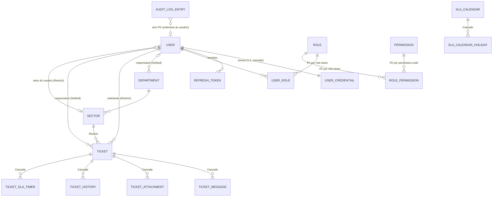
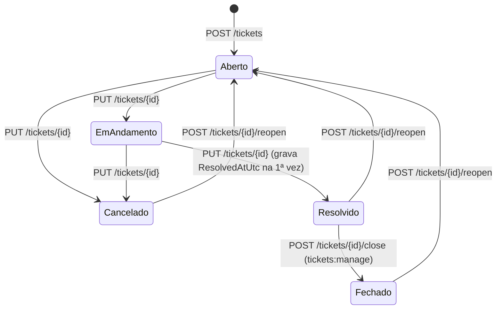
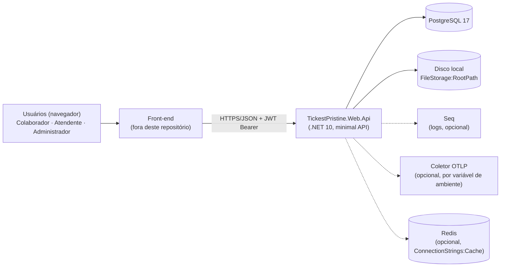
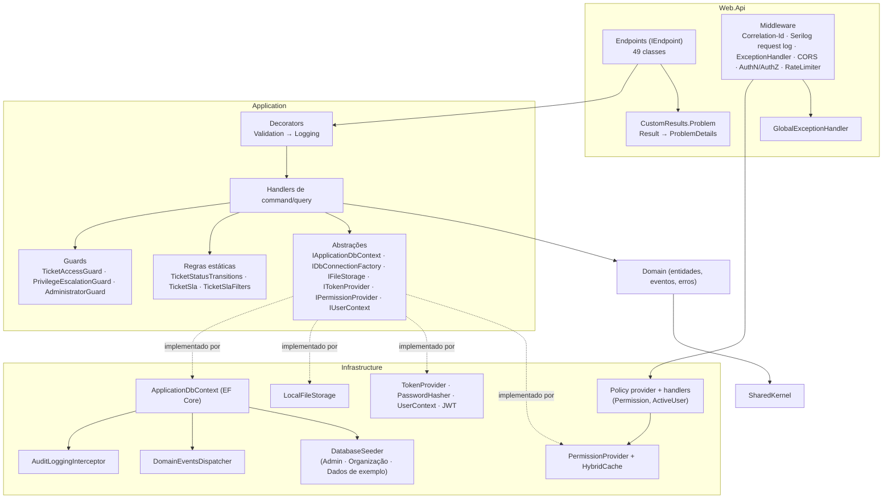
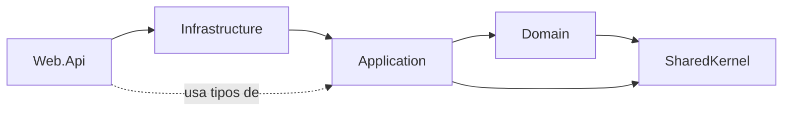
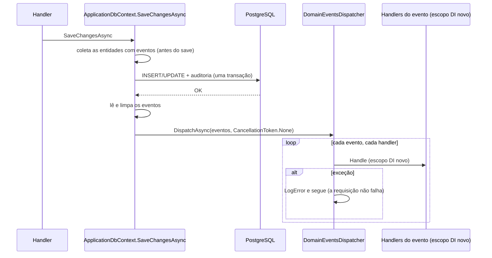

# SYSTEM_SPECIFICATION — TickestPristine

> **Estado documentado:** branch `feat/spec-driven-development`, commit `50fbdea` (23/10/2026), enviada ao GitHub e em revisão no PR #11 para a `main`. O código de `src/` e `tests/` é o desse commit e inclui as specs 001 (remover o responsável, entregue no commit `b0e78b0`) e 002 (histórico da alteração da descrição, entregue no commit `9ea5ef6`) (seções 5.4, 5.10 e 6.1). Produzido por leitura do código, da configuração, dos testes e da documentação, mais a execução de `dotnet build` e `dotnet test` (seção 6.1). O histórico das mudanças está no Git.
>
> **Convenções de leitura:**
> - **[Fato]** está no código ou na configuração e tem referência verificável.
> - **[Inferência]** é uma conclusão tirada de fatos, mas não declarada em nenhuma fonte.
> - **[Recomendação]** é uma sugestão do analista e não um requisito.
> - **[Decisão humana]** é um ponto que depende de definição do produto ou da arquitetura.
> - **[Resolvido]** marca um problema da análise original que já foi corrigido, com a data ou o commit da correção.
>
> As referências usam `caminho:linha` relativas à raiz do repositório. Os números de linha valem para o estado documentado acima.

---

## Sumário

1. [Visão executiva](#1-visão-executiva)
2. [Escopo do produto e domínio](#2-escopo-do-produto-e-domínio)
3. [Arquitetura e organização técnica](#3-arquitetura-e-organização-técnica)
4. [Especificação técnica](#4-especificação-técnica)
5. [Fluxos funcionais de ponta a ponta](#5-fluxos-funcionais-de-ponta-a-ponta)
6. [Qualidade, segurança e operação](#6-qualidade-segurança-e-operação)
7. [GAP analysis e evolução recomendada](#7-gap-analysis-e-evolução-recomendada)
8. [Catálogo de evidências e rastreabilidade](#8-catálogo-de-evidências-e-rastreabilidade)
9. [Limitações, pendências e perguntas em aberto](#9-limitações-pendências-e-perguntas-em-aberto)

---

## 1. Visão executiva

### 1.1 Propósito

- **[Fato]** O código implementa o **backend HTTP de um sistema de chamados internos (helpdesk)**. Ele cobre a abertura e o acompanhamento de chamados por setor, com mensagens, anexos, histórico, prazo de resolução (SLA) e painéis de contagem, além de usuários, funções (roles) e permissões, departamentos e setores e trilha de auditoria. Evidências: `src/TickestPristine.Domain/Tickets/`, `src/TickestPristine.Web.Api/Endpoints/` (49 classes de endpoint).
- **[Fato]** O `README.md:5` descreve o projeto como um "backend de sistema de chamados (helpdesk/ticketing)" que "nasceu a partir de um template genérico de Clean Architecture".
- **[Inferência]** O público é **interno a uma organização**: os papéis "Colaborador" (abre chamados) e "Atendente" (atende a fila), mais o seed com departamentos como TI, RH, Financeiro e Facilities (`src/TickestPristine.Infrastructure/Database/Seeding/DefaultOrganizationSeeder.cs:15-59`), apontam para atendimento de demandas internas, e não de clientes externos. Nenhum documento declara isso explicitamente.
- **[Fato]** Não há front-end neste repositório. Os comentários do código citam um "front" (ex.: `src/TickestPristine.Application/Users/GetCurrent/GetCurrentUserQueryHandler.cs:52`), e a configuração de CORS prevê origens de navegador (`src/TickestPristine.Web.Api/Extensions/CorsExtensions.cs`).

### 1.2 Principais capacidades identificadas

| Área | Situação resumida |
|---|---|
| Autenticação (login, refresh com rotação, logout, troca de senha, senha provisória, bloqueio por tentativas) | Implementada e evidenciada |
| Autorização por permissões vindas de roles (RBAC), com proteção contra escalada de privilégio e contra a remoção do último administrador | Implementada e evidenciada |
| Chamados: abrir, editar descrição/status, atribuir responsável, fechar, reabrir, excluir (lógico), listar, detalhar | Implementada e evidenciada (fechamento e atribuição incluídos na revisão de 22/10) |
| SLA de primeira resposta e de resolução em minutos úteis por prioridade (spec 005), com plano gravado no chamado, cronômetros por ciclo, situação (no prazo, em risco, violado, cumprido, perdido) e painel; chamados anteriores mantêm o prazo em horas corridas | Implementada e evidenciada |
| Mensagens, anexos (disco local) e histórico do chamado | Implementada e evidenciada |
| Departamentos e setores (CRUD sem reativação) | Implementada e evidenciada |
| Auditoria automática de alterações (interceptor EF) com consulta | Implementada e evidenciada |
| Dashboards (contagem por status, volume por período, resumo dos próprios chamados) | Implementada e evidenciada |
| Eventos de domínio | Mecanismo implementado; **quase nenhum consumidor** (1 handler, vazio) |
| SLA completo (calendário útil, pausas, escalonamento, matriz impacto × urgência, relatórios) | Parcialmente implementada: calendário útil (spec 004), plano com cronômetros de primeira resposta e resolução (spec 005) e monitoramento que grava a violação e dispara o evento (spec 006); pausa, escalonamento, notificações e políticas configuráveis seguem planejadas (`specs/_fontes/prompt-sla.md`) |

### 1.3 Maturidade e arquitetura predominante

- **[Fato]** A arquitetura é uma **Clean Architecture em 5 projetos** (SharedKernel, Domain, Application, Infrastructure, Web.Api), com a direção das dependências garantida por testes de arquitetura (`tests/TickestPristine.ArchitectureTests/Layers/LayerTests.cs`) e, desde a spec 003, também as regras permanentes de convenção (`tests/TickestPristine.ArchitectureTests/Conventions/`). A Application usa **CQRS leve sem MediatR**, com handlers próprios decorados (Validation → Logging → handler), além de **Result pattern**, **minimal APIs** e **EF Core + PostgreSQL**.
- **[Fato]** O **domínio é anêmico**: as entidades só têm propriedades (ex.: `src/TickestPristine.Domain/Tickets/Ticket.cs:5-20`), e as regras ficam nos handlers e em classes estáticas da Application (`TicketStatusTransitions`, `TicketSla`, `TicketAccessGuard`).
- **[Fato]** O build compila sem avisos com `TreatWarningsAsErrors` e `AnalysisMode=All` (`Directory.Build.props:9-13`). A suíte completa passou: 674 testes na análise inicial e 699 depois da revisão de 22/10, sempre com 0 falhas (seção 6.1).
- **[Inferência]** A maturidade é a de um **MVP funcional em evolução ativa**: 53 commits entre 01/10/2026 e 21/10/2026, com migrations e refatorações em curso no working tree. Não há evidência de implantação em produção, de pipeline de deploy nem de configuração para ambiente produtivo.

### 1.4 Principais riscos e limitações conhecidos

1. **[Fato] Os eventos de domínio são publicados em memória depois do commit, sem outbox.** Hoje isso tem baixo impacto porque o único handler é vazio, mas o plano de SLA depende de notificações confiáveis. Ver GAP-05.
2. **[Fato] Os anexos ficam em disco local.** **[Spec 011]** O arquivo de um anexo excluído é apagado logo depois da exclusão (GAP-08 resolvido), e o conteúdo é conferido contra o tipo declarado; o armazenamento local continua não servindo para várias instâncias. Ver GAP-09.
3. **[Fato] Não há procedimento automatizado de implantação nem de migração fora de Development.** Ver GAP-10.
4. **[Fato] O `CLAUDE.md` continua descrevendo o domínio de exemplo Todos**, de forma intencional (os caminhos e a porta foram corrigidos). Ver 9.3.

**[Resolvido] em 22/10/2026:** o status "Fechado" ficou alcançável (GAP-01), há atribuição de responsável depois da abertura (GAP-02), o cadastro de usuários exige `users:create` (GAP-03), e o `README.md` foi alinhado ao modelo de roles (GAP-07).

### 1.5 Limitações desta análise

- A API não foi executada contra um banco real fora dos testes. Nenhum fluxo foi exercitado manualmente.
- O conteúdo completo das 18 migrations não foi revisado linha a linha. Foram lidas a mais recente, o snapshot do modelo (via configurações EF) e os nomes de todas.
- O arquivo de user-secrets local não foi lido (segredos). Por isso, valores efetivos de `Jwt:Secret`, `Admin:Password` e `Seeding:SampleUserPassword` em desenvolvimento não são conhecidos.
- Os arquivos `.claude/skills/*` foram identificados, mas lidos apenas parcialmente (são instruções para agentes, não parte do produto).
- Não houve análise de desempenho nem de carga.

---

## 2. Escopo do produto e domínio

### 2.1 Contexto de negócio conhecido

- **[Fato]** O idioma do produto é o português do Brasil. Mensagens de erro, nomes de roles e permissões estão em pt-BR (`src/TickestPristine.Domain/*/*Errors.cs`, `src/TickestPristine.Application/Permissions/PermissionCatalog.cs`), e o FluentValidation é configurado para `pt-BR` (`src/TickestPristine.Application/DependencyInjection.cs:14-15`).
- **[Fato]** Há fuso horário de negócio fixo: o gráfico de volume agrupa os chamados pelo horário de `America/Sao_Paulo` (`src/TickestPristine.Application/Tickets/GetVolume/GetTicketVolumeQueryHandler.cs:26,36`).
- **[Fato]** Não há multi-tenancy. Nenhuma entidade tem identificador de organização ou tenant.

### 2.2 Atores e perfis identificados

Os perfis são **roles fixas criadas por migration** (`src/TickestPristine.Infrastructure/Roles/RoleConfiguration.cs:23-26`, nomes em `src/TickestPristine.Application/Roles/RoleNames.cs:8-10`). A API **não cria nem exclui roles**: só edita as permissões das que existem, menos a de administrador.

| Ator / role | Permissões padrão (`RolePermissionConfiguration.cs:33-51`) | Observações |
|---|---|---|
| **Visitante anônimo** | — | Pode fazer login, renovar token e trocar a senha provisória. Desde a revisão de 22/10, **não** pode mais se cadastrar. |
| **Colaborador** | `tickets:create`, `tickets:view-own`, `tickets:update-own`, `tickets:delete-own`, `tickets:reopen-own` | É a role atribuída automaticamente no cadastro (`RegisterUserCommandHandler.cs:39`) e marcada como `IsDefault` na listagem de roles (`GetRolesQueryHandler.cs:19`). |
| **Atendente** | As do Colaborador mais `tickets:manage` | Vê e trata os chamados de todos. **Não** tem permissões de usuários, roles ou estrutura. **[Spec 009]** Assume um chamado para si, mas não o atribui a outra pessoa (isso exige `tickets:assign`). |
| **Administrador** | Todas as permissões do catálogo (17) | As permissões da role são gerenciadas pelo sistema e não podem ser editadas (`AssignRolePermissionsCommandHandler.cs:29-32`). O sistema impede ficar sem nenhum administrador ativo (`AdministratorGuard.cs:24-58`). |
| **Participantes do chamado** (papel contextual) | — | O solicitante (`CreatedByUserId`) e o responsável atual (`AssignedToUserId`) sempre podem **ver** o chamado e os itens dele (`TicketAccessGuard.cs:35-38`). Quem deixa de ser o responsável (remoção, spec 001) perde esse acesso, salvo se for o solicitante ou tiver `tickets:manage` (RN-23). |

**Catálogo de permissões** (`src/TickestPristine.Application/Permissions/PermissionCatalog.cs:16-44`, códigos em `PermissionCodes.cs`):

| Grupo | Código | Administrativa? | Exigida por algum endpoint/handler? |
|---|---|---|---|
| Chamados | `tickets:create`, `tickets:view-own`, `tickets:update-own`, `tickets:delete-own`, `tickets:reopen-own`, `tickets:manage` | Não | Sim |
| Chamados | `tickets:assign` (spec 009) | Sim | Sim: no handler de `PUT tickets/{id}/assignee`, para atribuir a outra pessoa. Concedida pela migration só à role Administrador. |
| Usuários | `users:read`, `users:update`, `users:deactivate`, `users:assign-roles` | Sim | Sim |
| Usuários | `users:create` | Sim | Sim: `POST users/register` (`Endpoints/Users/Register.cs`). **[Resolvido]** GAP-03. |
| Funções | `roles:read`, `roles:manage` | Sim | Sim |
| Estrutura | `departments:manage`, `sectors:manage` | Sim | Sim |
| Auditoria | `audit:read` | Sim | Sim |

"Administrativa" significa que a permissão só pode ser concedida ou removida por quem já a possui (`PrivilegeEscalationGuard.cs:17-32`).

### 2.3 Módulos e áreas funcionais

| Módulo (pasta da Application) | Casos de uso (slices) |
|---|---|
| `Users` | Register, Login, Refresh, Logout, ChangePassword, ChangeRequiredPassword, UpdateProfile, Activate, Deactivate, AssignRoles, ChangeSector, GetAll, GetAttendants, GetById, GetByEmail, GetCurrent |
| `Roles` / `Permissions` | Roles: GetAll, AssignPermissions · Permissions: GetAll |
| `Departments` / `Sectors` | Create, Update, Deactivate, GetAll, GetById (em cada um) |
| `Tickets` | Create, Update, Assign, Unassign, Close, Reopen, Delete, GetAll, GetById, GetOwn, GetOwnSummary, GetSlaSummary, GetStatusCounts, GetVolume |
| `TicketMessages` | Post, Edit, Delete, GetAll |
| `TicketAttachments` | Upload, Download, Delete, GetAll |
| `TicketHistories` | GetAll (o histórico é gravado pelos handlers dos outros módulos) |
| `AuditLogs` | GetHistory |

### 2.4 Entidades e relacionamentos



Fonte: `src/TickestPristine.Infrastructure/*/*Configuration.cs`. Pontos relevantes:

- **[Fato]** `Ticket`, `TicketMessage` e `TicketAttachment` usam **exclusão lógica** (`DeletedAtUtc`) com filtro global do EF (`TicketConfiguration.cs:25`, `TicketMessageConfiguration.cs:16`, `TicketAttachmentConfiguration.cs:20`). `TicketHistory` é imutável e não tem filtro (`TicketHistoryConfiguration.cs:21`).
- **[Fato]** Roles e permissões têm `Id` (Guid determinístico), mas os vínculos usam **chaves alternativas por nome/código** (`RoleConfiguration.cs:16`, `PermissionConfiguration.cs:16`, `RolePermissionConfiguration.cs:20-28`, `UserRoleConfiguration.cs:20-23`).
- **[Fato, spec 004]** `SlaCalendar` (nome, fuso IANA, 24x7 e grade semanal em `jsonb`) e `SlaCalendarHoliday` (data e descrição, no máximo um feriado por calendário e data, índice único `(sla_calendar_id, date)`) são auditáveis. A grade é uma propriedade comum convertida para `jsonb`, para que a alteração dela entre na auditoria (`SlaCalendarConfiguration.cs`, `SlaCalendarHolidayConfiguration.cs`). Nenhum chamado referencia um calendário ainda.
- **[Fato, spec 005]** O `Ticket` grava o plano de SLA aplicado (`TicketSlaPlan`: política, versão, calendário, metas em minutos e `IsLegacy`) numa coluna `jsonb` obrigatória, convertida como propriedade comum para entrar na auditoria (`TicketConfiguration.cs`). `TicketSlaTimer` (auditável, tabela `ticket_sla_timers`) é o cronômetro de um objetivo (`FirstResponse` ou `Resolution`) num ciclo, com início, alerta, prazo, conclusão e parada; índice único `(ticket_id, metric, cycle)`; `CompletedOnUtc` e `StoppedOnUtc` são os tokens de concorrência (`TicketSlaTimerConfiguration.cs`). **[Spec 006]** O cronômetro guarda também `BreachedOnUtc` (violação, gravada uma vez, no próprio prazo) e `NextActionOnUtc` (próximo instante em que o monitoramento precisa agir), com o índice filtrado `ix_ticket_sla_timers_next_action_on_utc` (`WHERE next_action_on_utc IS NOT NULL`; migration `20261025225544_Add_Sla_Breach_Monitoring`, que também preenche os cronômetros existentes). Os chamados anteriores à spec 005 ganharam, pela migration `20261025201353_Add_Ticket_Sla_Timers`, o plano "Legado (horas corridas)" no calendário "24 horas" e o cronômetro de resolução do ciclo 1 com os prazos que já tinham.
- **[Fato]** `User` tem `Code` público único no formato `usr_<ULID>` (`UserCodes.cs:9-11`, `UserConfiguration.cs:20-22`).
- **[Fato, spec 009]** `User` tem `SectorId` opcional: chave estrangeira para `sectors` com `Restrict` e índice `ix_users_sector_id` (`UserConfiguration.cs`, migration `20261026214827_Add_User_Sector_And_Tickets_Assign_Permission`). Desativar o setor não apaga o vínculo. A mesma migration grava a permissão `tickets:assign` e o vínculo com a role Administrador com `ON CONFLICT DO NOTHING`.
- **[Fato]** A role Administrador tem o token de concorrência sombra `Version` (`RoleConfiguration.cs:21`). `Ticket` tem token sombra mapeado em `xmin` (`TicketConfiguration.cs:29`). `RefreshToken.TokenHash` é token de concorrência (`RefreshTokenConfiguration.cs:19`).
- **[Fato]** Os enums `TicketStatus`, `TicketPriority` e `TicketHistoryAction` são gravados **pelo nome** (texto), conforme alteração registrada no commit `b2028ae` (`TicketConfiguration.cs:21-23`, `TicketHistoryConfiguration.cs:15`, migration `20261022023422_Store_Ticket_Enums_As_Names.cs`). A API continua expondo os valores numéricos.

### 2.5 Estados e transições do chamado

Regras em `src/TickestPristine.Application/Tickets/TicketStatusTransitions.cs:7-25`:



- **[Fato]** "Ativo" significa Aberto ou Em andamento (`TicketStatusTransitions.cs:7`). `Update` e `Delete` recusam chamados inativos (`UpdateTicketCommandHandler.cs:42-45`, `DeleteTicketCommandHandler.cs:42-45`), e `Reopen` recusa chamados ativos (`ReopenTicketCommandHandler.cs:42-45`).
- **[Fato]** **[Resolvido]** O fechamento é feito por `POST tickets/{id}/close`, que exige `tickets:manage` e aceita só chamados Resolvidos (`Tickets/Close/CloseTicketCommandHandler.cs`). Antes da revisão de 22/10, nenhuma requisição levava a "Fechado".
- **[Fato]** A reabertura volta para Aberto e **não** limpa `ResolvedAtUtc`. O `SlaStatus`, o `DueAtUtc` e o `SlaWarningAtUtc` do chamado ficam no primeiro ciclo de resolução (`TicketSlaStatus.cs:3-6`). **[Fato, spec 005]** A reabertura abre um novo ciclo de resolução, com a meta integral do plano, visível só no bloco `sla` (`ReopenTicketCommandHandler.cs`, `TicketSlaClock.StartResolutionCycle`).

### 2.6 Regras de negócio comprovadas

| # | Regra | Evidência (código) | Teste relacionado |
|---|---|---|---|
| RN-01 | **[Spec 005]** Os chamados novos recebem a política "Padrão" (versão 1), em minutos úteis do calendário "Expediente": Urgente 30 / 240, Alta 120 / 600, Média 240 / 1.200, Baixa 600 / 3.000 (primeira resposta / resolução). O alerta "em risco" vale aos 75% da meta em tempo útil. Os chamados anteriores ficam no plano "Legado (horas corridas)": Urgente 4h, Alta 8h, Média 24h, Baixa 72h, sem primeira resposta. | `Application/Tickets/TicketSla.cs` (`DefaultPlan`, `LegacyPlan`), `TicketSlaClock.cs` | `TicketSlaTests.cs`, `TicketSlaClockTests.cs`, `CreateTicketCommandHandlerTests.cs` |
| RN-02 | O plano, os cronômetros do ciclo 1 e os prazos do chamado (`DueAtUtc` e `SlaWarningAtUtc`, iguais aos do cronômetro de resolução do ciclo 1) são gravados na abertura e não mudam com a política depois (a prioridade não é editável). | `CreateTicketCommandHandler.cs`, `TicketSlaClock.Start` | `CreateTicketCommandHandlerTests.cs`, `GetTicketSlaQueryHandlerTests.cs` |
| RN-03 | Situação do SLA: com resolução, `Met` se resolvido até o prazo e `Missed` se depois. Sem resolução: cancelado é `NotApplicable`; após o prazo, `Breached`; após o alerta, `AtRisk`; senão `OnTime`. | `TicketSla.cs:34-57`; mesma regra em SQL em `TicketSlaFilters.cs:20-36` | `TicketSlaTests.cs`, `GetTicketsQueryHandlerTests.cs` |
| RN-04 | Abrir um chamado em nome de outra pessoa exige `tickets:manage`. | `CreateTicketCommandHandler.cs:24-37` | `TicketsTests.cs:835` |
| RN-05 | Solicitante, responsável e setor informados precisam existir e estar ativos. | `CreateTicketCommandHandler.cs:41-67` | `TicketsTests.cs:88,860` |
| RN-06 | Editar, excluir ou reabrir exige ser o dono com a permissão `*-own` correspondente, ou ter `tickets:manage`. | `TicketAccessGuard.cs:53-72` e os três handlers | `TicketAccessGuardTests.cs`, `TicketsTests.cs:905,979,553` |
| RN-07 | Ver o chamado, as mensagens, os anexos e o histórico é permitido ao solicitante, ao responsável ou a quem tem `tickets:manage`. | `TicketAccessGuard.cs:18-46` | `TicketsTests.cs:350,371` |
| RN-08 | Só o autor edita a própria mensagem. O autor ou quem tem `tickets:manage` a exclui. | `EditTicketMessageCommandHandler.cs:31-34`, `DeleteTicketMessageCommandHandler.cs:33-43` | `EditTicketMessageCommandHandlerTests.cs`, `DeleteTicketMessageCommandHandlerTests.cs` |
| RN-09 | Anexo: até 10 MB, com tipos permitidos (imagens, PDF, Office, txt, zip) e extensão coerente com o tipo declarado. **[Spec 011]** O tamanho é o do conteúdo recebido; o conteúdo precisa corresponder ao tipo (assinatura dos primeiros bytes; DOCX e XLSX com `word/` ou `xl/` no pacote; TXT sem byte nulo nos primeiros 8 KB), senão 400 `TicketAttachments.ContentMismatch`; o nome não pode ter `/`, `\`, `..` nem caracteres de controle; um chamado aceita até 20 anexos não excluídos e 100 MB somados (400 `TicketAttachments.TicketLimitReached`); corpo acima de 11 MB responde 413 em Problem Details. A política fica em `GET ticket-attachments/policy`. Envio limitado a 30 por usuário a cada 10 min, e exclusão a 60 por minuto. | `TicketAttachmentLimits.cs`, `TicketAttachmentContentInspector.cs`, `Upload/*`, `GetPolicy/*`, `GlobalExceptionHandler.cs` | `TicketAttachmentValidatorsTests.cs`, `TicketAttachmentContentInspectorTests.cs`, `UploadTicketAttachmentCommandHandlerTests.cs`, `TicketAttachmentsTests.cs` |
| RN-10 | Um departamento ou setor não pode ser desativado com chamados ativos. Desativar o departamento desativa os setores dele. | `DeactivateDepartmentCommandHandler.cs:29-49`, `DeactivateSectorCommandHandler.cs:27-34` | `DeactivateDepartmentCommandHandlerTests.cs`, `DeactivateSectorCommandHandlerTests.cs` |
| RN-11 | O nome do departamento é único entre os ativos, sem diferenciar maiúsculas. O nome do setor é único dentro do departamento, entre os ativos. | Handlers mais índice filtrado `citext` (`DepartmentConfiguration.cs:15-18`, `SectorConfiguration.cs:15-18`) | `DepartmentsTests.cs`, `SectorsTests.cs` |
| RN-12 | O e-mail do usuário é único, sem diferenciar maiúsculas (`citext`). | `RegisterUserCommandHandler.cs:19-22`, `UserConfiguration.cs:14-18` | `RegisterUserCommandHandlerTests.cs` |
| RN-13 | Senha forte: pelo menos 6 caracteres, uma maiúscula e um caractere especial. Na troca, a nova senha precisa ser diferente da atual. | `UserValidationRules.cs:18-40` | `UserValidatorsTests.cs` |
| RN-14 | Cinco senhas erradas seguidas bloqueiam a conta por 15 minutos. Durante o bloqueio, a senha nem é conferida. | `UserCredentialsVerifier.cs:15-17,52-71` | `LoginUserCommandHandlerTests.cs` |
| RN-15 | A sessão dura no máximo 30 dias a partir do login. O refresh token roda a cada renovação. Reusar um token já trocado depois de 30 s revoga todas as sessões. Trocar a senha revoga todas as sessões. | `UserSessions.cs:16`, `RefreshTokenCommandHandler.cs:15,72-104`, `UserPasswords.cs:24-30` | `RefreshTokenCommandHandlerTests.cs`, `ChangeUserPasswordCommandHandlerTests.cs` |
| RN-16 | O administrador inicial é criado com senha provisória. O login devolve 403 até a troca em `users/login/new-password`. | `AdminUserSeeder.cs:21-60`, `LoginUserCommandHandler.cs:38-42` | `IntegrationTestWebAppFactory.cs:76-84`, `DatabaseSeedingTests.cs` |
| RN-17 | Ninguém concede nem remove uma permissão administrativa que não possui, e ninguém desativa ou reativa quem tem uma permissão administrativa que ele não tem. | `PrivilegeEscalationGuard.cs:17-62` | `AssignRolePermissionsCommandHandlerTests.cs`, `AssignUserRolesCommandHandlerTests.cs`, `DeactivateUserCommandHandlerTests.cs` |
| RN-18 | Deve haver sempre ao menos um administrador ativo, com proteção contra duas remoções concorrentes. | `AdministratorGuard.cs:24-58` | `AdministratorGuardTests.cs`, `RoleConcurrencyTests.cs` |
| RN-19 | Ninguém desativa a própria conta. Um usuário desativado perde o acesso na requisição seguinte; só `users/me` e o logout continuam aceitos. | `DeactivateUserCommandHandler.cs:21-24,60-73`, `ActiveUserRequirement.cs`, `EndpointExtensions.cs:45-52` | `DeactivateUserCommandHandlerTests.cs`, `UsersTests.cs` |
| RN-20 | O perfil (nome e sobrenome) pode ser editado pelo próprio usuário ou por quem tem `users:update`. | `UpdateUserProfileCommandHandler.cs:20-29` | `UpdateUserProfileCommandHandlerTests.cs` |
| RN-21 | Só quem tem `tickets:manage` fecha um chamado, e só se ele estiver Resolvido. O fechamento grava o histórico `StatusChanged` e não altera `ResolvedAtUtc`. | `Tickets/Close/CloseTicketCommandHandler.cs`, `Endpoints/Tickets/Close.cs` | `CloseTicketCommandHandlerTests.cs`, `TicketsTests.cs` (Close_*) |
| RN-22 | **[Revisada pela spec 009]** Só quem tem `tickets:manage` atribui o responsável, e só em chamado ativo. Assumir o chamado para si basta com `tickets:manage`; atribuir a **outra pessoa** exige também `tickets:assign` (403 `Tickets.CannotAssignToOthers`, conferido antes do chamado). O responsável precisa ser atendente elegível (RN-28); senão, 400 `Tickets.AssigneeNotAttendant`. A ordem das demais validações se mantém: chamado inexistente 404, inativo 400 `Tickets.NotActive`, responsável inexistente ou inativo 404 `Users.NotFound`. Atribuir a quem já é o responsável não muda nada. A primeira atribuição grava `Assigned`; a troca, `Reassigned` (anterior e novo, executor e data, no mesmo `SaveChangesAsync`). A atribuição não se restringe ao setor do chamado. | `Tickets/Assign/AssignTicketCommandHandler.cs`, `Endpoints/Tickets/Assign.cs` | `AssignTicketCommandHandlerTests.cs`, `TicketsTests.cs` (Assign_*) |
| RN-23 | Só quem tem `tickets:manage` remove o responsável (deixa o chamado sem ninguém), e só em chamado ativo; a inatividade é conferida antes do responsável, então chamado inativo sem responsável também recebe `400 Tickets.NotActive`. Remover de chamado já sem responsável responde `204` sem gravar nada. O status não muda (um chamado Em andamento pode ficar sem responsável). A remoção grava o histórico `Unassigned` (responsável anterior em `oldValue`) e dispara `TicketUnassignedDomainEvent`; quem foi removido perde o acesso de participante. (Spec 001, 23/10/2026) | `Tickets/Unassign/UnassignTicketCommandHandler.cs`, `Endpoints/Tickets/Unassign.cs` | `UnassignTicketCommandHandlerTests.cs`, `TicketsTests.cs` (Unassign_*) |
| RN-24 | Tempo útil (spec 004): só conta dentro das faixas de expediente do dia, em hora local do fuso do calendário, pulando dias sem faixa e feriados; durações em `TimeSpan` e instantes em UTC. A soma e a subtração terminam na borda da própria faixa quando o tempo acaba exatamente nela; duração zero devolve o próprio instante e negativa lança exceção; elas procuram tempo útil por no máximo 366 dias e lançam exceção depois disso (calendário mal configurado). O tempo entre dois instantes não tem esse limite. Num calendário 24x7, as contas são corridas. Ainda não é usado pelos chamados. | `Application/SlaCalendars/BusinessCalendar.cs` | `BusinessCalendarTests.cs` |
| RN-25 | Calendário padrão "Expediente" (spec 004): segunda a sexta, 08:00–18:00, `America/Sao_Paulo`, sem expediente nos feriados nacionais calculados por ano (fixos, com o 20/11 a partir de 2024, e móveis pela Páscoa: Carnaval e Corpus Christi como pontos facultativos, Sexta-feira Santa como feriado). Fica em código, com Id reservado, e não existe no banco; nenhuma migration do SLA grava dados. | `DefaultSlaCalendar.cs`, `SlaCalendarIds.cs`, `BrazilianNationalHolidays.cs`, migration `20261025012628_Add_Sla_Calendars` | `BrazilianNationalHolidaysTests.cs`, `SlaCalendarsTests.cs` |
| RN-26 | **[Spec 005]** Cronômetros: a primeira mensagem de quem não é o solicitante e tem `tickets:manage` conclui a primeira resposta (editar ou excluir a mensagem não reabre); resolver conclui a resolução do ciclo corrente e, se aberta, a primeira resposta; cancelar para os cronômetros em aberto (parado não conta como violação); fechar e Em andamento não mexem neles; reabrir abre um novo ciclo de resolução. Estado calculado na leitura, com um único instante: em aberto `Running`, `AtRisk` a partir do alerta e `Breached` a partir do prazo; concluído até o prazo (inclusive) `Met`, depois `Missed`; parado `Stopped`. Consumido em minutos úteis truncados; restante = meta − consumido, nunca negativo. Duas primeiras respostas simultâneas resultam numa única conclusão, e as duas mensagens são gravadas. | `TicketSlaClock.cs`, `UpdateTicketCommandHandler.cs`, `ReopenTicketCommandHandler.cs`, `PostTicketMessageCommandHandler.cs` | `TicketSlaClockTests.cs`, `PostTicketMessageCommandHandlerTests.cs`, `TicketsTests.cs` (PostMessage_*, Cancel_*, Reopen_*) |
| RN-27 | **[Spec 006]** Monitoramento do SLA: o `NextActionOnUtc` de cada cronômetro vale o prazo enquanto ele puder ser violado sem violação gravada, e fica nulo quando ele é concluído até o prazo, parado, violado ou o chamado é excluído; a conclusão depois do prazo o mantém. Só o monitoramento grava `BreachedOnUtc` (igual ao `DueOnUtc`) e dispara `TicketSlaBreachedDomainEvent(TicketId, Metric, Cycle, DueOnUtc)`, uma vez por cronômetro não cumprido (em aberto vencido ou concluído depois do prazo). Parada nunca grava violação; violação gravada antes da parada continua. A violação gravada não muda nenhuma leitura (estados, resumo, filtros, `SlaStatus`). Nenhum handler trata o evento ainda. | `TicketSlaClock.cs` (`ProcessDue`, `Dequeue`), `Tickets/ProcessSlaBreaches/*`, `DeleteTicketCommandHandler.cs` | `TicketSlaClockTests.cs`, `ProcessSlaBreachesCommandHandlerTests.cs`, `TicketsTests.cs` (SlaMonitor_*) |
| RN-28 | **[Spec 009]** Atendente elegível (quem pode ser responsável): usuário ativo com a permissão efetiva `tickets:manage`, vinda de qualquer role, lida sempre do banco (sem o cache de permissões). A consulta de atendentes e a atribuição usam o mesmo filtro, então nunca discordam. `GET users/attendants` exige usuário ativo e confere `users:read` no handler (403 `Users.ReadForbidden`, mesmo com `tickets:manage`); devolve `id`, `fullName`, `email`, `sectorId`, `sectorName` e `departmentName`; `searchTerm` opcional de 2 a 100 caracteres depois do `Trim` (senão 400 `Users.InvalidSearchTerm`), dividido em até 5 palavras, cada uma contida, sem diferenciar maiúsculas, no nome, sobrenome, e-mail, setor ou departamento; `sectorId` filtra, `prioritySectorId` só põe esse setor primeiro; ordem por nome, sobrenome e id; paginação no padrão do sistema; só o limite global de requisições. | `Tickets/TicketAssigneeEligibility.cs`, `Users/GetAttendants/*`, `Endpoints/Users/GetAttendants.cs` | `GetBacklogAttendantsQueryHandlerTests.cs`, `UsersTests.cs` (GetAttendants_*) |
| RN-29 | **[Spec 009]** O setor do usuário é definido por `PUT users/{id}/sector` (`users:update`), passa pela RN-17 e só aceita setor ativo (404 `Sectors.NotFound`); `null` remove o vínculo; informar o setor atual não muda nada. A troca dispara `UserSectorChangedDomainEvent`. **[Spec 013]** `GET users` (cada item) e `GET users/{id}` mostram o setor: `sectorId`, `sectorName`, `departmentName` e `sectorIsActive`, nulos sem setor; o setor desativado continua aparecendo, com `sectorIsActive` = `false`. `GET users/me` e `GET users/by-email` não trazem o setor. | `Users/ChangeSector/*`, `Endpoints/Users/ChangeSector.cs`, `Users/GetAll/*`, `Users/GetById/*` | `ChangeUserSectorCommandHandlerTests.cs`, `GetUsersQueryHandlerTests.cs`, `GetUserByIdQueryHandlerTests.cs`, `UsersTests.cs` (ChangeSector_*, GetAll*_Should_*Sector*, GetById_Should_ReturnSectorFields_*) |

### 2.7 Matriz de capacidades

Legenda de estado: **IE** = Implementada e evidenciada · **PI** = Parcialmente implementada · **PNI** = Planejada, não implementada · **IND** = Indeterminada · **INV** = Implementação identificada, comportamento não validado.

| ID | Capacidade | Estado | Evidências | Dependências | Lacunas / questões |
|---|---|---|---|---|---|
| C-01 | Cadastro de usuário | IE | `Users/Register/*`, `Endpoints/Users/Register.cs`, `UsersTests.cs` (inclui 401 sem token e 403 sem `users:create`) | `users:create` | **[Resolvido]** Exige `users:create` (GAP-03). Não há auto-cadastro nem convite por e-mail. |
| C-02 | Login, refresh com rotação, logout | IE | `Users/Login`, `Users/Refresh`, `Users/Logout`, unitários e integração | JWT, PostgreSQL | O access token continua válido após logout ou troca de senha até expirar (GAP-14). |
| C-03 | Senha provisória e troca obrigatória | IE | `ChangeRequiredPassword/*`, `AdminUserSeeder.cs` | Seed | Só o seed do administrador marca `MustChangePassword`. Não há fluxo de "resetar a senha de alguém". |
| C-04 | Recuperação de senha esquecida | IND | Nenhum código | — | Não há fluxo nem documento que o planeje. |
| C-05 | Gestão de usuários (listar, ver, editar perfil, ativar/desativar, atribuir roles e setor) | IE | `Users/*`, `UsersTests.cs` | Permissões | Não existe exclusão de usuário (o README cita "exclusão"). **[Spec 013]** A listagem e o detalhe mostram o setor atual do usuário (RN-29); não há filtro por setor na listagem. |
| C-06 | Gestão de permissões das roles | IE | `Roles/AssignPermissions`, `RolesTests.cs` | Cache de permissões | Não é possível criar ou excluir roles pela API. |
| C-07 | Departamentos e setores | IE | `Departments/*`, `Sectors/*`, testes | — | Não há reativação. O responsável pelo departamento pode ser um usuário inativo (`DepartmentResponsibleUser.cs:26`). |
| C-08 | Abertura de chamado | IE | `Tickets/Create/*`, `TicketsTests.cs` | Setor ativo | Na abertura, qualquer pessoa com `tickets:create` ainda pode indicar qualquer usuário ativo como responsável, sem a exigência de `tickets:manage` aplicada na atribuição posterior (Q-05). |
| C-09 | Edição de chamado (descrição e status) | IE | `Tickets/Update/*` | — | Título, prioridade e setor não são editáveis (Q-06). O responsável muda por C-10, e o fechamento por C-25. |
| C-10 | Atribuição ou reatribuição de responsável | IE | `Tickets/Assign/*`, `Endpoints/Tickets/Assign.cs`, `Users/GetAttendants/*`, `AssignTicketCommandHandlerTests.cs`, `TicketsTests.cs` (Assign_*), `UsersTests.cs` (GetAttendants_*) | `tickets:manage` do autor e do responsável; `tickets:assign` para atribuir a outra pessoa (spec 009) | **[Resolvido]** (GAP-02). **[Resolvido em 23/10, spec 001]** O responsável pode ser removido por `DELETE tickets/{id}/assignee` (`Tickets/Unassign/*`, RN-23). **[Spec 009]** Consulta de atendentes elegíveis com busca e prioridade por setor (RN-28) e atribuição a outra pessoa só com `tickets:assign` (RN-22). Até os setores dos usuários serem cadastrados, todos aparecem sem setor e a prioridade não tem efeito. |
| C-11 | Reabertura | IE | `Tickets/Reopen/*`, testes | — | **[Spec 005]** Abre um novo ciclo de resolução do SLA; o ciclo 1 e o `SlaStatus` do chamado não mudam. |
| C-12 | Exclusão lógica de chamado | IE | `Tickets/Delete/*`, testes | — | Só funciona para chamados ativos. |
| C-13 | Listagens e painéis (todos, meus, resumo, SLA, status, volume) | IE | `Tickets/Get*/*`, `TicketsTests.cs` | Dapper (volume) | O fuso fixo é `America/Sao_Paulo`. |
| C-14 | SLA de primeira resposta e resolução, com plano, cronômetros (spec 005) e violação materializada (spec 006) | IE | `TicketSla.cs`, `TicketSlaClock.cs`, `TicketSlaFilters.cs`, `Tickets/GetSla/*`, `Tickets/ProcessSlaBreaches/*`, `Infrastructure/Tickets/SlaMonitoring/*`, `TicketSlaTimerConfiguration.cs`, testes | Calendário útil (spec 004) | Sem pausa; o evento de violação não tem handler (sem notificação). |
| C-15 | SLA completo (calendário, pausas, 1ª resposta, escalonamento, matriz, relatórios) | PI | Calendário útil (spec 004), plano com cronômetros de primeira resposta e resolução (spec 005) e monitoramento da violação (spec 006) prontos. Plano das fases em `specs/_fontes/prompt-sla.md` | Outbox (para notificações confiáveis) | Faltam pausa, alerta "em risco" como evento, escalonamento, notificações, políticas configuráveis e o cadastro de calendários (Fase 3). A stack descrita no prompt diverge da real (ver 9.3). |
| C-16 | Mensagens do chamado | IE | `TicketMessages/*`, testes | — | Não há distinção entre mensagem pública e nota interna. Aceita mensagens em chamados encerrados (Q-07). |
| C-17 | Anexos | IE | `TicketAttachments/*`, `LocalFileStorage.cs`, testes | Disco local | **[Spec 011]** Conteúdo conferido contra o tipo, limites por chamado, política em `GET ticket-attachments/policy`, 404 `TicketAttachments.FileMissing` para arquivo ausente e remoção física do arquivo depois da exclusão (`PurgedAtUtc`). Sem antivírus. O armazenamento local não serve para várias instâncias (GAP-09). |
| C-18 | Histórico do chamado | IE | `TicketHistories/*`, testes | — | **[Spec 009]** A primeira atribuição grava `Assigned` e a troca, `Reassigned`, com os ids do anterior e do novo; as descrições de `Assigned`, `Reassigned` e `Unassigned` trazem os nomes completos (inclusive de usuários desativados; id sem usuário aparece como "usuário removido"), lidos por subconsultas na própria consulta da página. Registros antigos têm `Reassigned` também na primeira atribuição. A remoção do responsável grava `Unassigned` (spec 001), descrita como "Responsável removido: <nome>". **[Resolvido em 23/10, spec 002]** A alteração da descrição grava `DescriptionChanged` ("Descrição alterada"), com o texto anterior e o novo. |
| C-19 | Auditoria de entidades | IE | `AuditLoggingInterceptor.cs`, `AuditLogsTests.cs` | — | `TicketHistory`, `RefreshToken`, `Role` e `Permission` não implementam `IAuditable` (escolha não documentada). |
| C-20 | Eventos de domínio | INV | 28 tipos de evento declarados, 27 disparados em 31 pontos de `Raise(...)`; 1 handler vazio (`UserRegisteredDomainEventHandler.cs:8-12`) | — | Os eventos não têm efeito observável. `TicketHistoryRecordedDomainEvent` nunca é disparado (GAP-04). |
| C-21 | Notificações (e-mail, push) | IND | Só um comentário "ponto para enviar e-mail" (`UserRegisteredDomainEventHandler.cs:10`) | — | Não há mecanismo de envio. |
| C-22 | Cache de permissões (HybridCache + Redis opcional) | INV para Redis, IE para memória | `Infrastructure/DependencyInjection.cs:43-63`, `PermissionProvider.cs` | Redis (opcional) | Nenhum teste usa Redis. A invalidação entre instâncias não foi validada. |
| C-23 | Observabilidade (Serilog, Seq, OpenTelemetry, Correlation-Id, health check) | IE para Correlation-Id e health, INV para OTLP e Seq | `Program.cs`, `OpenTelemetryExtensions.cs`, `RequestContextLoggingTests.cs` | Seq, coletor OTLP | O OTLP só é ativado com `OTEL_EXPORTER_OTLP_ENDPOINT`, e não há teste. |
| C-24 | Rate limiting e CORS | IE | `RateLimitingExtensions.cs`, `CorsExtensions.cs`, `CorsTests.cs` | — | Não há `ForwardedHeaders`. Atrás de um proxy, a partição por IP pode juntar todos os clientes (GAP-11). |
| C-25 | Fechamento de chamado | IE | `Tickets/Close/*`, `Endpoints/Tickets/Close.cs`, testes unitários e de integração | `tickets:manage` | **[Resolvido]** (GAP-01). Não há fechamento automático por prazo. |

---

## 3. Arquitetura e organização técnica

### 3.1 Estilo arquitetural predominante

- **[Fato]** O estilo é **Clean Architecture em camadas concêntricas**, com slices verticais por caso de uso dentro da Application. O `TickestPristine.slnx` declara 5 projetos de produção e 3 de teste.
- **[Fato]** As referências de projeto são `Domain → SharedKernel`, `Application → Domain, SharedKernel`, `Infrastructure → Application` e `Web.Api → Infrastructure` (arquivos `.csproj`). Os testes NetArchTest garantem 10 regras de não dependência (`LayerTests.cs`).
- **[Fato]** O CQRS é **lógico, não físico**: commands e queries usam o mesmo `ApplicationDbContext` e o mesmo banco. Uma única consulta usa SQL cru via Dapper (`GetTicketVolumeQueryHandler.cs`).
- **[Fato]** O domínio é **anêmico** (propriedades públicas com `set`). Os eventos de domínio são disparados pelos handlers da Application (`Raise(...)`), e não pelas entidades.

### 3.2 Projetos e responsabilidades

| Projeto | Responsabilidade observada | Dependências externas relevantes |
|---|---|---|
| `TickestPristine.SharedKernel` | `Entity` (lista de eventos), `Result`/`Result<T>`, `Error`/`ErrorType`/`ValidationError`, `IDomainEvent`, `IDomainEventHandler<T>`, `IDateTimeProvider`, `IAuditable` | Nenhuma |
| `TickestPristine.Domain` | Entidades, enums, eventos e catálogos de erros por agregado (`Audit`, `Departments`, `Roles`, `Sectors`, `Tickets`, `Users`) | Nenhuma |
| `TickestPristine.Application` | Slices de commands e queries, validators, decorators, guards de autorização, regras de chamados e SLA, catálogo de permissões, paginação, abstrações (`IApplicationDbContext`, `IDbConnectionFactory`, `IFileStorage`, `ITokenProvider`, `IPasswordHasher`, `IUserContext`, `IPermissionProvider`) | EF Core (abstração `DbSet`), Dapper, FluentValidation, Scrutor, Ulid |
| `TickestPristine.Infrastructure` | `ApplicationDbContext`, configurações EF, migrations, seed, JWT, hash de senha, autorização por permissão, HybridCache, interceptor de auditoria, despacho de eventos, armazenamento de arquivos em disco, health check | Npgsql/EF, JwtBearer, HybridCache, StackExchangeRedis, Bogus (seed) |
| `TickestPristine.Web.Api` | Host, 49 endpoints de minimal API, tratamento global de exceções, `CustomResults`, CORS, rate limiting, OpenTelemetry, Serilog, Swagger, middleware de Correlation-Id | Serilog, OpenTelemetry, Swashbuckle |

### 3.3 Diagrama de contexto do sistema



As linhas tracejadas são dependências **opcionais**, ativadas só por configuração (`Infrastructure/DependencyInjection.cs:47-52`, `OpenTelemetryExtensions.cs:28-31`, `appsettings.Development.json:16-22`). Não foram encontradas integrações com sistemas externos de negócio (e-mail, ERP, SSO, filas).

### 3.4 Componentes e dependências



### 3.5 Camadas



- **[Fato]** A Web.Api depende transitivamente da Application. Os endpoints usam `ICommandHandler<,>`/`IQueryHandler<,>` e os commands diretamente.
- **[Fato]** A Infrastructure usa tipos da Application que não são interfaces, como `PermissionCatalog`, `RoleNames`, `UserCodes`, `TicketSla`, `TicketHistoryEntries` e `TicketStatusTransitions` (ex.: `RolePermissionConfiguration.cs:1-2`, `SampleDataSeeder.cs:174-200`). A direção da dependência é permitida.

### 3.6 Fluxo de execução de um caso de uso representativo (abrir chamado)

```mermaid
sequenceDiagram
    autonumber
    participant C as Cliente
    participant MW as Pipeline ASP.NET
    participant AZ as PermissionAuthorizationHandler
    participant PP as PermissionProvider (HybridCache)
    participant EP as Endpoints/Tickets/Create
    participant V as ValidationDecorator
    participant L as LoggingDecorator
    participant H as CreateTicketCommandHandler
    participant G as TicketAccessGuard
    participant DB as ApplicationDbContext
    participant AI as AuditLoggingInterceptor
    participant DD as DomainEventsDispatcher

    C->>MW: POST /tickets (Bearer JWT)
    MW->>MW: Correlation-Id, autenticação JWT
    MW->>AZ: policy "tickets:create"
    AZ->>PP: GetForUserIdAsync(userId)
    PP-->>AZ: permissões (cache ou banco, só se o usuário estiver ativo)
    MW->>MW: RateLimiter (janela fixa global)
    MW->>EP: Request → CreateTicketCommand
    EP->>V: Handle
    V->>V: CreateTicketCommandValidator
    alt inválido
        V-->>EP: Result.Failure(ValidationError) → 400
    end
    V->>L: Handle
    L->>H: Handle
    H->>G: EnsureOwnerOrManager (abertura em nome de outra pessoa)
    H->>DB: confere usuários e setor ativos
    H->>H: monta Ticket (prazos do SLA) + Raise(TicketCreatedDomainEvent)
    H->>DB: Add Ticket + TicketHistory(Created)
    H->>DB: SaveChangesAsync
    DB->>AI: SavingChanges → AuditLogEntry para Ticket (IAuditable)
    DB->>DB: COMMIT
    DB->>DD: publica eventos (fora da transação; nenhum handler para TicketCreated)
    H-->>EP: Result<Guid>
    EP-->>C: 200 { id } ou ProblemDetails
```

Evidência: `Endpoints/Tickets/Create.cs:68-90`, `Application/DependencyInjection.cs:28-34`, `CreateTicketCommandHandler.cs:22-94`, `ApplicationDbContext.cs:59-72`, `AuditLoggingInterceptor.cs:25-58`.

### 3.7 Fluxos assíncronos

- **[Fato]** Não há fila nem broker (Quartz, Hangfire e MassTransit não são usados). **[Fato, spec 006]** Há um único serviço em background, o `SlaMonitorBackgroundService` (`Infrastructure/Tickets/SlaMonitoring/`): laço que, a cada volta, toma a trava consultiva do PostgreSQL (`pg_try_advisory_lock`, uma volta por vez em todas as instâncias), cria um escopo de DI, envia um `ProcessSlaBreachesCommand(BatchSize)` e espera `SleepTimeInMilliseconds`; falha de uma volta vai para o log como `Critical` e não para o serviço. A regra fica no handler do command (`Tickets/ProcessSlaBreaches/`), que grava a violação e dispara o evento no mesmo `SaveChangesAsync` do lote.
- **[Fato]** O único mecanismo "assíncrono" é o **despacho de eventos de domínio em memória, depois do commit, na mesma requisição**:



Fonte: `ApplicationDbContext.cs:57-108`, `DomainEventsDispatcher.cs:19-59`. **[Fato]** Se o processo cair entre o commit e o despacho, os eventos se perdem. Não há persistência de eventos.

### 3.8 Persistência e estado

- **[Fato]** O banco é um **PostgreSQL** único, schema `public`, com nomes em snake_case (`Infrastructure/DependencyInjection.cs:101-110`) e a extensão `citext` (`ApplicationDbContext.cs:50`). Um único `NpgsqlDataSource` é compartilhado pelo EF e pelo Dapper (`DependencyInjection.cs:96-98`).
- **[Fato]** Há **19 migrations** (de `20261002014106_Initial` a `20261025012628_Add_Sla_Calendars`, da spec 004, que cria só a estrutura de `sla_calendars` e `sla_calendar_holidays`, sem dados). As 2 anteriores à da spec 004 estavam fora do Git no momento da análise e foram registradas no commit `b2028ae`.
- **[Fato]** As migrations são aplicadas **automaticamente só em Development** (`Program.cs:34-39`). O seed roda acoplado ao `Migrate` (`UseSeeding`/`UseAsyncSeeding`, `DependencyInjection.cs:107-110`).
- **[Fato]** O estado em memória se limita ao cache de permissões e de "usuário ativo" (HybridCache: expira em 5 min, cópia local por 1 min), com invalidação explícita (`DependencyInjection.cs:56-60`, `PermissionProvider.cs:44-48`), e, desde a spec 004, ao cache dos calendários de SLA do banco (1 hora, cópia local por 1 min, guardando uma cópia serializável e não o objeto de cálculo; `SlaCalendarProvider.cs`). Ainda não há quem chame o `InvalidateAsync` dos calendários: o cadastro deles é da Fase 3.
- **[Fato]** Os arquivos de anexo ficam em disco local, com chave `Guid + extensão` (`LocalFileStorage.cs:16-45`).

### 3.9 Decisões arquiteturais identificáveis (com evidência)

| Decisão | Evidência | Observação |
|---|---|---|
| Sem MediatR; handlers próprios com decorators via Scrutor | `Application/DependencyInjection.cs:17-34`, `CLAUDE.md` | Decisão explícita no `CLAUDE.md` e confirmada pelo responsável em 22/10/2026: por enquanto o MediatR não será adotado. |
| Erros esperados como `Result`, não exceções | `SharedKernel/Result.cs`, `CustomResults.cs` | Aplicada de forma consistente. As exceções ficam para concorrência, unicidade e requisição malformada (`GlobalExceptionHandler.cs:19-81`). |
| Permissões resolvidas no servidor a cada requisição, não carregadas no JWT | `TokenProvider.cs:22-29` | Permite revogação imediata, ao custo de consulta ou cache por requisição. |
| Concorrência otimista (`xmin` em Ticket, `Version` na role Administrador, `TokenHash` em RefreshToken) | Configurações EF citadas em 2.4; `TicketConcurrencyTests.cs` | Os conflitos viram 409 no `GlobalExceptionHandler`. |
| Plano e prazos de SLA materializados na abertura (spec 005) | `TicketSla.DefaultPlan`, `TicketSlaClock.Start`, `CreateTicketCommandHandler.cs` | Mudar a política não afeta chamados existentes. |
| Texto do histórico derivado na leitura (não gravado) | `TicketHistoryDescriptions.cs:5-8`, migration `20261022022728` | Alteração registrada no commit `b2028ae`. |
| Paginação por offset (listagens) e por cursor composto (data + id) para os subrecursos do chamado e a auditoria | `PaginationExtensions.cs` | Tamanho máximo de página: 100. |

### 3.10 Inconsistências e desvios observados

1. **[Fato]** **SQL específico do PostgreSQL dentro da Application.** `GetTicketVolumeQueryHandler.cs:19-49` referencia `public.tickets`, colunas físicas e funções do PostgreSQL. O `IDbConnectionFactory.cs:5-8` declara essa possibilidade como intencional ("quando o SQL expressa a consulta melhor que o LINQ"), mas ela acopla a Application ao esquema físico.
2. **[Fato]** **`IApplicationDbContext` expõe `DbSet<T>` do EF Core** (`Abstractions/Data/IApplicationDbContext.cs`). A Application depende do EF Core como abstração, o que é coerente com o template pragmático, mas significa que ela não é agnóstica de ORM.
3. **[Fato]** **Eventos de domínio sem consumidores.** São 31 pontos de `Raise(...)` (27 tipos de evento) e 1 handler, que é vazio. `TicketHistoryRecordedDomainEvent` é declarado e nunca disparado.
4. **[Fato]** **Comentário desatualizado no seed.** `SampleDataSeeder.cs:206` diz que o histórico é "igual ao que os handlers de evento de domínio gravam", mas o histórico é gravado pelos handlers de command (ex.: `CreateTicketCommandHandler.cs:89`).
5. **[Fato]** **Inconsistência de leitura entre departamento e setor.** `GetDepartmentById` devolve departamento inativo (`GetDepartmentByIdQueryHandler.cs:14-24`), e `GetSectorById` devolve 404 para setor inativo (`GetSectorByIdQueryHandler.cs:15`).
6. **[Fato]** **Uso de cache restrito.** As skills do repositório orientam usar `HybridCache` nas leituras frequentes (`.claude/skills/add-feature/SKILL.md:29`), mas a Application não usa cache em nenhuma consulta. O único uso está nas permissões, na Infrastructure.

---

## 4. Especificação técnica

### 4.1 Linguagens, frameworks e versões (identificadas nos arquivos)

| Item | Versão | Fonte |
|---|---|---|
| .NET / C# | `net10.0`, `ImplicitUsings`, `Nullable` | `Directory.Build.props:12-14` |
| SDK usado nesta análise | 10.0.401 | `dotnet --version`; fixado em `global.json` (`10.0.401`, `rollForward: latestFeature`) desde 23/10/2026 |
| EF Core / Npgsql EF | 10.0.9 / 10.0.2 | `Directory.Packages.props` |
| PostgreSQL (compose e Testcontainers) | imagem `postgres:17` | `docker-compose.yml`, `IntegrationTestWebAppFactory.cs:22` |
| FluentValidation | 12.1.1 | `Directory.Packages.props` |
| Scrutor | 7.0.0 | idem |
| Dapper | 2.1.89 | idem |
| HybridCache / StackExchangeRedis | 10.7.0 / 10.0.11 | idem |
| JwtBearer | 10.0.9 | idem |
| Serilog.AspNetCore / Sinks.Seq | 10.0.0 / 9.1.0 | idem |
| OpenTelemetry | 1.16.0 (Runtime 1.15.1) | idem |
| Swashbuckle | 10.2.3 | idem |
| Testes | xUnit 2.9.3, NSubstitute 5.3.0, Shouldly 4.3.0, Testcontainers.PostgreSql 4.15.0, NetArchTest 1.3.2, EF InMemory 10.0.9 | idem |
| Análise estática | SonarAnalyzer.CSharp 10.27; `AnalysisMode=All`; avisos tratados como erros | `Directory.Build.props:9-25` |
| Seq (compose) | `datalust/seq:2024.3` | `docker-compose.yml` |

### 4.2 Organização do código e convenções observadas

- **[Fato]** Cada slice segue o trio `{UseCase}Command|Query.cs` + `...Handler.cs` (`internal sealed`, construtor primário) + `...Validator.cs`. Há 29 validators, todos para commands, um para cada um dos 29 commands; desde a spec 003, `CommandValidatorTests` e `HandlerShapeTests` impedem command sem validator e handler que não seja `internal sealed`. **Queries não passam por validação**: o `ValidationDecorator` só decora commands (`Application/DependencyInjection.cs:33-34`).
- **[Fato]** Cada endpoint é uma classe `internal sealed : IEndpoint`, registrada por varredura do assembly (`EndpointExtensions.cs:10-22`), com tag de `Tags.cs` (exigida por `EndpointTagTests` desde a spec 003) e uma classe `Permissions.cs` por pasta, que aponta para `PermissionCodes`.
- **[Fato]** Cada agregado tem a sua classe estática `{Entity}Errors`, com códigos `Agregado.Motivo` e mensagens em pt-BR.
- **[Fato]** Os nomes de propriedades aparecem em pt-BR nas mensagens de validação por meio de `ValidationDisplayNames.cs`.

### 4.3 Contratos e mecanismos de comunicação

- **[Fato]** A comunicação é **HTTP/JSON síncrona** (minimal APIs). O upload usa `multipart/form-data`, com limite de 11 MB por requisição (`Endpoints/TicketAttachments/Upload.cs:15,43-44`). O download devolve o arquivo em stream (`Download.cs:27`).
- **[Fato]** Os erros saem como **ProblemDetails** (RFC 7807). `ValidationError` inclui `errors[]` (`CustomResults.cs:45-56`), e erros do tipo `Failure` têm título e detalhe mascarados (`CustomResults.cs:14-19`).
- **Mapeamento `ErrorType` → HTTP** (`CustomResults.cs:35-43`): Validation/Problem → 400, NotFound → 404, Conflict → 409, Forbidden → 403, Failure → 500.
- **Exceções → HTTP** (`GlobalExceptionHandler.cs`): `DbUpdateConcurrencyException` → 409, violação de unicidade (`23505`) → 409, `BadHttpRequestException` → status dela (400/413), `UserContextUnavailableException` → 401, demais → 500.
- **[Fato]** O OpenAPI é gerado pelo Swashbuckle, exposto **só em Development** (`Program.cs:34-37`), com esquema Bearer aplicado apenas às rotas protegidas (`AuthorizeOperationFilter.cs`). Não há versionamento de API.

#### 4.3.1 Inventário de rotas

| Método e rota | Autorização | Rate limit dedicado |
|---|---|---|
| `POST users/register` | `users:create` (desde 22/10; antes era anônima) | — |
| `POST users/login` | Anônima | `authentication` |
| `POST users/login/new-password` | Anônima | `authentication` |
| `POST users/refresh-token` | Anônima | `authentication` |
| `POST users/logout` | Token válido (aceita usuário desativado) | — |
| `GET users/me` | Token válido (aceita usuário desativado) | — |
| `PUT users/me/password` | Usuário ativo | `authentication` |
| `PUT users/{id}/profile` | Usuário ativo, e no handler: o próprio usuário ou `users:update` | — |
| `GET users/{id}` | Usuário ativo, e no handler: o próprio usuário ou `users:read` | — |
| `GET users`, `GET users/by-email` | `users:read` | — |
| `PUT users/{id}/activate`, `PUT users/{id}/deactivate` | `users:deactivate` | — |
| `PUT users/{id}/roles` | `users:assign-roles` | — |
| `PUT users/{id}/sector` (spec 009) | `users:update` | — |
| `GET users/attendants` (spec 009) | Usuário ativo, e no handler: `users:read` | — (só o global) |
| `GET roles` | `roles:read` | — |
| `PUT roles/{roleName}/permissions` | `roles:manage` | — |
| `GET permissions` | Usuário ativo | — |
| `GET departments`, `GET departments/{id}` | Usuário ativo | — |
| `POST/PUT/DELETE departments...` | `departments:manage` | — |
| `GET sectors`, `GET sectors/{id}` | Usuário ativo | — |
| `POST/PUT/DELETE sectors...` | `sectors:manage` | — |
| `POST tickets` | `tickets:create` | — |
| `GET tickets` | `tickets:manage` | — |
| `GET tickets/mine`, `GET tickets/mine/summary` | `tickets:view-own` | — |
| `GET tickets/sla-summary`, `GET tickets/stats/status`, `GET tickets/stats/volume` | `tickets:manage` | — |
| `GET tickets/{id}` | Usuário ativo, e no handler: participante ou `tickets:manage` | — |
| `GET tickets/{id}/sla` (spec 005) | Usuário ativo, e no handler: participante ou `tickets:manage` | — |
| `PUT tickets/{id}`, `DELETE tickets/{id}`, `POST tickets/{id}/reopen` | Usuário ativo, e no handler: dono com `*-own` ou `tickets:manage` | — |
| `POST tickets/{id}/close` | `tickets:manage` | — |
| `PUT tickets/{id}/assignee` | `tickets:manage`, e no handler: `tickets:assign` para atribuir a outra pessoa (spec 009) | — |
| `DELETE tickets/{id}/assignee` | `tickets:manage` | — |
| `GET/POST tickets/{id}/messages` | Usuário ativo, e no handler: participante ou `tickets:manage` | — |
| `PUT/DELETE ticket-messages/{id}` | Usuário ativo, e no handler: autor (editar) ou autor/`tickets:manage` (excluir) | — |
| `GET/POST tickets/{id}/attachments` | Usuário ativo, e no handler: participante ou `tickets:manage` | `attachment-upload` no POST (spec 011) |
| `GET ticket-attachments/{id}/download` | idem | — |
| `DELETE ticket-attachments/{id}` | Usuário ativo, e no handler: quem enviou ou `tickets:manage` | `attachment-delete` (spec 011) |
| `GET ticket-attachments/policy` (spec 011) | Usuário ativo | — |
| `GET tickets/{id}/history` | Usuário ativo, e no handler: participante ou `tickets:manage` | — |
| `GET audit-logs/{entityName}/{entityId}` | `audit:read` | — |
| `GET health` | Anônima | Global |

Fonte: `src/TickestPristine.Web.Api/Endpoints/**`. O limite global (100 req/60 s por usuário ou IP) vale para todas as rotas (`RateLimitingExtensions.cs:29-32`, `appsettings.json:36-45`).

### 4.4 Entidades e DTOs relevantes

- **Entidades**: `User`, `UserCredential`, `RefreshToken`, `UserRole`, `Role`, `Permission`, `RolePermission`, `Department`, `Sector`, `Ticket`, `TicketMessage`, `TicketAttachment`, `TicketHistory`, `TicketSlaTimer` (spec 005), `AuditLogEntry`, `SlaCalendar`, `SlaCalendarHoliday` (`src/TickestPristine.Domain/**`).
- **Objetos de valor**: **[Fato]** só o `TicketSlaPlan` (record imutável, gravado em `jsonb`; spec 005). Valores como e-mail, prazos e nomes são tipos primitivos.
- **Enums de negócio**: `TicketStatus` (1–5), `TicketPriority` (1–4), `TicketSlaStatus` (1–6), `SlaMetric` (1–2) e `SlaObjectiveState` (1–7) (spec 005), `TicketHistoryAction` (1–12; `Unassigned = 11` desde a spec 001 e `DescriptionChanged = 12` desde a spec 002).
- **DTOs**: um `*Response` por slice (ex.: `TicketSummaryResponse`, `TicketResponse`, `CurrentUserResponse`), mais `PagedResponse<T>` e `CursorPagedResponse<T>`.

### 4.5 Validação, erros e resultados

- **[Fato]** A validação de entrada fica no FluentValidation dos commands. O decorator executa todos os validators e devolve um `ValidationError` agregado (`ValidationDecorator.cs:48-71`).
- **[Fato]** As regras que dependem do banco (existência, unicidade, estado) ficam nos handlers e retornam `Result.Failure`.
- **[Fato, spec 004]** O `ISlaCalendarProvider` devolve `SlaCalendars.NotFound` (tipo `NotFound`, mensagem em pt-BR) para calendário inexistente, sem rota que o exponha ainda. O cálculo de tempo útil lança exceção só para falha inesperada: `InvalidOperationException` quando o calendário não tem tempo útil em 366 dias e `ArgumentOutOfRangeException` para duração negativa ou ano fora de 1583 a 9999 (DEC-8, DEC-16 e DEC-18 da spec).
- **[Fato]** O `LoggingDecorator` registra o início, o fim e as falhas de cada command ou query, com o `Error` no escopo (`LoggingDecorator.cs`). Ele registra **erros esperados (404/409) em nível `Error`**, o que pode poluir os alertas. **[Inferência]**

### 4.6 Autenticação, autorização e fronteiras de segurança

- **JWT** HMAC-SHA256, com segredo de pelo menos 32 caracteres validado na inicialização (`JwtOptions.cs:17-19`, `DependencyInjection.cs:130-133`). As claims são só `sub`, `email` e `name` (`TokenProvider.cs:24-29`). `ClockSkew = 0` (`ConfigureJwtBearerOptions.cs:32`). Expiração configurável de 1 a 1440 minutos (60 em Development).
- **Senhas**: PBKDF2-SHA512 com 500.000 iterações, salt de 16 bytes e comparação em tempo constante (`PasswordHasher.cs:8-31`). O login com e-mail inexistente gasta tempo equivalente ao de um hash (`UserCredentialsVerifier.cs:36-42`).
- **Refresh token**: 32 bytes aleatórios. Só o hash SHA-256 é gravado (`RefreshTokenHasher.cs`, `RefreshTokenStorageTests.cs`). Ele também é ligado ao `SecurityStamp` da credencial (`RefreshTokenCommandHandler.cs:51-61`).
- **Autorização**:
  - A policy padrão exige usuário autenticado e ativo (`DependencyInjection.cs:150-153`, `ActiveUserAuthorizationHandler.cs`).
  - `HasPermission(code)` cria dinamicamente uma policy com `PermissionRequirement` (`PermissionAuthorizationPolicyProvider.cs:14-18`). Essa policy **não** inclui `ActiveUserRequirement`, mas a consulta de permissões já filtra usuários inativos (`PermissionProvider.cs:18`).
  - As regras por recurso (participante, dono) ficam nos guards da Application.
- **Auditoria**: grava toda inclusão, alteração ou exclusão de entidades `IAuditable` na mesma transação, excluindo `PasswordHash` e `SecurityStamp` dos valores (`AuditLoggingInterceptor.cs:19-23`, `AuditLogsTests.cs:128`).
- **Arquivos**: a chave de armazenamento é gerada pelo servidor, a extensão é sanitizada e há proteção contra path traversal (`LocalFileStorage.cs:20,71-91`). **[Spec 011]** O conteúdo é conferido pela assinatura contra o tipo declarado, e o nome recusa caminho e caracteres de controle; **não há** antivírus. O download envia `Content-Disposition: attachment` e `nosniff`.
- **Leitura do corpo**: **[Spec 011, DEC-6]** `RouteHandlerOptions.ThrowOnBadRequest` fica ligado em todos os ambientes: corpo ou parâmetros que não puderam ser lidos chegam ao `GlobalExceptionHandler` e respondem em Problem Details (antes, fora de Development, a resposta saía sem corpo). Corpo acima do limite da própria rota responde 413.

### 4.7 Transações, concorrência e consistência

- **[Fato]** Cada caso de uso faz **um `SaveChangesAsync`**, ou seja, uma transação implícita. A exceção é a contagem de senhas erradas, gravada antes (`UserCredentialsVerifier.cs:67,80`).
- **[Fato]** O upload grava o arquivo **antes** da transação e o apaga se o `SaveChanges` falhar (`UploadTicketAttachmentCommandHandler.cs:35,66-75`). Se o processo cair entre os dois passos, o arquivo fica órfão. **[Inferência]**
- **[Fato]** A invalidação de cache de permissões acontece **depois** do commit e fora do `CancellationToken` da requisição (ex.: `AssignUserRolesCommandHandler.cs:91-94`).
- **[Fato, spec 005]** Os cronômetros de SLA são gravados no mesmo `SaveChangesAsync` do chamado. Na publicação de mensagem, que não altera o chamado, a conclusão da primeira resposta usa `CompletedOnUtc` e `StoppedOnUtc` como tokens de concorrência: se outra mensagem concluir antes, o handler descarta só a mudança do cronômetro e os registros de auditoria da tentativa, e grava a mensagem (`PostTicketMessageCommandHandler.cs`; `TicketsTests.cs`, `PostMessage_Should_RecordBothMessagesAndSingleCompletion_WhenTwoAgentsAnswerAtOnce`).
- **[Fato, spec 006]** O monitoramento só grava `BreachedOnUtc` e `NextActionOnUtc`, fora dos tokens de concorrência do cronômetro (`CompletedOnUtc` e `StoppedOnUtc`): a conclusão e a parada nunca entram em conflito com ele. Se o desfecho mudar entre a leitura e a gravação do lote, o lote inteiro é desfeito e volta na próxima volta (`TicketsTests.cs`, `PostMessage_Should_CompleteFirstResponse_WhenMonitorBreachesItBeforeTheHandlerSaves`, `Cancel_Should_StopTimersAndKeepBreach_WhenMonitorBreachesThemBeforeTheHandlerSaves`, `SlaMonitor_Should_RollBackBatchAndLogCritical_WhenSaveConflicts_AndProcessItOnNextRun`).
- **[Fato]** A unicidade é garantida por índices únicos (e-mail, código, nome de departamento/setor entre ativos, `TokenHash`, pares role/permissão e usuário/role). Uma colisão concorrente vira 409 (`GlobalExceptionHandler.cs:32-44`).

### 4.8 Configuração necessária para execução (sem valores sensíveis)

| Chave | Obrigatória | Onde é validada | Observação |
|---|---|---|---|
| `ConnectionStrings:Database` | Sim | `Infrastructure/DependencyInjection.cs:31-32` (exceção na inicialização) | Em Development aponta para `localhost:5440`. |
| `ConnectionStrings:Cache` | Não | — | Ativa o Redis como segundo nível do HybridCache. |
| `Jwt:Secret` (≥ 32 caracteres), `Jwt:Issuer`, `Jwt:Audience`, `Jwt:ExpirationInMinutes` (1–1440), `Jwt:RefreshTokenExpirationInDays` (1–365) | Sim | `ValidateOnStart` | O segredo vem de user-secrets (`UserSecretsId` em `TickestPristine.Web.Api.csproj:4`). |
| `Admin:Email`, `Admin:Password` (+ `FirstName`, `LastName`) | Só quando não há administrador ativo | `ValidateDataAnnotations` (sem `ValidateOnStart`) | O seed falha se o e-mail já existir sem ser administrador (`AdminUserSeeder.cs:31-36`). |
| `Seeding:DefaultOrganization` (padrão `true`), `Seeding:SampleData`, `Seeding:SampleUserPassword` | Condicional | `SampleDataSeeder.cs:102-106` | A senha de exemplo é obrigatória com `SampleData=true`. |
| `FileStorage:RootPath` | Não (padrão `App_Data/attachments`) | `ValidateOnStart` | — |
| `SlaMonitor:Enabled` (padrão `true`), `SlaMonitor:BatchSize` (200), `SlaMonitor:SleepTimeInMilliseconds` (60000) | Não (têm padrão no appsettings) | `ValidateDataAnnotations` + `ValidateOnStart` (valores menores que 1 impedem a API de subir) | Spec 006. Os testes de integração desligam o monitoramento e chamam as voltas diretamente. |
| `Cors:AllowedOrigins[]`, `Cors:AllowLoopbackOrigins` | Não | — | Sem origens configuradas, nenhuma origem externa é aceita. |
| `RateLimiting:Global|Authentication|AttachmentUpload|AttachmentDelete:{PermitLimit,WindowInSeconds}` | Sim (têm padrão no appsettings) | `RateLimitingOptionsValidator` + `ValidateOnStart` | **[Spec 011]** `AttachmentUpload` (30 / 600 s) e `AttachmentDelete` (60 / 60 s), por usuário. |
| `OTEL_EXPORTER_OTLP_ENDPOINT` | Não | — | Ativa a exportação OTLP. |
| `Serilog:*` | Não | — | Em Development, envia para o Seq em `http://seq:5341`. |

---

## 5. Fluxos funcionais de ponta a ponta

### 5.1 Primeiro acesso do administrador

1. **Objetivo**: criar o primeiro administrador e obrigar a troca da senha provisória.
2. **Gatilho**: `Migrate()` (automático em Development, `Program.cs:38`), seguido de `POST users/login/new-password`.
3. **Componentes**: `DatabaseSeeder` → `AdminUserSeeder` → (cliente) `ChangeRequiredPassword` endpoint → `ChangeRequiredUserPasswordCommandHandler` → `UserCredentialsVerifier` → `UserPasswords.ReplaceAsync` → `UserSessions.StartAsync`.
4. **Regras**: o seed só roda sem administrador ativo, recusa e-mail já existente e marca `MustChangePassword=true` (`AdminUserSeeder.cs:23-56`). A troca exige credenciais válidas, conta ativa e pendência de troca (`ChangeRequiredUserPasswordCommandHandler.cs:21-44`).
5. **Domínio**: `UserPasswordChangedDomainEvent` e `RefreshTokenCreatedDomainEvent` (sem handlers).
6. **Persistência**: `users`, `user_credentials`, `user_roles`, `refresh_tokens`, `audit_log_entries`.
7. **Resposta**: `200 { accessToken, refreshToken }`.
8. **Erros**: 400 (credenciais inválidas), 403 (bloqueado ou desativado), 409 (sem troca pendente).
9. **Evidências**: `IntegrationTestWebAppFactory.cs:61-84` exercita o fluxo completo em toda execução da suíte de integração. Também `DatabaseSeedingTests.cs`.
10. **Lacunas**: fora de Development, as migrations e o seed precisam ser disparados por fora (ex.: `dotnet ef database update`). O procedimento não está documentado.

### 5.2 Login e renovação de sessão

1. **Objetivo**: obter tokens e renová-los com segurança.
2. **Gatilho**: `POST users/login`, depois `POST users/refresh-token`.
3. **Componentes**: endpoint → Validation → Logging → `LoginUserCommandHandler` (`UserCredentialsVerifier`, `UserSessions`), e depois `RefreshTokenCommandHandler`.
4. **Regras**: RN-14 (bloqueio) e RN-15 (rotação, limite de 30 dias, reuso, `SecurityStamp`). A situação da conta é checada só depois da senha (`LoginUserCommandHandler.cs:32-36`).
5. **Domínio**: eventos `RefreshToken*` (sem handlers).
6. **Persistência**: `refresh_tokens` (só o hash). Os tokens expirados do usuário são removidos a cada login (`UserSessions.cs:31-35`).
7. **Resposta**: `200 { accessToken, refreshToken }`.
8. **Erros**: 400 (`InvalidCredentials`, `InvalidRefreshToken`), 403 (`LockedOut`, `Deactivated`, `PasswordChangeRequired`), 409 (renovação concorrente, via `TokenHash` como token de concorrência), 429 (rate limit `authentication`, 10 req/60 s).
9. **Evidências**: `LoginUserCommandHandlerTests.cs` (10), `RefreshTokenCommandHandlerTests.cs` (8), `UsersTests.cs`, `RefreshTokenStorageTests.cs`.
10. **Lacunas**: o access token emitido não é revogável antes de expirar. O bloqueio por usuário desativado depende do cache (invalidado na desativação).

### 5.3 Abrir chamado

Descrito no diagrama 3.6.

- **Regras**: RN-01, RN-02, RN-04, RN-05, RN-26.
- **Persistência**: `tickets` (com o plano de SLA), `ticket_sla_timers` (primeira resposta e resolução do ciclo 1; spec 005), `ticket_histories` (`Created`), `audit_log_entries`.
- **Resposta**: `200` com o `Guid`.
- **Erros**: 400 (validação), 403 (abertura em nome de outra pessoa sem `tickets:manage`), 404 (usuário ou setor inexistente ou inativo).
- **Evidências**: `CreateTicketCommandHandlerTests.cs` (10), `TicketsTests.cs:68-135,835-900`.
- **Lacunas**: nenhuma regra limita quem pode ser indicado como responsável (Q-05). Não há notificação ao responsável.

### 5.4 Tratar chamado (mudança de status e descrição)

1. **Objetivo**: avançar o atendimento.
2. **Gatilho**: `PUT tickets/{id}` com `{ description, status }`.
3. **Componentes**: endpoint → Validation → Logging → `UpdateTicketCommandHandler` → `TicketAccessGuard.EnsureOwnerOrManagerAsync` → `TicketStatusTransitions`.
4. **Regras**: o chamado precisa estar ativo e a transição precisa ser válida. Na primeira ida a `Resolved`, grava `ResolvedAtUtc` (`UpdateTicketCommandHandler.cs:42-62`). **[Fato, spec 005]** Resolver conclui os cronômetros em aberto; cancelar os para (RN-26). **[Fato]** O dono com `tickets:update-own` passa pelo guard e pode mudar o status do próprio chamado, inclusive para Em andamento, Resolvido ou Cancelado, já que o handler não diferencia quem muda o status.
5. **Domínio**: `TicketUpdatedDomainEvent` e, se o status mudar, `TicketStatusChangedDomainEvent`.
6. **Persistência**: `tickets` (com `xmin`), `ticket_histories` (`StatusChanged` com nomes dos enums, quando o status muda; `DescriptionChanged` com o texto anterior e o novo, quando a descrição muda pela comparação exata, ordinal; os dois quando ambos mudam; nenhum quando nada muda; spec 002), auditoria.
7. **Resposta**: `204`.
8. **Erros**: 400 (inativo, transição inválida), 403, 404, 409 (concorrência, `TicketConcurrencyTests.cs`).
9. **Evidências**: `UpdateTicketCommandHandlerTests.cs` (15), `TicketsTests.cs` (Update_*).
10. **Lacunas**: o fechamento e a troca de responsável ficam em rotas próprias (5.10). A descrição é obrigatória mesmo quando só o status muda (`UpdateTicketCommandValidator.cs:10-12`).

### 5.5 Reabrir chamado

- **Gatilho**: `POST tickets/{id}/reopen`. **Regras**: o chamado precisa estar inativo e a transição para Aberto precisa ser válida. Exige o dono com `tickets:reopen-own` ou `tickets:manage` (`ReopenTicketCommandHandler.cs:30-50`).
- **Efeitos**: status Aberto, histórico `Reopened` com os status antigo e novo, evento `TicketReopenedDomainEvent`. Os prazos do chamado não são recalculados; **[spec 005]** abre um novo ciclo de resolução no `ticket_sla_timers`.
- **Erros**: 400, 403, 404, 409 (`AlreadyActive`).
- **Evidências**: `ReopenTicketCommandHandlerTests.cs` (8), `TicketsTests.cs:213,525,553,1023`.

### 5.6 Conversa e anexos do chamado

- **Mensagens**: `POST tickets/{id}/messages` (participante ou `tickets:manage`), com limite de 4000 caracteres. Editar só o autor. Excluir: autor ou `tickets:manage` (exclusão lógica). Cada ação grava histórico. **[Spec 005]** A primeira mensagem de quem atende a fila conclui a primeira resposta do SLA (RN-26). Evidências: `TicketMessages/*`, `TicketMessagesTests.cs` (15), `PostTicketMessageCommandHandlerTests.cs`.
- **Anexos**: `POST tickets/{id}/attachments` (`multipart`) segue a sequência validação → guard de visualização → grava o arquivo no disco → grava a linha e o histórico → em caso de falha, apaga o arquivo. O download repete o guard e abre o stream do disco. **[Spec 011]** Antes de gravar, o handler confere os limites do chamado e o conteúdo contra o tipo. O download responde 404 `TicketAttachments.FileMissing` (com log de erro) quando o arquivo sumiu do disco. A exclusão é lógica, e o `TicketAttachmentDeletedDomainEventHandler` apaga o arquivo depois do commit e grava `PurgedAtUtc`; se a remoção falhar, a exclusão continua valendo e a falha fica no log do despacho dos eventos. Evidências: `TicketAttachmentsTests.cs` (27), `UploadTicketAttachmentCommandHandlerTests.cs`, `TicketAttachmentDeletedDomainEventHandlerTests.cs`.
- **Lacunas**: não há restrição pelo status do chamado (é possível conversar e anexar em chamado cancelado ou fechado, Q-07). **[Spec 011]** Os limites por chamado são conferidos sem trava: dois envios simultâneos no limite podem passar dele por um anexo.

### 5.7 Painel de SLA e dashboards

- **Gatilhos**: `GET tickets?slaStatus=...&sort=DueDate`, `GET tickets/sla-summary?sectorId=`, `GET tickets/stats/status`, `GET tickets/stats/volume?groupBy=`, `GET tickets/mine/summary`.
- **Regras**: RN-03, com a mesma lógica em memória (`TicketSla.GetStatus`) e em SQL (`TicketSlaFilters`). O resumo conta só chamados ativos com o relógio correndo (`TicketSlaSummaryResponse.cs:3-7`). O volume usa o horário de Brasília e preenche os períodos sem chamados com zero.
- **Evidências**: `GetTicketsQueryHandlerTests.cs` (11), `GetTicketSlaSummaryQueryHandlerTests.cs`, `TicketsTests.cs:283-350,469-505,633-833` (inclui casos de fronteira de fuso).
- **Lacunas**: o resumo e os filtros seguem o primeiro ciclo de resolução (`DueAtUtc` do chamado); a primeira resposta e os ciclos de reabertura aparecem só no bloco `sla` do chamado (`GET tickets/{id}` e `GET tickets/{id}/sla`; spec 005). Não há alerta ativo; a situação é calculada na leitura. **[Spec 006]** A violação é gravada pelo monitoramento, até uma volta (60 s) depois do prazo, e não muda nenhuma leitura.

### 5.8 Gestão de acesso (roles e usuários)

- **Gatilhos**: `PUT roles/{roleName}/permissions`, `PUT users/{id}/roles`, `PUT users/{id}/deactivate|activate`.
- **Regras**: RN-17, RN-18 e RN-19. A role Administrador não é editável. Depois do commit, o cache de permissões de todos os usuários afetados é invalidado (`AssignRolePermissionsCommandHandler.cs:71-82`).
- **Evidências**: `RolesTests.cs` (10), `UsersTests.cs` (74), testes unitários correspondentes, `RoleConcurrencyTests.cs`.
- **Lacunas**: não há criação de roles. Nos testes de integração, roles extras são inseridas direto no banco (`BaseIntegrationTest.cs:182-196`).

### 5.9 Auditoria

- **Gatilho**: qualquer `SaveChanges` com entidades `IAuditable`. A consulta é feita em `GET audit-logs/{entityName}/{entityId}` (`audit:read`).
- **Evidências**: `AuditLogsTests.cs` (5), `GetAuditHistoryQueryHandlerTests.cs`.
- **Lacunas**: não há consulta por usuário ou período nem política de retenção. Os valores ficam em `jsonb`, e o crescimento da tabela não é tratado. **[Inferência]**


### 5.10 Fechar chamado, atribuir e remover responsável (adicionados em 22 e 23/10/2026)

**Fechar**
1. **Objetivo**: encerrar um chamado resolvido.
2. **Gatilho**: `POST tickets/{id}/close`.
3. **Componentes**: endpoint (`HasPermission(tickets:manage)`) → Validation → Logging → `CloseTicketCommandHandler`.
4. **Regras**: RN-21. Usa `TicketStatusTransitions.CanTransition(status, Closed)`, que só aceita `Resolved`.
5. **Domínio**: `TicketStatusChangedDomainEvent` (sem handlers).
6. **Persistência**: `tickets` (com `xmin`), `ticket_histories` (`StatusChanged`, `Resolved` → `Closed`), auditoria.
7. **Resposta**: `204`.
8. **Erros**: 400 (`InvalidStatusTransition`), 403 (sem `tickets:manage`), 404 (inexistente ou excluído), 409 (concorrência).
9. **Evidências**: `CloseTicketCommandHandlerTests.cs` (casos de não encontrado, status inválido e sucesso), `TicketsTests.cs` (Close_*).
10. **Lacunas**: não há fechamento automático. O solicitante não fecha o próprio chamado (decisão de 22/10).

**Atribuir**
1. **Objetivo**: definir ou trocar o responsável por um chamado ativo.
2. **Gatilho**: `PUT tickets/{id}/assignee` com `{ assignedToUserId }`.
3. **Componentes**: endpoint (`HasPermission(tickets:manage)`) → Validation → Logging → `AssignTicketCommandHandler` → `IPermissionProvider` (`tickets:assign` de quem atribui) e `TicketAssigneeEligibility` (elegibilidade do responsável, lida do banco). **[Spec 009]** O front escolhe o responsável pela lista de `GET users/attendants` (RN-28).
4. **Regras**: RN-22 e RN-28.
5. **Domínio**: `TicketReassignedDomainEvent(TicketId, PreviousAssignedToUserId, AssignedToUserId, ChangedByUserId)` (sem handlers).
6. **Persistência**: `tickets` (com `xmin`), `ticket_histories` (`Assigned` na primeira atribuição, `Reassigned` na troca, com os ids do anterior e do novo), auditoria.
7. **Resposta**: `204`, inclusive quando o responsável já era o informado (nada é gravado).
8. **Erros**: 400 (validação, `Tickets.NotActive`, `Tickets.AssigneeNotAttendant`), 403 (sem `tickets:manage`; `Tickets.CannotAssignToOthers` sem `tickets:assign`), 404 (chamado ou usuário inexistente/inativo), 409.
9. **Evidências**: `AssignTicketCommandHandlerTests.cs`, `TicketsTests.cs` (Assign_*), `UsersTests.cs` (GetAttendantsAndAssign_*); rastreabilidade completa na spec 009.
10. **Lacunas**: **[Resolvido em 23/10]** o chamado pode ficar sem responsável (ver "Remover responsável"). A abertura (`POST tickets`) ainda aceita como responsável qualquer usuário ativo (Q-05). **[Resolvido pela spec 009]** A descrição do histórico mostra os nomes. O responsável não é notificado (C-21).

**Remover responsável** (spec 001, 23/10/2026)
1. **Objetivo**: deixar um chamado ativo sem responsável.
2. **Gatilho**: `DELETE tickets/{id}/assignee`, sem corpo.
3. **Componentes**: endpoint (`HasPermission(tickets:manage)`) → Validation → Logging → `UnassignTicketCommandHandler`.
4. **Regras**: RN-23.
5. **Domínio**: `TicketUnassignedDomainEvent(TicketId, PreviousAssignedToUserId, ChangedByUserId)` (sem handlers).
6. **Persistência**: `tickets` (com `xmin`), `ticket_histories` (`Unassigned`, com o id do anterior em `oldValue` e `newValue` nulo), auditoria. Sem migration: a ação é gravada como texto.
7. **Resposta**: `204`, inclusive quando o chamado já estava sem responsável (nada é gravado).
8. **Erros**: 400 (id vazio, `Validation.General`; chamado inativo, `Tickets.NotActive`), 401, 403 (sem `tickets:manage`), 404 (inexistente ou excluído), 409 (concorrência).
9. **Evidências**: `UnassignTicketCommandHandlerTests.cs`, `TicketValidatorsTests.cs` (UnassignValidator_*), `TicketHistoryEntriesTests.cs`, `TicketHistoryDescriptionsTests.cs`, `TicketsTests.cs` (Unassign_*); rastreabilidade completa na spec 001.
10. **Lacunas**: o responsável removido não é notificado (C-21). Um chamado Em andamento pode ficar sem responsável (GAP-18). A reversão da migration `20261022023422_Store_Ticket_Enums_As_Names` falha se houver registros `Unassigned` (R-1 da spec 001).

---

## 6. Qualidade, segurança e operação

### 6.1 Testes e builds executados nesta análise

| Comando | Resultado real |
|---|---|
| `dotnet --version` | `10.0.401` |
| `docker info` | Servidor Docker 29.6.1 disponível |
| `dotnet build TickestPristine.slnx` | **Sucesso, 0 avisos, 0 erros** (com `TreatWarningsAsErrors`) |
| `dotnet test TickestPristine.slnx --no-build` (análise inicial) | **Todos aprovados, 0 falhas, 0 ignorados**: ArchitectureTests 10/10 (0,8 s); Application.UnitTests 424/424 (1 s); IntegrationTests 240/240 (1 min 52 s, PostgreSQL 17 via Testcontainers) |
| `dotnet build` + `dotnet test` (depois da revisão de 22/10) | Build com 0 avisos e 0 erros. **Todos aprovados, 0 falhas**: ArchitectureTests 10/10; Application.UnitTests 441/441; IntegrationTests 248/248 (2 min 44 s) |
| Auditoria arquitetural (23/10/2026, commit `50fbdea`): `dotnet build TickestPristine.slnx` e `dotnet test TickestPristine.slnx --no-build` | Build com **0 avisos e 0 erros**. **742 aprovados, 0 falhas, 0 ignorados**: ArchitectureTests 10/10; Application.UnitTests 462/462; IntegrationTests 270/270 (3 min 5 s) |
| Verificação da spec 003 (24/10/2026 15:22, `spec-verify`, depois da DEC-9): `dotnet build TickestPristine.slnx --no-incremental` e `dotnet test TickestPristine.slnx --no-build --logger trx` | Build com **0 avisos e 0 erros**. **782 aprovados, 0 falhas, 0 ignorados**: ArchitectureTests 50/50; Application.UnitTests 462/462; IntegrationTests 270/270 (3 min 11 s) |
| Verificação da spec 002 (23/10/2026 17:53, `spec-verify`): `dotnet build TickestPristine.slnx` e `dotnet test TickestPristine.slnx --no-build --logger trx` | Build com **0 avisos e 0 erros**. **742 aprovados, 0 falhas, 0 ignorados**: ArchitectureTests 10/10; Application.UnitTests 462/462; IntegrationTests 270/270 (3 min 3 s) |
| Verificação da spec 001 (23/10/2026 16:55, `spec-verify`): `dotnet build TickestPristine.slnx` e `dotnet test TickestPristine.slnx --no-build --logger trx` | Build com **0 avisos e 0 erros**. **726 aprovados, 0 falhas, 0 ignorados**: ArchitectureTests 10/10; Application.UnitTests 455/455; IntegrationTests 261/261 (3 min 5 s) |
| Linha de base antes da spec 001 (22/10/2026, commit `8660490`): `docker version`, `docker compose ps`, `dotnet build TickestPristine.slnx` e `dotnet test TickestPristine.slnx --no-build` | Docker 29.6.1 disponível, com os três serviços do `docker compose` em execução (`tickestpristine-postgres`, `tickestpristine-seq`, `tickestpristine-web-api`); os testes de integração usam um PostgreSQL próprio via Testcontainers. Build com **0 avisos e 0 erros**. **699 aprovados, 0 falhas, 0 ignorados**: ArchitectureTests 10/10; Application.UnitTests 441/441; IntegrationTests 248/248 (2 min 49 s) |

- **[Fato]** O `WebApplicationFactory` sobe a API no ambiente padrão dele (Development), então a configuração de `appsettings.Development.json`, inclusive os enrichers sem pacote (6.3), **não impediu a inicialização**. Isso não prova que os enrichers funcionem.
- **[Fato]** Testes aprovados mostram que o comportamento coberto funciona nesse ambiente controlado. **Não** são evidência de funcionamento em produção.

### 6.2 Estratégia e cobertura identificáveis

| Projeto | Casos executados | O que cobre | Limitações |
|---|---|---|---|
| `TickestPristine.Application.UnitTests` | 494, em 69 arquivos `*Tests.cs` (462 antes da spec 004; 441 antes das specs 001 e 002; 424 antes da revisão de 22/10) | Handlers (EF InMemory via `TestDbContext` + NSubstitute) e validators de todos os módulos; regras de SLA, paginação e guards | O EF InMemory não reproduz `citext`, filtros parciais, `xmin` nem SQL do Dapper. |
| `TickestPristine.IntegrationTests` | 276, em 21 arquivos `*Tests.cs` (270 antes da spec 004; 248 antes das specs 001 e 002; 240 antes da revisão de 22/10) | HTTP de ponta a ponta contra PostgreSQL real (Testcontainers), autorização por rota, seed, migrations sem pendência (`MigrationsTests.cs`), concorrência, CORS, Correlation-Id, Swagger, auditoria | Uma única instância de banco compartilhada pela coleção. Não cobre Redis, OTLP nem Seq. |
| `TickestPristine.ArchitectureTests` | 50 (10 antes da spec 003) | Direção das dependências entre camadas (`Layers/LayerTests.cs`) e, pela spec 003, regras permanentes em `Conventions/`: sem relógio do sistema na Application, handlers `internal sealed`, todo command com validator e todo endpoint com `.WithTags(Tags.…)`; cada verificador também é testado com exemplos válidos e inválidos | A regra "sem MediatR" não tem teste: o projeto não usa o MediatR, e o teste entra junto se ele for adotado (spec 003, DEC-9); a regra é conferida pela `ca-review`. As regras de texto (relógio e tags) são busca textual, não análise semântica: não pegam alias de `DateTime` e reportam a forma proibida dentro de strings (spec 003, R-1 e R-4). A leitura ignora `bin/`, `obj/` e as pastas que começam com ponto. Não verifica nomes nem a ausência de EF no Domain além das referências de projeto. |

- **[Fato]** Não há medição de cobertura configurada no CI (há `coverlet.collector` nos projetos, mas nenhum relatório é gerado em `build.yml`).
- **[Fato]** Não há testes de carga, de contrato de API nem de front-end.

### 6.3 Execução e reprodução do ambiente

- **[Fato]** `docker compose up -d` sobe o PostgreSQL (host `5440`), o Seq (UI `8090`) e a própria API (`5000/5001`) (`docker-compose.yml`). O `README.md:44-58` está coerente com o compose. O `CLAUDE.md` cita o Seq em `8081`, o que diverge.
- **[Fato]** Em Development, os logs vão para o Seq em `http://seq:5341` (`appsettings.Development.json:20`). Esse nome só resolve dentro da rede do compose. **[Inferência]** Rodando a API no host com `dotnet run`, o envio ao Seq falha sem interromper a aplicação.
- **[Fato]** `appsettings.Development.json:23` declara os enrichers `WithMachineName` e `WithThreadId`, mas os pacotes `Serilog.Enrichers.Environment`/`Thread` não estão entre as dependências restauradas (`obj/project.assets.json`). O efeito em execução não foi verificado. **[Inferência]** Esses enrichers provavelmente são ignorados.
- **[Fato]** O volume do PostgreSQL é mapeado para `./.containers/db` na raiz do repositório (`docker-compose.yml`). O diretório existe com dados locais e está no `.gitignore` (linha 400). Desde 23/10/2026, o `.gitignore` também ignora `.env` e `.env.*`, menos `.env.example` (linhas 402-405).

### 6.4 Logs e observabilidade

- **[Fato]** Serilog configurado por `appsettings`. Uma propriedade `CorrelationId` é aceita do cliente se corresponder a `^[A-Za-z0-9._-]{1,64}$`; senão, usa o TraceId do OpenTelemetry. Ela é devolvida no header `Correlation-Id`, inclusive em respostas de erro (`RequestContextLoggingMiddleware.cs`, `RequestContextLoggingTests.cs`).
- **[Fato]** O OpenTelemetry tem tracing (ASP.NET Core, HttpClient, Npgsql) e métricas (ASP.NET Core, HttpClient, Runtime). Não há métricas de negócio.
- **[Fato]** O health check `GET health` verifica o PostgreSQL. O relatório detalhado só aparece em Development (`Program.cs:41-50`).

### 6.5 Segurança

Pontos positivos comprovados: hash de senha forte, refresh token com hash e rotação e detecção de reuso, bloqueio por tentativas, rate limit nas rotas de autenticação, autorização no servidor, proteção contra escalada de privilégio, mascaramento de erro 500, validação do Correlation-Id, proteção contra path traversal, exclusão de campos sensíveis da auditoria e segredos fora do `appsettings.json` (valores vazios nos arquivos versionados).

Pontos de atenção (detalhados na seção 7):

- O auto-cadastro anônimo (GAP-03) foi **resolvido** em 22/10: o cadastro exige `users:create`.
- Access token não revogável antes de expirar, até 1440 min por configuração (GAP-14).
- **[Spec 011]** O conteúdo dos anexos é conferido pela assinatura; não há antivírus (GAP-09).
- Não há `UseHttpsRedirection`, HSTS nem `ForwardedHeaders` no pipeline (`Program.cs`). **[Inferência]** Pode ser intencional se TLS e proxy forem tratados fora da aplicação (GAP-11).
- `docker-compose.override.yml` e `appsettings.Development.json` contêm credenciais **padrão de desenvolvimento** do PostgreSQL em texto plano. Os valores não foram reproduzidos aqui.

### 6.6 Tratamento de falhas e resiliência

- **[Fato]** Não há retry ou circuit breaker explícito (ex.: `EnableRetryOnFailure` do Npgsql não está configurado em `DependencyInjection.cs:103-104`).
- **[Fato]** A falha de um handler de evento é registrada em log e engolida (`DomainEventsDispatcher.cs:43-56`).
- **[Fato]** A invalidação de cache depois do commit não tem compensação: se falhar, o cache expira em até 5 min.

### 6.7 Desempenho e escalabilidade

- **[Fato]** Existem índices dedicados às listagens e paginações (`TicketConfiguration.cs:32-40`, configurações de mensagens, anexos, histórico e auditoria).
- **[Inferência]** Escalar a API para várias instâncias exige Redis (cache) e **armazenamento de arquivos compartilhado**. `LocalFileStorage` grava em disco local, e o rate limiting também é por instância. Não há evidência de que isso tenha sido testado.
- Não há evidência suficiente para avaliar o desempenho sob carga.

### 6.8 CI/CD e deploy

- **[Fato]** `.github/workflows/build.yml` roda em três eventos: push na `main`, pull request para a `main` e disparo manual (`workflow_dispatch`) (`build.yml:3-10`). Os passos são restore, build (Release) e test (Release). **[Corrigido em 23/10/2026]** Este item dizia que havia também um passo `Test SDD gate hook` (`build.yml:22-23`); o arquivo não tinha esse passo (conferido em 23/10/2026). Desde 23/10/2026, o workflow tem os passos `Setup Python` (3.12), `Test SDD gate hook` (`python -m unittest discover -s .claude/hooks -p "test_*.py"`) e `SDD compliance audit` (`python scripts/auditoria_sdd.py . --min-score 70`, commit `50fbdea`; o script fica em `scripts/` desde 24/10/2026), antes do restore, e o checkout baixa o histórico completo (`fetch-depth: 0`), porque a auditoria avalia os últimos commits (o script ignora commits de merge). O passo `Publish` tem a condição `if: github.event_name != 'pull_request'` (`build.yml:39-41`): roda em push e no disparo manual, e não roda em pull request. O workflow não publica artefatos nem imagens, e não há etapa de deploy.
- **[Fato]** O modelo de PR (`.github/pull_request_template.md`) pede o caminho da spec, o status `Verificada`, os critérios de aceitação cobertos, as evidências de verificação (build, testes, revisão de convenções), a informação de migration e um checklist; uma mudança trivial sem spec só vale com autorização explícita do responsável no chat e precisa ser descrita no PR. O modelo só aparece no GitHub depois de chegar à branch padrão.
- **Validação:**
  - **[Fato]** Validado localmente em 22/10/2026 (Windows): o YAML do workflow foi lido sem erro, e os quatro comandos do workflow em Release terminaram com 0 avisos, 0 erros, 699 de 699 testes aprovados e publish concluído.
  - **[Fato]** No GitHub, as 5 últimas execuções registradas do workflow foram em push na `main` e tiveram sucesso, a última em 04/10/2026 (`gh run list`). Em 23/10/2026, a branch `feat/spec-driven-development` foi enviada e o PR #11 para a `main` foi aberto: foi a primeira execução do gatilho de pull request e dos passos do hook e da auditoria no GitHub. Resultado: **sucesso** em 3 min (run `40042208097`), com `Test SDD gate hook`, `SDD compliance audit`, restore, build e test aprovados e `Publish` pulado, como esperado em pull request.
  - **[Fato]** Proteção da `main` (configurada em 23/10/2026 pela API do GitHub, fora do repositório): exige pull request, sem número mínimo de aprovações; exige o check `build` verde; vale também para administradores (`enforce_admins`), então não há push direto na `main`; bloqueia force push e exclusão. A revisão do code owner não é obrigatória porque o repositório tem um único colaborador e o GitHub não deixa o autor aprovar o próprio PR; ativá-la quando houver um segundo revisor.
- **[Fato]** `.github/CODEOWNERS` (`* @rafaelps15`) pede a revisão do responsável em todo PR (desde 23/10/2026, commit `50fbdea`).
- **[Fato]** O Dependabot está configurado para NuGet, com frequência diária (`.github/dependabot.yml`).
- **[Fato]** O Dockerfile tem 4 estágios e roda com usuário não root (`USER $APP_UID`) (`src/TickestPristine.Web.Api/Dockerfile`).

### 6.9 Processo de desenvolvimento (Spec-Driven Development)

- **[Fato, atualizado em 24/10/2026 pela spec 007]** O `CLAUDE.md` define o fluxo nas seções "Política de autonomia" e "Fluxo de desenvolvimento (SDD)": a spec é a unidade de trabalho; mudança funcional não trivial passa por descoberta e spec, aprovação explícita do responsável no chat (sem `[SUPOSIÇÃO]` pendente), implementação de uma tarefa por vez, verificação e entrega por PR. Todo commit, dentro ou fora das skills, só depois de o agente mostrar o diff e receber o ok do responsável (DEC-12). O PR leva a spec `Verificada`, com o número no campo `pr:`; a spec fica `Entregue` quando o responsável mergeia o PR na `main`. Branch `<tipo>/SPEC-NNN-<slug>` e commit `tipo(escopo): descrição [SPEC-NNN T00n]`.
- **[Fato]** Três skills de projeto implementam as etapas:
  - `spec-new` (`.claude/skills/spec-new/`): escreve só em `specs/`, a partir do modelo `references/spec-template.md`, depois de uma descoberta com no máximo 5 perguntas por rodada (negócio e técnico), marca como `[SUPOSIÇÃO]` o que não foi confirmado e para à espera da aprovação (spec 007);
  - `spec-implement` (`.claude/skills/spec-implement/`): declara `disable-model-invocation: true`, para só rodar por `/spec-implement` (efeito observado em 22/10/2026: a skill não aparece entre as que o modelo pode acionar sozinho; ver "Frontmatter das skills" abaixo), começa só de uma spec `Aprovada` (e retoma `Em implementação`, `Verificada` com código a alterar e `Bloqueada`, recusando os demais estados), define a retomada de uma spec `Bloqueada` e usa as skills `add-entity`, `add-feature` e `add-tests`; desde a spec 007, executa uma tarefa por vez (build e testes, diff, ok do responsável e commit) e trata mudança de escopo pela DEC-13: DEC nova ou ajuste de AC aprovado no chat é registrado e segue; REQ novo, REQ removido ou mudança grande volta para `Em descoberta`;
  - `spec-verify` (`.claude/skills/spec-verify/`): roda build e testes, exige que cada critério seja coberto por um teste que exercita o comportamento e passou na execução feita por ela, chama a `ca-review`, roda a auditoria `python scripts/auditoria_sdd.py .` (desde a spec 007) e atualiza as seções afetadas deste documento.
  - `/spec-status` (`.claude/commands/spec-status.md`, desde a spec 007): comando somente leitura que mostra o estado de todas as specs a partir do frontmatter e, com o campo `pr:` preenchido, do estado do PR.
- **[Fato, atualizado em 24/10/2026 pela spec 007]** Os estados (`Rascunho`, `Em descoberta`, `Bloqueada`, `Aprovada`, `Em implementação`, `Verificada`, `Entregue` e `Descartada`, que substituiu `Cancelada`) e as transições permitidas ficam numa tabela única, `.claude/skills/spec-new/references/spec-status.md`; toda transição acrescenta uma linha no histórico da spec.
- **[Fato]** Cada spec é um arquivo único em `specs/NNN-slug/spec.md`, com requisitos (REQ), critérios de aceitação (AC, no formato dado/quando/então), decisões (DEC, com quem decidiu e quando), fora do escopo, plano técnico, tarefas (T, ligadas a ACs e à skill que as executa), rastreabilidade (AC → teste → como o teste cobre o critério → resultado), evidências de verificação e histórico.
- **[Fato]** Specs existentes: `specs/001-remover-responsavel/spec.md`, aprovada em 2026-10-22 (commit `8660490`), revisada no mesmo dia a pedido do responsável e aprovada de novo na versão revisada, implementada e `Verificada` em 2026-10-23 e entregue no commit `b0e78b0`; `specs/002-historico-descricao-chamado/spec.md`, aprovada em 2026-10-22, implementada e `Verificada` em 2026-10-23 e entregue no commit `9ea5ef6`; `specs/003-testes-arquitetura-regras-permanentes/spec.md`, aprovada em 2026-10-24, implementada, `Verificada` e entregue pelo PR #15; `specs/004-sla-calendario-util/spec.md`, em `Rascunho`; `specs/007-spec-first-sem-backlog/spec.md`, a migração para o fluxo spec-first, em implementação em 24/10/2026. O `/spec-status` mostra o estado atual de todas.
- **[Fato, desde 24/10/2026, spec 007]** Sem backlog no repositório: as ideias e as prioridades ficam com o responsável, fora do repositório (a cópia arquivada do antigo `specs/BACKLOG.md`, com os itens abertos, também fica fora), e o estado de cada demanda fica só no frontmatter da spec dela. **Nota sobre o `BL-n`:** `BL-n` era o identificador anterior das demandas, usado entre 23/10 e 24/10/2026; as menções a `BL-n` em specs entregues, neste documento e em commits antigos ficam como registro histórico. Hoje a demanda é identificada pela spec (`SPEC-NNN`). O registro abaixo descreve como era:
  - **[Histórico]** Backlog (23/10 a 24/10/2026): `specs/BACKLOG.md` listava as demandas futuras (`BL-n`) em três faixas (`Agora`, `Próxima` e `Depois`), com origem, dependências e os estados `Proposta`, `Pronta`, `Especificada` e `Descartada`, definidos no próprio arquivo. O item aponta para as specs e, depois de `Especificada`, não acompanha o andamento, que fica só no status da spec; a única mudança permitida nele é a `spec-new` acrescentar à coluna Specs uma spec posterior da mesma demanda, sem remover nem trocar números já registrados e sem alterar as demais colunas. A coluna Specs só traz specs existentes; as planejadas ficam numa nota. Mudanças nas regras, e de faixa, ordem ou estado fora da `spec-new`, são registradas na seção "Histórico" do próprio arquivo, sem editar linhas anteriores. A `spec-new` preenche o campo `backlog:` do frontmatter (novo no modelo) e marca o item como `Especificada`; as specs 001 a 004 estão nos itens BL-001 a BL-004; a 001 e a 002 estão sem o campo, porque são anteriores a ele; a 003 tem `backlog: BL-003` e a 004 o recebeu na revisão de 23/10/2026. As fontes externas usadas no backlog ficam em `specs/_fontes/` (hoje, `prompt-sla.md`).
- **[Fato, com correção de 23/10/2026]** Portão determinístico (**instalado neste repositório em 23/10/2026**; até essa data só existia na worktree de teste, ver "Estado da instalação"): o hook de projeto `.claude/hooks/sdd_gate.py`, registrado em `.claude/settings.json` (`UserPromptSubmit` e `PreToolUse` com matcher `Edit|Write|MultiEdit|NotebookEdit|Bash|PowerShell`), bloqueia escrita em `src/` e `tests/`, por ferramenta de edição ou comando de shell, fora de um `/spec-implement NNN` cuja spec esteja `Em implementação`, e também a alteração do próprio hook e dos settings. Desde a spec 007 (DEC-11), um bloqueio com a spec registrada ainda `Aprovada` não encerra o `/spec-implement` da sessão; nos demais estados, o bloqueio continua encerrando. A mensagem do usuário com `[sdd:autorizo]` libera a escrita só naquela mensagem: a próxima mensagem do usuário, inclusive uma enviada no meio de uma resposta, encerra a liberação (observado em 22/10/2026). O hook também vale para subagentes (observado: bloqueou um subagente de revisão). O estado de cada sessão fica fora do repositório (pasta temporária do sistema).
  - **Estado da instalação [corrigido em 23/10/2026]:** o registro de 22/10/2026 dizia "v2 completa no repositório [...]; 33 testes aprovados no lugar". A auditoria de 23/10/2026 (`auditoria_sdd.py`, GOV-05) e a conferência seguinte mostraram que `sdd_gate.py`, `test_sdd_gate.py` e `.claude/settings.json` existem só na worktree de teste `C:\dev\tickest-pristine-sdd-gate-test` (branch `test/sdd-gate-20261022`), sem versionar; neste repositório não há nenhum dos três, em nenhum commit de nenhuma branch, e `.claude/hooks/` só tem um `__pycache__`. Os testes e os cenários descritos neste item foram executados na worktree. Consequência: nas specs 001 e 002 nada bloqueou a escrita; o fluxo SDD foi seguido pelo agente, sem imposição do hook. **Instalação (23/10/2026):** a v2 foi copiada da worktree (`sdd_gate.py` e `test_sdd_gate.py` com os mesmos SHA-256 dos arquivos validados), e o `.claude/settings.json` foi criado com os hooks `UserPromptSubmit` e `PreToolUse` da worktree e com `permissions.deny` para `Read(./.env)`, `Read(./.env.*)`, `Bash(git push:*)` e `PowerShell(git push:*)`, por decisão do responsável; 33 testes do hook aprovados no repositório. Os hooks valem a partir de uma sessão nova do Claude Code.
  - **O que a v2 bloqueia, com teste executado** (33 testes automatizados; "e2e" = cenário de ponta a ponta com `claude -p`, E-41): Edit, Write, MultiEdit e NotebookEdit cujo alvo esteja em `src/` ou `tests/`, inclusive com maiúsculas e caminhos `/c/...` (Write: e2e); em comandos de shell, cada trecho (`;`, `&&`, `||`, `|`) é avaliado: redirecionamento `>` e `>>`, com ou sem espaço, alvo entre aspas, absoluto, com `./` ou `../` e em variável (`f=src/…; echo x > $f`: e2e), heredoc com redirecionamento; `cd src && sed -i`; `sed -Ei` e `sed --in-place`; `cp` (inclusive com destino em variável); `git checkout -- src/…`; código embutido em `python` (heredoc e `-c`) e em `pwsh -Command`; no PowerShell, `Set-Content` (e2e), `Out-File` em pipeline, `'x' > $p`, `ni`, `copy`, `[IO.File]::WriteAllText`, `-EncodedCommand` e `mklink /J`; comandos que mudam a árvore sem citar caminho (`git stash pop`, `git checkout main`, `git switch`, `git merge`, `git pull`, `git restore .`, `git clean -fd`, `git reset --hard`, `dotnet format`); escrita com o diretório atual dentro de `src/`. Protege `.claude/hooks`, `.claude/settings.json`, `.claude/settings.local.json` (Edit, Write e `Remove-Item`) e o estado da sessão. No modo `/spec-implement`, exige `status: Em implementação` e `aprovada-em` preenchido, e termina quando a spec sai de `Em implementação`; o `/spec-implement` no meio da mensagem não conta e não libera o próprio portão. A liberação por `[sdd:autorizo]` vale só na mensagem, expira em 60 minutos e é isolada por sessão. JSON inválido bloqueia; `python` ausente bloqueia com o `|| exit 2` (e2e).
  - **Regra presente no código da v2, sem teste executado:** `Add-Content`, `New-Item` e `Copy-Item` (nome completo), `Move-Item`, `Rename-Item`, `Clear-Content`, `Tee-Object`, `Expand-Archive`, `Invoke-WebRequest`, `[IO.File]::WriteAllBytes/WriteAllLines/AppendAllText`, `robocopy`, `xcopy`, `rm`, `mv`, `mkdir`, `rmdir`, `touch`, `tee` como escrita, `ln`, `truncate`, `dd`, `install`, `del`, `erase`, `move`, `ren` e os demais aliases do PowerShell (`sc`, `ac`, `md`, `rd`, `cpi`, `mi`, `ri`, `rni`, `clc`), `patch`, `tar`, `unzip`, `rsync`, `perl -i`, `dotnet ef/new/add/remove/sln`, `curl -o` e `wget`, `git apply/am/rebase/cherry-pick/revert/mv/rm`, código embutido em `node`, `ruby`, `perl` e `powershell -Command`, e a falha interna (exceção) numa ferramenta que escreve. A existência do padrão no código não prova o bloqueio.
  - **O que a v2 libera:** leitura (`grep`, `cat`, `Get-Content`, `git diff`), `dotnet build` e `dotnet test` (inclusive com log redirecionado para fora de `src/` e `tests/`), `git commit` isolado (mesmo com mensagem em heredoc que cite `src/`), escrita em `specs/`, no documento de estado e fora do repositório.
  - **Limites que continuam:** caminho montado por concatenação ou vindo de outra variável sem citar `src/`/`tests/` no comando; script em arquivo (`python script.py`, `./build.sh`) que escreva em `src/`; ferramentas MCP que escrevam em disco (fora do matcher); hook que estoure o timeout de 30 s (o comportamento do Claude Code nesse caso não foi verificado e deve ser tratado como possível liberação; uma chamada típica leva cerca de 84 ms); o `status` e o `aprovada-em` da spec podem ser editados pelo modelo. Falso positivo conhecido (observado quatro vezes em 22/10/2026): um comando que tenha um trecho de escrita com variável (ex.: `Copy-Item … "$destino\x.md"`, `'x' | Out-File "$destino\y.py"`, `New-Item … "$destino\pasta"` ou `… 2>$null | Out-File -Encoding utf8 "$destino\z.diff"`) e cite `src`, `tests` ou `.claude/hooks` em outra instrução, mesmo só de leitura, é bloqueado, porque a regra de alvo em variável considera o comando inteiro; separar a escrita das leituras, ou usar caminhos literais, resolve. Outros falsos positivos observados em 23/10/2026, todos em comandos sem escrita em `src/`, `tests/` ou no portão: (1) `python -c` que só lia arquivos `appsettings*.json` de `src/`; (2) um comando que juntava `python`, `grep -E` (o `-E` casa com o `-e` de `INLINE_INTERPRETER_PATTERN`, `sdd_gate.py:83-85`), `>/dev/null` e uma menção a `.claude/hooks`; (3) `git merge-base`, que casa com `git merge` em `TREE_CHANGING_PATTERN` (`sdd_gate.py:66-69`); (4) um heredoc que gravava um arquivo na pasta temporária do sistema e citava `.claude/hooks` no texto; (5) um redirecionamento para `"$TEMP/…"` num comando que também tinha `git log -- src tests`. **[Corrigidos em 23/10/2026]** Os cinco foram corrigidos no `sdd_gate.py`, com testes: a flag de código embutido (`-c`, `-e`, `-Command`, `-`) precisa vir logo depois do interpretador, só com outras opções no meio, e heredoc ou pipe para um interpretador (inclusive `bash`, `sh` e `zsh`) também contam; dentro do código embutido, `>` só conta como escrita quando é seguido de um alvo (não `->`, `>=`, `'<vazio>'` nem `/dev/null`); o subcomando do git precisa terminar ali (`git merge-base` não é `git merge`); destinos em `$TEMP`, `$TMP`, `$TMPDIR`, `$env:TEMP` ou `%TEMP%` são resolvidos para a pasta temporária, salvo se o próprio comando redefinir a variável; o conteúdo de heredocs entregues a comandos que não são interpretadores deixa de contar como comando ou menção. Também foi corrigido o caso que levou ao desvio por `git show HEAD:arquivo > arquivo` em 23/10: `git checkout [<commit>] -- <caminhos>` e `git restore <caminhos>` passam a ser decididos pelos caminhos citados, e continuam bloqueados sem caminho explícito, com `.`, curinga, pathspec mágico (`:/`), fora do repositório ou dentro de `src/`, `tests/` e do portão. Ficaram livres também os comandos que não mudam a árvore e eram bloqueados: criar uma branch a partir do commit atual (`git switch -c <nome>`, `git switch --create <nome>`, `git checkout -b <nome>`) e `git apply` só de conferência (`--check`, `--stat`, `--numstat`, `--summary`) ou só no stage (`--cached`); continuam bloqueados a criação com ponto de partida (`git switch -c nova origin/main`), `-C`/`-B` (recriam uma branch existente), a troca de branch e `git apply` na árvore (sem opção, `--index`, `--3way`, `--reject`, `--apply`). Testes: 38 (os 33 anteriores mais 5 novos, com 52 comandos: os cinco falsos positivos e variantes deles, 5 restaurações e 7 criações de branch ou conferências de patch liberadas, e 32 variantes que continuam bloqueadas), aprovados em Windows e em Linux (`python:3.12-slim`). Também continuam fora, na v2 (por leitura do código, sem teste executado): escrita com destino vindo da entrada do pipeline sem variável nem caminho citado (ex.: `Get-ChildItem … | Set-Content -Value x`); `cd`/`Set-Location` com caminho em variável; `git ls-files src | xargs sed -i …` (xargs sem `-I{}`); `find src -delete`; `bash -c` e `cmd /c` com o caminho só dentro da string; `read -r f < lista.txt`. O portão evita erros do agente; não resiste a quem queira burlá-lo.
  - **Proposta v3 (descartada, não instalada):** restringia o contexto da escrita com variável à própria instrução e às instruções de atribuição ou laço. Passava nos seus 35 testes (Windows e Linux), mas a revisão independente de 22/10/2026 mostrou, por leitura do código, que ela libera escritas que a v2 bloqueia, em formas comuns fora desses testes: `ls src | while read f; do … > $f; done`, `-OutVariable`/`-ov`/`Tee-Object -Variable`, pipelines e blocos em várias linhas, atribuições que não estão no início da instrução (`if (…) { $p = … }`, `{ f=…; }`, funções, scriptblocks), `+=`, `[string]$p =`, `readonly`/`declare`/`printf -v`, `set --`, `Set-Item Env:`, `mapfile`/`readarray`/`read`, e até a escrita no próprio portão (`Get-ChildItem .claude\hooks -ov h; $h | % { Set-Content $_ x }`). Descartada como candidata.
  - **Proposta v4 (candidata, não instalada, no rascunho de trabalho):** mantém a regra da v2 como padrão e só abre uma exceção quando todas as variáveis da instrução que escreve têm valor literal (atribuição simples `d=…` ou `$d = '…'`, feita uma única vez, antes da escrita, sem religação por `+=`, `-OutVariable`, `Set-Variable`, `read`, laço, escopo `$script:` ou afins, e sem `eval`/`iex`/`source` no comando) e o caminho final, com os valores no lugar, fica fora de `src/`, `tests/` e do portão; na dúvida, vale a v2. As constantes `$null`, `$true` e `$false` (ex.: `2>$null`) contam como valor conhecido, que não é caminho, só se o comando não as atribuir em lugar nenhum (no Bash são variáveis comuns). Testes executados em 22/10/2026: 41 (os 33 da v2 mais 8 novos, com 72 comandos), aprovados em Windows e em Linux (`python:3.12-slim`); a mesma suíte contra a v2 falha só nos 11 casos de exceção, e os 28 casos de regressão da v3, as 14 tentativas de burlar a exceção, os 9 destinos literais dentro de `src/`, `tests/` ou do portão e os 9 casos negativos das constantes são bloqueados pelas duas versões. Dos quatro falsos positivos reais, três passam com a v4; o segundo continua bloqueado, porque o comando enviava ao `Out-File` um here-string e carregava, dentro do texto, escritas com variáveis sem valor literal (caso ambíguo). Os testes cobrem casos específicos: não provam ausência de outras brechas. A instalação depende de decisão e autorização explícitas do responsável, com `[sdd:autorizo]`.
  - **CI [corrigido em 23/10/2026]:** o registro anterior dizia que o passo "Test SDD gate hook" estava configurado no `.github/workflows/build.yml`; o arquivo não tinha esse passo. Desde 23/10/2026 o passo existe (com `Setup Python` 3.12 antes dele); a primeira execução no GitHub foi a do PR #11, com sucesso (run `40042208097`, ver 6.8).
- **[Resolvido em 22/10/2026, commit `6dbe6a5`] Frontmatter das skills:** até 22/10, o YAML do frontmatter de 6 skills (`add-entity`, `add-feature`, `add-tests`, `spec-implement`, `spec-new` e `spec-verify`) não era lido, porque o valor sem aspas do `argument-hint` continha `ex.: ` (dois-pontos seguido de espaço). O `claude plugin validate .claude/skills` (Claude Code 2.1.309) acusava "YAML frontmatter failed to parse … all frontmatter fields silently dropped" nas seis. Com isso, a `description` era substituída pela primeira linha do conteúdo (o título) e o `disable-model-invocation: true` da `spec-implement` não tinha efeito: a skill aparecia entre as que o modelo podia acionar sozinho. Na `ca-review`, o mesmo campo começava com `[` e era lido como lista, não como texto. Correção: o valor do `argument-hint` das sete skills ficou entre aspas simples, sem mudar o texto, e o validador passou a aprovar todas.
- **Validação:** a `spec-new` gerou a spec 001 e, em 22/10/2026, revisou a 001 e gerou a 002 e a 003. A primeira execução real da `spec-implement` e da `spec-verify` foi a da spec 001, em 23/10/2026: a `spec-implement` rodou por `/spec-implement 001` digitado pelo responsável e a `spec-verify` levou a spec a `Verificada`. **[Corrigido em 23/10/2026]** O registro dizia que o portão liberou a escrita em `src/` e `tests/` durante a implementação; não havia portão instalado (ver "Estado da instalação"), e a afirmação foi feita sem verificar. Depois da correção do frontmatter, uma sessão nova mostrou as descrições completas e a `spec-implement` fora das skills que o modelo pode acionar sozinho. O comportamento diante de pedidos diretos foi testado (E-42) e o portão por hook, também, na worktree de teste (E-41).

---

## 7. GAP analysis e evolução recomendada

### 7.1 Problemas confirmados

| ID | Categoria | Evidência | Impacto potencial | Prioridade e justificativa | Dependências | Próxima ação recomendada |
|---|---|---|---|---|---|---|
| GAP-01 | Funcional / fluxo | **[Resolvido em 22/10]** Antes: `UpdateTicketCommandHandler.cs:42-45` recusava inativos e nenhum handler levava a `Closed`. Agora: `Tickets/Close/CloseTicketCommandHandler.cs` + `POST tickets/{id}/close` (`tickets:manage`) | — | Era **P1** | Q-01 (respondida: o atendente fecha) | Nenhuma. Fechamento automático por prazo continua fora do escopo. |
| GAP-02 | Funcional | **[Resolvido em 22/10]** `Tickets/Assign/AssignTicketCommandHandler.cs` + `PUT tickets/{id}/assignee` (`tickets:manage`); o responsável precisa estar ativo e ter `tickets:manage`; grava o histórico `Reassigned` e o evento `TicketReassignedDomainEvent` | Resta a divergência com a abertura, que aceita qualquer usuário ativo como responsável (Q-05) | Era **P1** | Q-05 | Decidir se a regra do responsável também vale na abertura. |
| GAP-03 | Segurança / produto | **[Resolvido em 22/10]** `Endpoints/Users/Register.cs` passou de `AllowAnonymous` para `.HasPermission(users:create)`; o rate limit `authentication` saiu da rota, que agora é autenticada | O cadastro passou a ser feito só por quem tem `users:create` (por padrão, o Administrador) | Era **P1** | Q-02 (respondida) | Nenhuma. Convite ou primeiro acesso por e-mail continua inexistente. |
| GAP-04 | Manutenção | 31 `Raise(...)`, 1 handler vazio; `TicketHistoryRecordedDomainEvent.cs` sem uso | Custo de manutenção e falsa sensação de reatividade | **P3**: não afeta o comportamento atual. | — | Manter enquanto não há consumidores, se for padrão desejado; remover `TicketHistoryRecordedDomainEvent` ou passar a dispará-lo. |
| GAP-05 | Arquitetura / confiabilidade | `ApplicationDbContext.cs:63-69`, `DomainEventsDispatcher.cs:9-11`: eventos em memória depois do commit | Efeitos colaterais futuros (notificações de SLA, e-mails) podem se perder em falhas ou quedas. | **P2**: sem impacto hoje (não há handlers relevantes), mas é pré-requisito declarado do plano de SLA (`specs/_fontes/prompt-sla.md`, Fase 0). | Decisão sobre o plano de SLA | Introduzir o outbox só quando o primeiro efeito colateral relevante for implementado. |
| GAP-06 | Documentação | **[Parcialmente resolvido em 22/10]** Os caminhos `src/TickestPristine.*` e `tests/TickestPristine.*` e a porta do Seq (`8090`) foram corrigidos no `CLAUDE.md`. Os exemplos de Todos foram mantidos de propósito | Os exemplos de Todos não correspondem ao domínio real | **P3** (era P2) | Q-09 | Nenhuma, salvo nova decisão sobre os exemplos. |
| GAP-07 | Documentação | **[Resolvido em 22/10]** O `README.md` descreve roles fixas, desativação em vez de exclusão, o administrador vindo de `Admin:*`, o fechamento, a atribuição e o cadastro com `users:create` | — | Era **P2** | — | Nenhuma. |
| GAP-08 | Funcional | **[Resolvido em 27/10, spec 011]** O arquivo é apagado logo depois da exclusão lógica (`TicketAttachmentDeletedDomainEventHandler.cs`), com `PurgedAtUtc`; a linha continua para o histórico e a auditoria. Antes: `DeleteTicketAttachmentCommandHandler.cs:47` só marcava `DeletedAtUtc` | Os arquivos continuam ocupando disco indefinidamente, e um "anexo removido" continua existindo fisicamente (relevante para a LGPD). | **P2** | Q-08 (política de retenção) | Definir a retenção e implementar a remoção física (imediata ou por rotina). |

### 7.2 Riscos potenciais

| ID | Categoria | Evidência | Impacto potencial | Prioridade e justificativa | Próxima ação |
|---|---|---|---|---|---|
| GAP-09 | Segurança / escalabilidade | `LocalFileStorage.cs`. **[Parcialmente resolvido em 27/10, spec 011]** O conteúdo é conferido pela assinatura contra o tipo (`TicketAttachmentContentInspector.cs`) | Não escala para várias instâncias. Um arquivo malicioso com a assinatura do tipo permitido (ex.: PDF com conteúdo ativo) ainda é aceito; não há antivírus. | **P2**: depende do modelo de implantação, que é desconhecido. | Definir o armazenamento alvo (ex.: blob) e a política de inspeção de arquivos. |
| GAP-10 | Operação | Migrations e seed automáticos só em Development (`Program.cs:34-39`); não há pipeline de deploy | Implantação manual e propensa a erro; o primeiro administrador depende de rodar a ferramenta EF com a seção `Admin`. | **P2** | Documentar ou automatizar o procedimento de migração em produção. |
| GAP-11 | Segurança / operação | Não há `ForwardedHeaders`, HTTPS redirection nem HSTS; rate limit por `RemoteIpAddress` (`RateLimitingExtensions.cs:50-56`) | Atrás de um proxy reverso, todos os anônimos podem cair na mesma partição (bloqueio coletivo do login). | **P2**: condicionado à topologia de rede, que é desconhecida. | Confirmar a topologia e configurar os forwarded headers, se aplicável. |
| GAP-12 | CI | **[Resolvido no repositório em 22/10, commit `d9d1f50`; validação no GitHub pendente]** Antes: `build.yml` sem gatilho `pull_request`, com testes de integração só depois do merge. Agora: gatilho `pull_request` para a `main` e `Publish` só fora de PR (seção 6.8) | Até rodar num PR real, não há prova de que os 699 testes passam no runner Linux do GitHub | **P2** | Abrir um PR para a `main` e conferir a execução do workflow; avaliar exigir o check "Build" na proteção da `main`. |
| GAP-13 | Observabilidade | Seq em `http://seq:5341` (só na rede do compose); enrichers sem pacote | Logs estruturados ausentes ao rodar a API no host | **P3** | Ajustar a URL por ambiente e adicionar ou remover os enrichers. |
| GAP-14 | Segurança | Access token sem revogação (`TokenProvider.cs`); logout e troca de senha só revogam o refresh | Um token vazado vale até expirar (60 min em Development, até 1440 permitido) | **P3**: compensado pela checagem de usuário ativo a cada requisição. | Manter o prazo curto em produção. Avaliar uma denylist só se houver requisito. |
| GAP-15 | Arquitetura | SQL cru do PostgreSQL na Application (`GetTicketVolumeQueryHandler.cs`) | Acoplamento ao esquema físico; renomear uma coluna quebra só em execução (mitigado pelos testes de integração) | **P3** | Aceitar como decisão consciente ou mover para a Infrastructure. |
| GAP-16 | Dados | Fuso `America/Sao_Paulo` fixo no SQL | Organizações em outros fusos teriam gráficos deslocados | **P3** | Só tratar se houver requisito multifuso. |
| GAP-17 | Observabilidade | `LoggingDecorator` registra falhas esperadas (404, 409, validação) como `LogError` | Ruído em alertas baseados em nível de log | **P3** | Avaliar `Warning` para erros de negócio. |
| GAP-18 | Funcional / fluxo | Spec 001, DEC-4: remover o responsável não muda o status (`Tickets/Unassign/UnassignTicketCommandHandler.cs`; `TicketsTests.Unassign_Should_KeepStatus_WhenTicketIsInProgress`) | Um chamado pode ficar Em andamento sem ninguém atendendo, sem alerta | **P3**: decisão consciente da spec 001; nenhuma regra atual depende do responsável em Em andamento | Decidir se a fila deve destacar esses chamados ou se o status deve voltar a Aberto. |

### 7.3 Melhorias recomendadas (sem urgência)

- **[Recomendação]** Medir cobertura no CI (o `coverlet` já está referenciado).
- **[Recomendação]** Uniformizar a leitura de entidades inativas (departamento × setor, item 3.10.5).
- **[Recomendação]** Tratar `FileNotFoundException` no download como 404 ou erro controlado, depois de confirmar o comportamento atual com um teste.

### 7.4 Decisões que dependem de requisitos ou aprovação humana

As perguntas Q-01 a Q-12 estão na seção 9.5 (Q-01 e Q-02 foram respondidas e Q-05 em parte). Nenhuma das ações dos GAP-05, 06, 08, 09 e 10 deve ser executada sem as respostas correspondentes.

### 7.5 Etapas evolutivas sugeridas (não obrigatórias)

**[Fato, desde 24/10/2026, spec 007]** A ordem de execução fica com o responsável, fora do repositório; cada demanda entra no repositório como uma spec, que cita os GAPs e as perguntas desta seção e da 9.5 pelo ID. **[Histórico]** Entre 23/10 e 24/10/2026, a ordem ficou em `specs/BACKLOG.md`, e as etapas que estavam aqui viraram itens daquele backlog: o que restava da Etapa 1 (Q-05 e a validação do GAP-12) está em BL-005 e BL-006; a Etapa 2 (GAP-09, GAP-10, GAP-11 e GAP-13), em BL-008 a BL-011; a Etapa 3 (SLA), em BL-004 (Fase 1, specs 004 a 006) e BL-012 a BL-018 (Fases 0 e 2 a 7). A divergência sobre construtores primários foi decidida na DEC-2 da spec 004, a favor do `CLAUDE.md`, e a ordem do outbox, na DEC-4 da mesma spec (pré-requisito da Fase 5).

---

## 8. Catálogo de evidências e rastreabilidade

| # | Afirmação | Arquivo : linhas | Símbolo | Teste relacionado |
|---|---|---|---|---|
| E-01 | Pipeline HTTP e ordem dos middlewares | `src/TickestPristine.Web.Api/Program.cs:13-69` | top-level | `RequestContextLoggingTests.cs`, `CorsTests.cs` |
| E-02 | Migrations automáticas só em Development | `src/TickestPristine.Web.Api/Program.cs:34-39` | `ApplyMigrations` | — |
| E-03 | Decorators Validation → Logging → handler | `src/TickestPristine.Application/DependencyInjection.cs:28-34` | `AddApplication` | — |
| E-04 | Commands validados, queries não | `src/TickestPristine.Application/DependencyInjection.cs:33-34` | — | — |
| E-05 | Eventos publicados depois do commit, falhas engolidas | `src/TickestPristine.Infrastructure/Database/ApplicationDbContext.cs:59-88`; `DomainEvents/DomainEventsDispatcher.cs:43-56` | `SaveChangesAsync`, `DispatchAsync` | `DomainEventsPublishingTests.cs` |
| E-06 | Único handler de evento, sem efeito | `src/TickestPristine.Application/Users/Register/UserRegisteredDomainEventHandler.cs:6-12` | `UserRegisteredDomainEventHandler` | — |
| E-07 | Auditoria na mesma transação, sem campos sensíveis | `src/TickestPristine.Infrastructure/Audit/AuditLoggingInterceptor.cs:19-58` | `AuditLoggingInterceptor` | `AuditLogsTests.cs:128` |
| E-08 | Permissões por roles, com cache | `src/TickestPristine.Infrastructure/Authorization/PermissionProvider.cs:10-48` | `PermissionProvider` | `PermissionsTests.cs`, `RolesTests.cs` |
| E-09 | Policy dinâmica por permissão | `src/TickestPristine.Infrastructure/Authorization/PermissionAuthorizationPolicyProvider.cs:14-18` | — | `SwaggerTests.cs` (indireto) |
| E-10 | Usuário ativo exigido na policy padrão | `src/TickestPristine.Infrastructure/DependencyInjection.cs:150-156`; `ActiveUserAuthorizationHandler.cs` | — | `UserIsActiveTests.cs`, `UsersTests.cs` |
| E-11 | JWT só com identidade | `src/TickestPristine.Infrastructure/Authentication/TokenProvider.cs:22-29` | `CreateAsync` | — |
| E-12 | PBKDF2-SHA512 com 500k iterações | `src/TickestPristine.Infrastructure/Authentication/PasswordHasher.cs:8-31` | `PasswordHasher` | — |
| E-13 | Bloqueio por tentativas | `src/TickestPristine.Application/Users/UserCredentialsVerifier.cs:15-71` | `VerifyAsync` | `LoginUserCommandHandlerTests.cs` |
| E-14 | Rotação e reuso do refresh token | `src/TickestPristine.Application/Users/Refresh/RefreshTokenCommandHandler.cs:15-104` | — | `RefreshTokenCommandHandlerTests.cs` |
| E-15 | Cadastro exige `users:create` e atribui a role Colaborador | `src/TickestPristine.Web.Api/Endpoints/Users/Register.cs`; `RegisterUserCommandHandler.cs:39` | — | `UsersTests.cs` (Register_Should_ReturnUnauthorized_WhenNoTokenProvided, Register_Should_ReturnForbidden_WhenCallerLacksUsersCreatePermission) |
| E-16 | `users:create` usada pelo cadastro | `src/TickestPristine.Web.Api/Endpoints/Users/Permissions.cs` (`UsersCreate`); `PermissionCatalog.cs:24` | `PermissionCatalog.UsersCreate` | `PermissionCatalogTests.cs`, `UsersTests.cs` |
| E-17 | Transições de status | `src/TickestPristine.Application/Tickets/TicketStatusTransitions.cs:7-25` | `CanTransition` | `UpdateTicketCommandHandlerTests.cs`, `ReopenTicketCommandHandlerTests.cs` |
| E-18 | Update só em chamados ativos | `src/TickestPristine.Application/Tickets/Update/UpdateTicketCommandHandler.cs:42-45` | — | `TicketsTests.cs:928` |
| E-19 | SLA em horas corridas | `src/TickestPristine.Application/Tickets/TicketSla.cs:13-57` | `TicketSla` | `TicketSlaTests.cs` |
| E-20 | SLA em SQL equivalente | `src/TickestPristine.Application/Tickets/TicketSlaFilters.cs:20-36` | `WhereSlaStatus` | `GetTicketsQueryHandlerTests.cs`, `TicketsTests.cs:308` |
| E-21 | Acesso ao chamado por participante ou `tickets:manage` | `src/TickestPristine.Application/Authorization/TicketAccessGuard.cs:18-72` | `EnsureCanViewAsync`, `EnsureOwnerOrManagerAsync` | `TicketAccessGuardTests.cs` |
| E-22 | Escalada de privilégio e último administrador | `src/TickestPristine.Application/Authorization/PrivilegeEscalationGuard.cs`; `AdministratorGuard.cs:24-58` | — | `AdministratorGuardTests.cs`, `RoleConcurrencyTests.cs` |
| E-23 | Concorrência `xmin` em Ticket | `src/TickestPristine.Infrastructure/Tickets/TicketConfiguration.cs:27-29` | — | `TicketConcurrencyTests.cs` |
| E-24 | Enums gravados como texto (commit `b2028ae`) | `src/TickestPristine.Infrastructure/Tickets/TicketConfiguration.cs:20-23`; migration `20261022023422_Store_Ticket_Enums_As_Names.cs` | — | `MigrationsTests.cs` |
| E-25 | Volume com SQL e fuso fixo | `src/TickestPristine.Application/Tickets/GetVolume/GetTicketVolumeQueryHandler.cs:19-49` | — | `TicketsTests.cs:709-833` |
| E-26 | Upload com compensação e arquivo antes da transação | `src/TickestPristine.Application/TicketAttachments/Upload/UploadTicketAttachmentCommandHandler.cs:35-75` | — | `UploadTicketAttachmentCommandHandlerTests.cs` |
| E-27 | Exclusão de anexo lógica, com remoção física do arquivo depois do commit (spec 011) | `src/TickestPristine.Application/TicketAttachments/Delete/DeleteTicketAttachmentCommandHandler.cs`, `TicketAttachmentDeletedDomainEventHandler.cs` | — | `DeleteTicketAttachmentCommandHandlerTests.cs`, `TicketAttachmentDeletedDomainEventHandlerTests.cs` |
| E-28 | Proteção contra path traversal | `src/TickestPristine.Infrastructure/Storage/LocalFileStorage.cs:71-81` | `ResolveContainedPath` | — (não identificado) |
| E-29 | Erros → ProblemDetails | `src/TickestPristine.Web.Api/Infrastructure/CustomResults.cs:7-57`; `GlobalExceptionHandler.cs:12-88` | — | vários testes de integração (status 400/403/404/409) |
| E-30 | Rate limiting | `src/TickestPristine.Web.Api/Extensions/RateLimitingExtensions.cs:11-56`; `appsettings.json:36-45` | — | — (os testes elevam o limite: `IntegrationTestWebAppFactory.cs:44-45`) |
| E-31 | Seed de administrador, organização e exemplos | `src/TickestPristine.Infrastructure/Database/Seeding/*.cs` | — | `DatabaseSeedingTests.cs` |
| E-32 | Roles fixas e permissões padrão | `src/TickestPristine.Infrastructure/Roles/RoleConfiguration.cs:23-26`; `RolePermissionConfiguration.cs:33-51` | — | `DatabaseSeedingTests.cs:20,44` |
| E-33 | Regras de camadas | `tests/TickestPristine.ArchitectureTests/Layers/LayerTests.cs` | `LayerTests` | (o próprio) |
| E-45 | Regras permanentes do `CLAUDE.md` como testes de arquitetura (spec 003) | `tests/TickestPristine.ArchitectureTests/Conventions/` (`DateTimeUsageChecker`, `HandlerShapeChecker`, `CommandValidatorChecker`, `EndpointTagChecker`) | — | `DateTimeUsageTests.cs`, `HandlerShapeTests.cs`, `CommandValidatorTests.cs`, `EndpointTagTests.cs` (40 testes, aprovados em 24/10/2026; a regra "sem MediatR" ficou sem teste pela DEC-9) |
| E-34 | Gatilhos do CI (push e pull request para a `main`, disparo manual) e `Publish` só fora de PR | `.github/workflows/build.yml:3-10`, `:39-41` | — | — (validado localmente; no GitHub, pendente) |
| E-35 | Seq e enrichers em Development | `src/TickestPristine.Web.Api/appsettings.Development.json:16-23` | — | — |
| E-36 | Fechamento de chamado | `src/TickestPristine.Application/Tickets/Close/CloseTicketCommandHandler.cs`; `src/TickestPristine.Web.Api/Endpoints/Tickets/Close.cs` | `CloseTicketCommandHandler` | `CloseTicketCommandHandlerTests.cs`, `TicketsTests.cs` |
| E-37 | Atribuição de responsável | `src/TickestPristine.Application/Tickets/Assign/AssignTicketCommandHandler.cs`; `src/TickestPristine.Web.Api/Endpoints/Tickets/Assign.cs`; `TicketErrors.AssigneeCannotManageTickets`; `TicketReassignedDomainEvent`; `TicketHistoryEntries.Reassigned` | `AssignTicketCommandHandler` | `AssignTicketCommandHandlerTests.cs`, `TicketsTests.cs` |
| E-38 | Modelo de PR alinhado ao fluxo SDD | `.github/pull_request_template.md` | — | — |
| E-39 | Fluxo SDD, estados e skills (fluxo spec-first desde a spec 007) | `CLAUDE.md` ("Política de autonomia", "Fluxo de desenvolvimento (SDD)"); `.claude/skills/spec-new/SKILL.md`, `references/spec-template.md`, `references/spec-status.md`; `.claude/skills/spec-implement/SKILL.md` (`disable-model-invocation: true`); `.claude/skills/spec-verify/SKILL.md`; `.claude/commands/spec-status.md` | — | — (fluxo executado nas specs 001, 002, 003 e 007) |
| E-40 | Primeira spec, implementada, verificada e entregue | `specs/001-remover-responsavel/spec.md` (aprovada no commit `8660490`; `Verificada` em 23/10/2026; entregue no commit `b0e78b0`) | — | Rastreabilidade AC → teste na seção 8 da spec |
| E-43 | Remoção do responsável | `src/TickestPristine.Application/Tickets/Unassign/UnassignTicketCommandHandler.cs`; `src/TickestPristine.Web.Api/Endpoints/Tickets/Unassign.cs`; `src/TickestPristine.Domain/Tickets/TicketUnassignedDomainEvent.cs`; `TicketHistoryAction.cs` (`Unassigned = 11`) | `UnassignTicketCommandHandler` | `UnassignTicketCommandHandlerTests.cs`, `TicketsTests.cs` (Unassign_*) |
| E-44 | Histórico da alteração da descrição (spec 002) | `src/TickestPristine.Application/Tickets/Update/UpdateTicketCommandHandler.cs` (comparação ordinal e registro `DescriptionChanged`); `TicketHistoryEntries.cs` (`DescriptionChanged`); `TicketHistoryAction.cs` (`DescriptionChanged = 12`) | `UpdateTicketCommandHandler` | `UpdateTicketCommandHandlerTests.cs`, `TicketsTests.cs` (Update_*) |
| E-41 | Portão SDD por hook de projeto (testado na worktree `C:\dev\tickest-pristine-sdd-gate-test`; instalado neste repositório em 23/10/2026, com 33 testes aprovados no lugar) | `.claude/hooks/sdd_gate.py`; `.claude/settings.json` | — | v1: 27 testes e 4 cenários de ponta a ponta (Write em `src/` e `echo >` em `tests/` bloqueados com `acceptEdits`; `/spec-implement` registrado pelo `UserPromptSubmit`; escrita liberada com `[sdd:autorizo]`). v2: `.claude/hooks/test_sdd_gate.py` com 33 testes aprovados em Windows e em Linux (`python:3.12-slim`); 6 cenários de ponta a ponta numa worktree descartável, todos em 22/10/2026: Write em `src/`, `f=src/…; echo x > $f` no Bash e `Set-Content tests\…` no PowerShell bloqueados pelo hook; `git diff -- src tests > log` liberado; Write com `[sdd:autorizo]` liberado; com o interpretador inexistente, Write com `[sdd:autorizo]` bloqueado pelo `|| exit 2`. Também observado: o hook bloqueou um subagente e esta sessão; o build com 0 avisos e os 699 testes da solução aprovados na mesma data |
| E-42 | Teste de contorno do portão (comportamento do modelo) | `claude -p` numa worktree descartável, antes do hook, em 22/10/2026 | — | Pedido com spec aprovada (1 execução): nenhuma escrita, encaminhado para `/spec-implement 001`. Pedido sem spec ("arquivar um chamado", 3 execuções): a `spec-new` acionada nas três, só escrita tentada em `specs/`, nenhuma skill `add-*`, nenhuma tentativa em `src/` ou `tests/` |
| E-46 | Tempo útil sobre o calendário de expediente (spec 004) | `src/TickestPristine.Application/SlaCalendars/BusinessCalendar.cs` | `BusinessCalendar` | `BusinessCalendarTests.cs` |
| E-47 | Feriados nacionais por ano e calendário padrão em código (spec 004) | `src/TickestPristine.Application/SlaCalendars/BrazilianNationalHolidays.cs`, `DefaultSlaCalendar.cs`, `SlaCalendarIds.cs` | `BrazilianNationalHolidays`, `DefaultSlaCalendar` | `BrazilianNationalHolidaysTests.cs` |
| E-48 | Calendários do banco com cache e auditoria (spec 004) | `src/TickestPristine.Infrastructure/SlaCalendars/SlaCalendarProvider.cs`, `SlaCalendarConfiguration.cs`, `SlaCalendarHolidayConfiguration.cs`, migration `20261025012628_Add_Sla_Calendars` | `SlaCalendarProvider` | `SlaCalendarsTests.cs` |

---

## 9. Limitações, pendências e perguntas em aberto

### 9.1 Estado do working tree analisado

**[Fato]** No momento da análise, as mudanças abaixo ainda não estavam commitadas. Todas foram registradas depois no commit `b2028ae` (22/10/2026), exceto o `prompt-sla-tickest.md`, que entrou no Git só no commit `b0e78b0` (23/10/2026).

Arquivos modificados (19): handlers de `TicketAttachments`, `TicketHistories`, `TicketMessages` e `Tickets` (Delete, GetOwnSummary, Reopen), `Domain/Tickets/TicketHistory.cs`, `TicketConfiguration.cs`, `TicketHistoryConfiguration.cs`, o snapshot do modelo e 4 arquivos de teste. Arquivos novos: as migrations `20261022022728_Derive_Ticket_History_Description` e `20261022023422_Store_Ticket_Enums_As_Names`, `TicketHistoryDescriptionsTests.cs` e `prompt-sla-tickest.md` (este entrou no Git em `b0e78b0`). **[Fato]** Essas mudanças retiram a coluna `description` do histórico e passam a gravar os enums como texto. Este documento descreve o estado **com** essas mudanças aplicadas.

**Revisão de 22/10 (registrada no mesmo commit `b2028ae`):** arquivos novos `Application/Tickets/Close/*`, `Application/Tickets/Assign/*`, `Domain/Tickets/TicketReassignedDomainEvent.cs`, `Web.Api/Endpoints/Tickets/Close.cs` e `Assign.cs`, `CloseTicketCommandHandlerTests.cs` e `AssignTicketCommandHandlerTests.cs`. Arquivos alterados: `TicketErrors.cs`, `TicketHistoryEntries.cs`, `Endpoints/Users/Register.cs` e `Permissions.cs`, `TicketValidatorsTests.cs`, `BaseIntegrationTest.cs` (o cadastro passa pelo administrador), `UsersTests.cs`, `AuditLogsTests.cs`, `TicketsTests.cs`, `README.md`, `CLAUDE.md` e `prompt-sla-tickest.md` (este entrou no Git em `b0e78b0`). Nenhuma migration nova: as mudanças não alteram o modelo do banco.

### 9.2 Áreas não inspecionadas ou inspecionadas parcialmente

- O conteúdo SQL das migrations antigas (só nomes e o efeito final pelas configurações EF).
- `.claude/skills/**` (lidas só parcialmente) e os diretórios `.vs/`, `bin/`, `obj/` e `.containers/` (ignorados).
- Os testes foram contados e amostrados pelos nomes. As asserções de cada teste não foram revisadas uma a uma.
- `appsettings` de outros ambientes: **não existem** além de `appsettings.json` e `appsettings.Development.json`.

### 9.3 Contradições entre código e documentação

| Fonte | O que afirma | O que o código mostra |
|---|---|---|
| `CLAUDE.md` | Antes de 22/10: domínio de exemplo "Todos + Users" | **Resolvido em 22/10:** os caminhos e a porta do Seq foram corrigidos no commit `b2028ae`, e a seção "O que é" passou a descrever o domínio de chamados no commit `13de660`; os exemplos de Todos continuam no arquivo e nas skills, identificados como ilustrativos |
| `README.md` | Antes de 22/10: permissões por usuário "sem papéis fixos", `AdminMaster`, "exclusão" de usuários, ciclo até `Closed` e atribuição | **Resolvido em 22/10**: o README foi alinhado ao código |
| `prompt-sla-tickest.md` (versionado desde `b0e78b0`; cópia em `specs/_fontes/prompt-sla.md` desde 23/10) | Antes de 22/10: SQL Server, MediatR, Quartz, `PublishDomainEventsInterceptor`, `AuditableEntity` e `RowVersion` | **Corrigido em 22/10**: cita PostgreSQL, handlers próprios, `BackgroundService` e advisory lock, `IAuditable` e `Version`/`xmin`. **Divergências que continuam:** a regra 4 proíbe construtores primários, mas o código usa construtores primários em todos os handlers; o prompt também cita entidades que não existem (categorias, multi-tenancy) e já instrui o agente a avisar se faltarem |
| `SampleDataSeeder.cs:206` (comentário) | Histórico gravado por "handlers de evento de domínio" | Histórico gravado pelos handlers de command |
| `GetTicketsQueryHandler.cs:66` (comentário) | Chama o cálculo de situação do SLA de "Regra do Domain" | A regra fica na Application (`TicketSla` está em `src/TickestPristine.Application/Tickets/TicketSla.cs`) |

### 9.4 Comportamentos não validados

- Funcionamento com Redis (`ConnectionStrings:Cache`) e invalidação entre instâncias.
- Exportação OTLP e envio de logs ao Seq.
- Comportamento do Serilog com enrichers sem pacote.
- Comportamento atrás de proxy reverso (IP do rate limit, esquema HTTPS).
- Execução da imagem Docker (o Dockerfile não foi construído nesta análise).
- Execução do workflow de CI disparado por pull request no GitHub (seção 6.8).
- **[Validado em 23/10/2026]** Execução da `spec-implement` e da `spec-verify`, com a spec 001 (seção 6.9). O efeito de `disable-model-invocation` na `spec-implement` já tinha sido observado (seção 6.9).

### 9.5 Perguntas em aberto (decisão humana)

| # | Pergunta | Relacionada a |
|---|---|---|
| Q-01 | **Respondida em 22/10:** o atendente (`tickets:manage`) fecha os chamados resolvidos manualmente. Implementado. | GAP-01 |
| Q-02 | **Respondida em 22/10:** o cadastro exige `users:create`. Implementado. | GAP-03 |
| Q-03 | O solicitante (Colaborador com `tickets:update-own`) deve poder mover o próprio chamado para Em andamento, Resolvido ou Cancelado? Hoje pode. | 5.4 |
| Q-04 | O responsável (`AssignedToUserId`) que não tem `tickets:manage` deve poder tratar o chamado (mudar status, reabrir)? Hoje só pode ver e conversar. | GAP-02 |
| Q-05 | **Respondida em parte (22/10):** depois da abertura, só quem tem `tickets:manage` atribui, e só a um usuário ativo com `tickets:manage`. Falta decidir se a mesma regra deve valer para o responsável indicado **na abertura**, que hoje aceita qualquer usuário ativo indicado por quem tem `tickets:create`. | C-08 |
| Q-06 | A prioridade, o título e o setor devem ser editáveis? Se a prioridade for, o SLA deve ser recalculado (`TicketSla.cs:8-9` já prevê isso)? | C-09 |
| Q-07 | Mensagens e anexos devem ser bloqueados em chamados Resolvidos, Fechados ou Cancelados? | 5.6 |
| Q-08 | Qual é a política de retenção para logs de auditoria e chamados excluídos logicamente (inclusive por exigência da LGPD)? **[Spec 011]** Para os arquivos de anexos excluídos, decidido: apagados logo depois da exclusão (DEC-1 da spec 011); a linha do anexo continua. | GAP-08 |
| Q-09 | O `CLAUDE.md` deve descrever o domínio real ou permanecer como guia genérico do template com exemplos de Todo? | GAP-06 |
| Q-10 | **Respondida em parte (23/10, Rafael Santos, no chat):** as fases do `prompt-sla-tickest.md` entraram no backlog (`specs/BACKLOG.md`, BL-004 e BL-012 a BL-018), e o prompt foi copiado como fonte para `specs/_fontes/prompt-sla.md`; a prioridade de cada fase fica no backlog e o escopo, em cada spec. Antes, já tinham sido resolvidas a stack (seção 9.3) e, na spec 004, os construtores primários (DEC-2) e a ordem do outbox (DEC-4). Faltam as decisões sobre multi-instância (Q-11) e notificações. **Complemento (25/10, spec 004):** a Fase 1 foi dividida nas specs 004, 005 e 006 (DEC-1); a série segue o estilo do `CLAUDE.md` (DEC-2), mantém o contrato do SLA atual (DEC-3), segue sem outbox até a Fase 5 (DEC-4) e não grava configuração padrão por migration (DEC-7). | C-15 |
| Q-11 | Qual é o modelo de implantação alvo: uma ou várias instâncias, proxy reverso, armazenamento de arquivos? | GAP-09, GAP-10, GAP-11 |
| Q-12 | Departamentos e setores desativados devem poder ser reativados? O responsável pelo departamento deve ser um usuário ativo? | C-07 |

---

_Documento gerado por análise estática e execução local de build e testes. Para atualizá-lo incrementalmente, revise primeiro a matriz 2.7, a seção 7 e o catálogo 8, que concentram as afirmações sujeitas a mudança._
