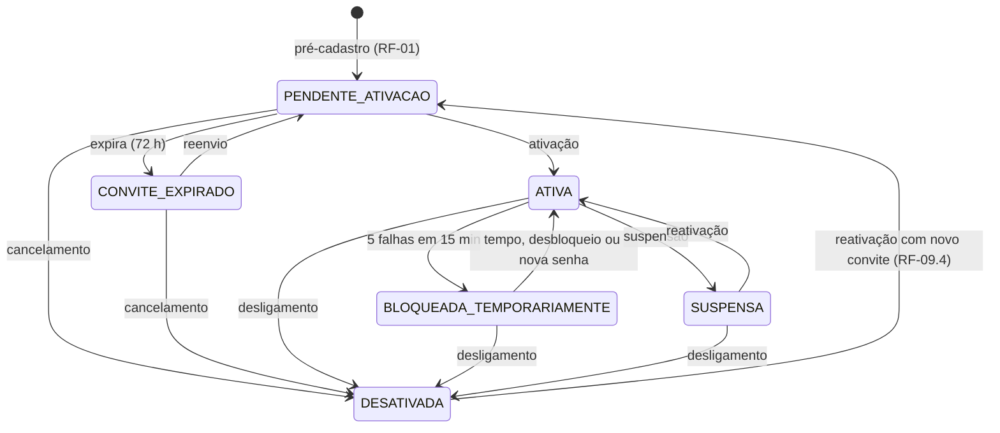

# Especificação de Requisitos — Gestão de Acessos, Onboarding e Autenticação

> **Fonte da spec 007.** Documento refinado no chat em 2026-10-24 a partir da especificação original de Rafael Santos (versão 1.0) e gravado aqui a pedido dele ("Essa documentação pode ficar lá como fonte dentro da pasta fonte para essa spec"). Cópia do Claude Doc https://claude.ai/artifact/QuVdekhFnUossYboK5Sq36 (revisão 8); o diagrama de estados foi convertido para Mermaid. É uma especificação de produto genérica: o que vale para o TickestPristine, e em que ordem, é decidido nas specs que a citam.

## Controle do documento

Versão 2.0 — substitui integralmente a versão 1.0. A principal mudança de segurança: **nenhuma senha trafega por e-mail**; o primeiro acesso passa a ser feito exclusivamente por link de ativação de uso único.

| # | Lacuna ou risco na versão 1.0 | Tratamento nesta versão |
| --- | --- | --- |
| L-01 | Senha temporária enviada em texto claro por e-mail (exposição em caixas de entrada, encaminhamentos e backups) | Substituída por token de ativação de uso único (RF-03) |
| L-02 | Conflito entre "e-mail pessoal" (RF-01) e "e-mail corporativo" (RF-04); não define qual é usado no login | Criado o campo único **E-mail de Acesso**; e-mail corporativo vira campo informativo (RF-01, D-01) |
| L-03 | Prazos de expiração não definidos | Ativação: 72 h. Recuperação: 30 min (RF-03, RF-06) |
| L-04 | Sem fluxo de reenvio, revogação ou expiração de convite | RF-02 |
| L-05 | Sem proteção contra força bruta e sem bloqueio de conta | RF-05 e RNF-SEG |
| L-06 | Sem ciclo de vida da conta (suspensão, desligamento, reativação) | Modelo de estados (seção 3) e RF-09 |
| L-07 | Sem regra sobre quem pode conceder perfis privilegiados (escalação de privilégio) | Matriz RBAC (seção 5) |
| L-08 | "Esqueci minha senha" para conta ainda não ativada não tratado | RF-06.5 |
| L-09 | Sessões não são invalidadas após troca de senha ou desativação | RF-10 |
| L-10 | Upload de foto sem restrição de tipo, tamanho e metadados | RF-08.6 |
| L-11 | Sem requisitos de auditoria, LGPD, rate limit e idempotência | Seção 6 |
| L-12 | Não define quais campos da complementação são obrigatórios | RF-08.3 |
| L-13 | Unicidade e imutabilidade de matrícula e CPF indefinidas | RF-01 e seção 5.2 |

## 1. Introdução

### 1.1 Propósito

Este documento especifica os requisitos do módulo de Gestão de Acessos: pré-cadastro de colaboradores pelo RH, ativação de conta, autenticação, recuperação de senha, complementação de perfil e ciclo de vida da conta. Destina-se a desenvolvimento, QA, segurança da informação e DPO.

### 1.2 Escopo

**Dentro do escopo:** pré-cadastro, convite, ativação, login, bloqueio, recuperação e troca de senha, gestão de sessões, edição de perfil, suspensão, desativação e reativação de contas, auditoria e notificações transacionais.

**Fora do escopo:** autocadastro público (proibido por definição), SSO/federação corporativa, fluxo de solicitação de alteração de dados ao RH (RF-08.8 apenas orienta o colaborador), folha de pagamento e demais dados contratuais.

### 1.3 Convenções normativas

| Termo | Significado |
| --- | --- |
| DEVE / NÃO DEVE | Obrigatório. Não atendimento reprova a entrega. |
| DEVERIA / NÃO DEVERIA | Recomendado. Desvio exige justificativa registrada. |
| PODE | Opcional. |

Cada requisito tem identificador único e rastreável (RF-xx.y, RNF-xxx-yy). Todo requisito DEVE ter ao menos um critério de aceitação verificável.

### 1.4 Glossário

| Termo | Definição |
| --- | --- |
| Colaborador | Pessoa física com vínculo ativo com a organização e conta no sistema. |
| Pré-cadastro | Registro criado pelo RH/Admin antes do primeiro acesso do colaborador. |
| E-mail de Acesso | E-mail único usado para login, convite e recuperação de senha. |
| Matrícula | Código de usuário único e imutável, usado como identificador de login. |
| Token de ativação | Segredo aleatório de uso único, enviado por link, que permite definir a primeira senha. |
| Token de recuperação | Segredo aleatório de uso único e curta duração para redefinir a senha. |
| Identificador de login | E-mail de Acesso ou Matrícula. |
| Ator privilegiado | Usuário com perfil ADMIN ou RH. |

### 1.5 Referências

- ISO/IEC/IEEE 29148:2018 — Engenharia de requisitos
- OWASP ASVS 4.0.3 — capítulos V2 (Autenticação), V3 (Sessão), V4 (Controle de acesso), V7 (Logs), V12 (Arquivos)
- OWASP Top 10:2021
- NIST SP 800-63B — Diretrizes de autenticação digital
- Lei nº 13.709/2018 (LGPD)

## 2. Descrição geral

### 2.1 Atores

| Ator | Perfil (role) | Responsabilidade |
| --- | --- | --- |
| Administrador | ADMIN | Gerencia contas de qualquer perfil, incluindo concessão de ADMIN e RH. |
| Recursos Humanos | RH | Cria pré-cadastros, mantém dados corporativos e o ciclo de vida das contas de perfil COLABORADOR. |
| Colaborador | COLABORADOR | Ativa a própria conta, autentica-se e mantém seus dados pessoais editáveis. |
| Sistema | — | Executa expiração de tokens, bloqueios automáticos, envio de e-mails e registro de auditoria. |

Um usuário DEVE ter exatamente um perfil de acesso principal. Perfis adicionais de outros módulos estão fora deste documento.

### 2.2 Premissas

- P-01: Todo colaborador possui um e-mail válido e acessível apenas por ele no momento do pré-cadastro.
- P-02: Existe um serviço de envio de e-mail transacional com SPF, DKIM e DMARC configurados no domínio remetente.
- P-03: Existe ao menos uma conta ADMIN ativa, criada por processo de provisionamento inicial (seed) fora deste fluxo.

### 2.3 Restrições

- R-01: O sistema NÃO DEVE oferecer autocadastro público. Toda conta nasce de um pré-cadastro feito por ator privilegiado.
- R-02: O sistema NÃO DEVE armazenar, enviar ou exibir senhas em texto claro em nenhum momento.
- R-03: Toda comunicação DEVE ocorrer exclusivamente via HTTPS (TLS 1.2 ou superior).
- R-04: O tratamento de dados pessoais DEVE seguir a LGPD (seção 6.2).

## 3. Modelo de estados da conta

Toda conta DEVE estar em exatamente um dos seis estados abaixo. Qualquer transição não desenhada DEVE ser rejeitada pelo domínio e auditada.



Apenas ATIVA autentica. Saídas para SUSPENSA e DESATIVADA revogam todas as sessões e tokens na hora (RF-09.3). Indicador separado do estado: `cadastro_completo` (RF-08.3).

| Estado | Pode autenticar | Token de ativação válido | Sessões |
| --- | --- | --- | --- |
| PENDENTE_ATIVACAO | Não | Sim | Nenhuma |
| CONVITE_EXPIRADO | Não | Não | Nenhuma |
| ATIVA | Sim | Não | Permitidas |
| BLOQUEADA_TEMPORARIAMENTE | Não | Não | Novas bloqueadas; existentes mantidas |
| SUSPENSA | Não | Não | Revogadas |
| DESATIVADA | Não | Não | Revogadas |

## 4. Requisitos funcionais

### RF-01 — Pré-cadastro de colaborador

**Ator:** ADMIN ou RH. **Pré-condição:** ator autenticado, com conta ATIVA.

- RF-01.1: O sistema DEVE permitir o pré-cadastro com os campos da tabela abaixo.
- RF-01.2: O sistema DEVE rejeitar o pré-cadastro se o CPF ou o E-mail de Acesso já existir em qualquer conta, inclusive DESATIVADA, retornando erro de conflito com o campo indicado. Readmissão de CPF existente DEVE ocorrer por reativação (RF-09.4), nunca por novo cadastro.
- RF-01.3: Quando a Matrícula for gerada automaticamente, o sistema DEVE garantir unicidade por sequência atômica no banco; NÃO DEVE gerá-la por consulta de "último valor + 1" na aplicação.
- RF-01.4: Quando informada manualmente, a Matrícula DEVE ser validada quanto a formato e unicidade antes da gravação.
- RF-01.5: O perfil RH NÃO DEVE conseguir atribuir os perfis ADMIN ou RH. A tentativa DEVE retornar erro de autorização e gerar evento de auditoria.
- RF-01.6: Ao salvar com sucesso, o sistema DEVE, na mesma transação: criar a conta no estado PENDENTE_ATIVACAO, gerar o token de ativação (RF-03) e registrar o evento de envio do convite na Outbox. O envio do e-mail ocorre de forma assíncrona após o commit.
- RF-01.7: A operação DEVE ser idempotente pelo cabeçalho `Idempotency-Key` (RNF-IDP-01).
- RF-01.8: Os dados de entrada DEVEM ser normalizados antes da validação: CPF somente dígitos, e-mail em minúsculas e sem espaços nas extremidades, nome sem espaços duplicados.

| Campo | Obrigatório | Regra de validação |
| --- | --- | --- |
| Nome Completo | Sim | 3 a 150 caracteres; ao menos duas palavras; letras, espaços, apóstrofo e hífen |
| CPF | Sim | 11 dígitos; dígitos verificadores válidos; rejeitar sequências repetidas (ex.: 111.111.111-11); único |
| E-mail de Acesso | Sim | Formato RFC 5322; até 254 caracteres; único (sem distinção de maiúsculas) |
| E-mail Corporativo | Não | Formato RFC 5322; informativo, não usado para login (D-01) |
| Matrícula | Sim | Automática ou manual; 3 a 20 caracteres alfanuméricos; única; imutável após criação |
| Cargo | Sim | Selecionado de cadastro mestre ativo |
| Departamento | Sim | Selecionado de cadastro mestre ativo |
| Perfil de Acesso | Sim | ADMIN, RH ou COLABORADOR, conforme RF-01.5 |

### RF-02 — Gestão do convite

- RF-02.1: O sistema DEVE enviar o e-mail de convite (N-01) ao E-mail de Acesso após o pré-cadastro.
- RF-02.2: ADMIN e RH DEVEM poder reenviar o convite de contas em PENDENTE_ATIVACAO ou CONVITE_EXPIRADO. O reenvio DEVE gerar novo token e invalidar o anterior imediatamente.
- RF-02.3: O reenvio DEVE ser limitado a 5 por conta a cada 24 h (RNF-RL).
- RF-02.4: ADMIN e RH DEVEM poder corrigir o E-mail de Acesso de conta não ativada. A correção DEVE invalidar o token vigente e enviar novo convite ao novo endereço.
- RF-02.5: ADMIN e RH DEVEM poder cancelar um pré-cadastro não ativado, levando a conta a DESATIVADA e invalidando o token.
- RF-02.6: Uma rotina do sistema DEVE mover para CONVITE_EXPIRADO as contas cujo token de ativação expirou sem uso.
- RF-02.7: A tela de gestão DEVE exibir, por conta, o estado, a data do último envio e a data de expiração do convite.

### RF-03 — Ativação da conta (primeiro acesso)

- RF-03.1: O token de ativação DEVE ter ao menos 256 bits de entropia, gerado por CSPRNG, e ser armazenado somente como hash SHA-256.
- RF-03.2: O token DEVE expirar em 72 horas a partir da emissão e ser de uso único.
- RF-03.3: O token DEVE ser transmitido no fragmento ou no corpo da requisição, não em query string registrada em logs. A página de ativação DEVE enviar o cabeçalho `Referrer-Policy: no-referrer`.
- RF-03.4: Ao abrir um link inválido, expirado ou já usado, o sistema DEVE exibir mensagem genérica ("Link inválido ou expirado. Solicite um novo convite ao RH."), sem revelar qual condição ocorreu.
- RF-03.5: Com token válido, o sistema DEVE exibir nome e Matrícula do colaborador e solicitar nova senha e confirmação, aplicando a política de senha (RNF-SEG-02).
- RF-03.6: Ao concluir, o sistema DEVE, de forma atômica: gravar o hash da senha, consumir o token, mudar o estado para ATIVA, registrar auditoria e enviar a notificação N-02.
- RF-03.7: Após a ativação, o colaborador DEVE ser redirecionado ao login. O sistema NÃO DEVE autenticá-lo automaticamente.
- RF-03.8: Duas submissões concorrentes do mesmo token DEVEM resultar em exatamente uma ativação; a segunda DEVE receber o erro genérico de RF-03.4.

### RF-04 — Autenticação

- RF-04.1: A tela de login DEVE aceitar como identificador o E-mail de Acesso ou a Matrícula, mais a senha. O sistema DEVE detectar o tipo pelo formato (presença de "@").
- RF-04.2: O sistema DEVE autenticar somente contas no estado ATIVA.
- RF-04.3: Para qualquer falha (identificador inexistente, senha errada, conta pendente, suspensa, bloqueada ou desativada), o sistema DEVE responder com a mesma mensagem — "Identificador ou senha inválidos." —, o mesmo status HTTP e tempo de resposta equivalente. Para identificador inexistente, o sistema DEVE executar uma verificação de hash fictícia.
- RF-04.4: Exceção à regra anterior: o sistema PODE informar o bloqueio temporário somente por e-mail ao titular (N-05), nunca na tela de login.
- RF-04.5: Após autenticação bem-sucedida de conta com cadastro incompleto (RF-08.3), o sistema DEVE redirecionar para a tela de complementação.
- RF-04.6: O sistema DEVE registrar em auditoria toda tentativa de login, com sucesso ou falha.

### RF-05 — Proteção contra força bruta

- RF-05.1: Após 5 falhas consecutivas para a mesma conta em 15 minutos, o sistema DEVE bloquear a conta por 15 minutos (estado BLOQUEADA_TEMPORARIAMENTE).
- RF-05.2: Bloqueios reincidentes em 24 h DEVEM dobrar a duração (15, 30, 60 min), até o máximo de 24 h.
- RF-05.3: O contador DEVE ser zerado após login bem-sucedido ou redefinição de senha.
- RF-05.4: A redefinição de senha via RF-06 DEVE desbloquear a conta.
- RF-05.5: ADMIN e RH DEVEM poder desbloquear manualmente uma conta, com registro em auditoria.
- RF-05.6: Os limites por IP da seção 6.4 DEVEM ser aplicados de forma independente do bloqueio por conta.

### RF-06 — Recuperação de senha ("Esqueci minha senha")

- RF-06.1: O usuário DEVE poder solicitar a recuperação informando E-mail de Acesso ou Matrícula.
- RF-06.2: A resposta na tela DEVE ser sempre a mesma, exista ou não a conta: "Se houver uma conta associada, enviaremos as instruções ao e-mail cadastrado."
- RF-06.3: Para conta ATIVA ou BLOQUEADA_TEMPORARIAMENTE, o sistema DEVE enviar link (N-03) com token de 256 bits, armazenado como hash, válido por 30 minutos e de uso único. Nova solicitação DEVE invalidar o token anterior.
- RF-06.4: Para conta SUSPENSA, DESATIVADA ou inexistente, o sistema NÃO DEVE enviar e-mail.
- RF-06.5: Para conta PENDENTE_ATIVACAO ou CONVITE_EXPIRADO, o sistema DEVE reenviar o convite de ativação (RF-02.2) em vez do link de recuperação, respeitando RF-02.3.
- RF-06.6: Ao redefinir a senha, o sistema DEVE aplicar a política de senha, revogar todas as sessões e refresh tokens ativos da conta e enviar a notificação N-04.
- RF-06.7: O e-mail DEVE ser enviado somente ao E-mail de Acesso cadastrado, nunca a um endereço informado na solicitação.

### RF-07 — Alteração de senha autenticada

- RF-07.1: O usuário autenticado DEVE poder alterar a senha informando a senha atual e a nova senha com confirmação.
- RF-07.2: Falhas na senha atual DEVEM contar para o limite de RF-05.1.
- RF-07.3: Após a alteração, o sistema DEVE revogar todas as demais sessões, manter a sessão atual com novo identificador e enviar N-04.

### RF-08 — Complementação e edição de perfil

- RF-08.1: O colaborador DEVE poder visualizar seus campos gerenciados pelo RH (seção 5.2) somente em modo leitura. O CPF DEVE ser exibido mascarado (***.456.789-**).
- RF-08.2: O colaborador DEVE poder editar somente: telefone celular, telefone fixo, endereço residencial, contato de emergência e foto de perfil.
- RF-08.3: São obrigatórios para considerar o cadastro completo: telefone celular, endereço (CEP, logradouro, número, bairro, cidade, UF) e contato de emergência (nome, parentesco e telefone). Enquanto incompleto, o sistema DEVE redirecionar o colaborador à complementação após cada login, liberando apenas logout e alteração de senha.
- RF-08.4: Validações: telefone no padrão E.164 com DDD válido; CEP com 8 dígitos; UF da lista oficial. O sistema PODE autopreencher o endereço por consulta de CEP, mas DEVE permitir edição manual se o serviço falhar.
- RF-08.5: A API DEVE ignorar e rejeitar com erro qualquer campo gerenciado pelo RH enviado pelo colaborador (proteção contra mass assignment). Não basta desabilitar o campo na interface.
- RF-08.6: A foto de perfil DEVE: aceitar somente JPEG, PNG ou WebP validados pelo conteúdo (magic bytes), não pela extensão; ter no máximo 5 MB e 4096 × 4096 px; ser reprocessada no servidor, removendo metadados EXIF; ser armazenada fora do diretório público e servida por URL assinada de curta duração.
- RF-08.7: Toda alteração DEVE gravar auditoria com valores anterior e novo (dados pessoais mascarados no log).
- RF-08.8: A tela DEVE informar ao colaborador que correções em campos gerenciados pelo RH devem ser solicitadas ao RH pelo canal oficial (D-04).
- RF-08.9: Edições concorrentes do mesmo registro DEVEM ser tratadas por controle otimista de concorrência; a segunda gravação DEVE falhar com conflito.

### RF-09 — Manutenção de dados e ciclo de vida da conta

- RF-09.1: ADMIN e RH DEVEM poder editar Nome, E-mail Corporativo, Cargo e Departamento, com registro em auditoria e notificação N-06 ao colaborador.
- RF-09.2: A alteração do E-mail de Acesso de conta ATIVA DEVE exigir confirmação pelo novo endereço (link de uso único, 24 h) e notificar o endereço antigo. Até a confirmação, o endereço antigo continua válido.
- RF-09.3: Suspensão (afastamento temporário) e desativação (desligamento) DEVEM revogar imediatamente todas as sessões e tokens da conta e exigir justificativa textual de 10 a 500 caracteres.
- RF-09.4: Reativação de conta SUSPENSA DEVE retorná-la a ATIVA. Reativação de conta DESATIVADA DEVE levá-la a PENDENTE_ATIVACAO com novo convite, invalidando a senha anterior.
- RF-09.5: O sistema NÃO DEVE permitir exclusão física de contas. A anonimização segue a política de retenção (RNF-LGPD-05).
- RF-09.6: Nenhum usuário DEVE poder suspender, desativar ou rebaixar o próprio perfil.
- RF-09.7: O sistema NÃO DEVE permitir desativar, suspender ou rebaixar o último ADMIN ativo.
- RF-09.8: Alteração de perfil de acesso DEVE revogar as sessões da conta afetada para que as novas permissões valham no próximo login.

### RF-10 — Gestão de sessão

- RF-10.1: O access token DEVE expirar em 15 minutos. O refresh token DEVE expirar em 8 horas, ser rotativo e de uso único; a reutilização de um refresh token já usado DEVE revogar toda a família de tokens (detecção de roubo).
- RF-10.2: Sessões inativas por 30 minutos DEVEM ser encerradas.
- RF-10.3: O logout DEVE revogar o refresh token no servidor, não apenas apagar o cookie.
- RF-10.4: O identificador de sessão DEVE ser renovado após login e após troca de senha (prevenção de session fixation).
- RF-10.5: A cada requisição, o sistema DEVE validar o estado da conta e o perfil vigentes no servidor; o conteúdo do token NÃO DEVE ser a única fonte de autorização.

## 5. Matriz de permissões e dados

O controle de acesso DEVE ser aplicado no servidor, em todo endpoint, com negação por padrão (deny by default). Ocultar botões na interface não é controle de acesso.

### 5.1 Permissões por operação

Legenda: **S** = permitido · **N** = negado · **P** = somente sobre a própria conta · **C** = somente sobre contas de perfil COLABORADOR.

| Operação | ADMIN | RH | COLABORADOR |
| --- | --- | --- | --- |
| Criar pré-cadastro com perfil COLABORADOR | S | S | N |
| Criar pré-cadastro com perfil RH ou ADMIN | S | N | N |
| Reenviar, corrigir e-mail ou cancelar convite | S | C | N |
| Listar e consultar contas | S | S | P |
| Ver CPF completo | S | S | N (mascarado) |
| Editar dados corporativos (seção 5.2) | S | C | N |
| Editar dados pessoais (seção 5.2) | N | N | P |
| Alterar perfil de acesso | S | N | N |
| Desbloquear conta | S | C | N |
| Suspender, desativar ou reativar conta | S (exceto a própria) | C | N |
| Consultar trilha de auditoria | S | C (somente eventos de contas COLABORADOR) | N |
| Alterar a própria senha | P | P | P |

Regras complementares:

- RBAC-01: Toda consulta por identificador DEVE verificar se o solicitante tem direito sobre aquele registro (prevenção de IDOR). Acesso negado a registro existente DEVE retornar o mesmo status que registro inexistente (404).
- RBAC-02: ADMIN NÃO DEVE editar dados pessoais do colaborador, por princípio de minimização (LGPD). Correções nesses dados são feitas pelo próprio titular.
- RBAC-03: Toda tentativa negada DEVE gerar evento de auditoria com o ator, a operação e o recurso.

### 5.2 Classificação e mutabilidade dos campos

| Campo | Classificação | Quem altera | Mutabilidade |
| --- | --- | --- | --- |
| Matrícula | Corporativo | Ninguém | Imutável após criação |
| CPF | Pessoal, identificador | ADMIN, somente para correção de erro de digitação antes da ativação | Imutável após ativação |
| Nome Completo | Corporativo | ADMIN, RH | Mutável com auditoria |
| E-mail de Acesso | Credencial | ADMIN, RH | Mutável com confirmação (RF-02.4, RF-09.2) |
| E-mail Corporativo | Corporativo | ADMIN, RH | Mutável com auditoria |
| Cargo, Departamento | Corporativo | ADMIN, RH | Mutável com auditoria |
| Perfil de Acesso | Segurança | ADMIN | Mutável com auditoria e revogação de sessões |
| Estado da conta | Segurança | Sistema, ADMIN, RH | Somente pelas transições da seção 3 |
| Telefones, endereço | Pessoal | Colaborador | Mutável com auditoria |
| Contato de emergência | Pessoal de terceiro | Colaborador | Mutável com auditoria |
| Foto de perfil | Pessoal | Colaborador | Substituível; a anterior DEVE ser excluída do armazenamento |
| Hash de senha, tokens | Credencial | Sistema | Nunca exposto por API, log ou tela |
| Data de criação, criador, registros de auditoria | Auditoria | Ninguém | Imutável (append-only) |

## 6. Requisitos não funcionais

### 6.1 Segurança (RNF-SEG)

- RNF-SEG-01: Senhas DEVEM ser armazenadas com Argon2id (mínimo: 19 MiB de memória, 2 iterações, paralelismo 1) e salt individual. Parâmetros DEVEM ser versionados para permitir rehash transparente no login.
- RNF-SEG-02 (política de senha): mínimo de 12 e máximo de 128 caracteres; ao menos uma letra maiúscula, uma minúscula, um número e um caractere especial; NÃO DEVE conter nome, CPF, Matrícula ou parte local do e-mail; NÃO DEVE constar em lista de senhas vazadas (ex.: consulta k-anonymity ao Have I Been Pwned); NÃO DEVE repetir as 5 últimas senhas. Espaços e Unicode DEVEM ser aceitos. A interface DEVE exibir os critérios atendidos em tempo real.
- RNF-SEG-03: Cookies de sessão DEVEM usar `HttpOnly`, `Secure` e `SameSite=Strict` (ou `Lax` com token anti-CSRF).
- RNF-SEG-04: Respostas DEVEM incluir HSTS (mínimo 1 ano), `Content-Security-Policy` restritiva, `X-Content-Type-Options: nosniff` e `frame-ancestors 'none'`.
- RNF-SEG-05: Senhas, tokens, hashes e CPF completo NÃO DEVEM aparecer em logs, mensagens de erro, URLs ou respostas de API.
- RNF-SEG-06: Erros DEVEM retornar formato padronizado (RFC 9457 — Problem Details) sem stack trace, nome de tabela ou detalhe de infraestrutura.
- RNF-SEG-07: Entradas DEVEM ser validadas no servidor por lista de permissão (allowlist); consultas ao banco DEVEM ser parametrizadas.
- RNF-SEG-08: Ações sensíveis de atores privilegiados (alterar perfil, desativar conta, alterar E-mail de Acesso) DEVERIAM exigir reautenticação se o último login tiver mais de 15 minutos.
- RNF-SEG-09: Contas ADMIN e RH DEVERIAM usar autenticação multifator (TOTP) — ver D-03.
- RNF-SEG-10: Comparação de tokens DEVE ser feita em tempo constante.

### 6.2 Privacidade e LGPD (RNF-LGPD)

- RNF-LGPD-01: A base legal do tratamento DEVE ser registrada no inventário de dados: execução de contrato e cumprimento de obrigação legal (art. 7º, II e V).
- RNF-LGPD-02: CPF, telefones e endereço DEVEM ser criptografados em repouso (AES-256). A unicidade do CPF DEVE ser verificada por um hash determinístico com chave secreta (HMAC-SHA-256) armazenado em coluna separada.
- RNF-LGPD-03: O contato de emergência é dado de terceiro. A tela DEVE informar que o colaborador é responsável por avisar essa pessoa e que o dado será usado somente em emergência.
- RNF-LGPD-04: O colaborador DEVE poder exportar seus próprios dados cadastrais em formato legível (direito de acesso, art. 18).
- RNF-LGPD-05: Após a desativação, dados pessoais DEVEM ser retidos pelo prazo definido pelo jurídico (D-02) e então anonimizados. Matrícula e trilha de auditoria DEVEM ser preservadas.
- RNF-LGPD-06: O acesso de atores privilegiados a dados pessoais completos DEVE ser registrado em auditoria.

### 6.3 Auditoria (RNF-AUD)

- RNF-AUD-01: Os eventos abaixo DEVEM ser registrados com: data/hora UTC, ator (id e perfil), conta afetada, operação, resultado, IP, user-agent e correlation id.
- RNF-AUD-02: Para alterações de dados, DEVEM ser registrados valores anterior e novo, com dados pessoais mascarados.
- RNF-AUD-03: A trilha DEVE ser append-only. Nenhum perfil, inclusive ADMIN, DEVE poder alterar ou excluir registros. A integridade DEVERIA ser garantida por encadeamento de hash ou armazenamento WORM.
- RNF-AUD-04: Retenção mínima de 5 anos (D-02).

Eventos obrigatórios: pré-cadastro criado; convite enviado, reenviado, cancelado e expirado; conta ativada; login com sucesso e com falha; bloqueio e desbloqueio; recuperação solicitada e concluída; senha alterada; perfil de acesso alterado; dados corporativos ou pessoais alterados; E-mail de Acesso alterado; suspensão, desativação e reativação; acesso negado (RBAC-03); visualização de CPF completo.

### 6.4 Limites de taxa (RNF-RL)

Excedido o limite, o sistema DEVE responder HTTP 429 com cabeçalho `Retry-After`. Os contadores DEVEM ser compartilhados entre instâncias (ex.: Redis).

| Endpoint | Chave | Limite |
| --- | --- | --- |
| Login | IP | 20 por minuto |
| Login | Identificador informado | Ver RF-05 (bloqueio por conta) |
| Esqueci minha senha | IP | 10 por hora |
| Esqueci minha senha | Identificador informado | 3 por hora (excedente ignorado silenciosamente, mesma resposta da RF-06.2) |
| Validação de token (ativação e recuperação) | IP | 10 por minuto |
| Reenvio de convite | Conta | 5 por 24 h |
| Pré-cadastro | Ator | 60 por minuto |
| Upload de foto | Usuário | 10 por hora |

### 6.5 Idempotência e consistência (RNF-IDP)

- RNF-IDP-01: Endpoints de criação (pré-cadastro) DEVEM aceitar `Idempotency-Key` (UUID). Mesma chave e mesmo corpo em até 24 h DEVEM retornar a resposta original; mesma chave com corpo diferente DEVE retornar 422.
- RNF-IDP-02: E-mails DEVEM ser enviados via Outbox transacional com chave de deduplicação por evento, garantindo envio pelo menos uma vez sem duplicidade visível ao usuário.
- RNF-IDP-03: Unicidade de CPF, E-mail de Acesso e Matrícula DEVE ser garantida por índice único no banco, não apenas por validação na aplicação.
- RNF-IDP-04: Consumo de token DEVE ser atômico (ex.: `UPDATE ... WHERE consumed_at IS NULL`), atendendo RF-03.8.

### 6.6 Desempenho, disponibilidade e observabilidade

- RNF-DES-01: O endpoint de login DEVE responder em até 800 ms no percentil 95, com o custo do hash incluído.
- RNF-DES-02: O e-mail de convite DEVE ser entregue ao provedor em até 2 minutos após o pré-cadastro no percentil 95.
- RNF-DIS-01: O módulo DEVE ter disponibilidade mensal de 99,5% em horário comercial.
- RNF-OBS-01: O sistema DEVE emitir métricas de falhas de login, bloqueios, e-mails com falha de entrega e respostas 429, com alerta para picos anômalos (indício de credential stuffing).

### 6.7 Usabilidade e acessibilidade

- RNF-USA-01: As telas de login, ativação, recuperação e perfil DEVEM atender WCAG 2.1 nível AA.
- RNF-USA-02: Campos de senha DEVEM permitir colar texto e alternar visibilidade, e aceitar gerenciadores de senha (`autocomplete="new-password"` e `"current-password"`).

## 7. Notificações transacionais

Todas as notificações DEVEM: ser enviadas ao E-mail de Acesso; usar domínio remetente com SPF, DKIM e DMARC (`p=quarantine` ou mais restritivo); conter apenas links HTTPS para o domínio oficial da plataforma; ter versão HTML e texto puro; e informar um canal oficial para o colaborador reportar atividade não reconhecida.

Nenhuma notificação DEVE conter senha, CPF completo, token fora do link ou dados pessoais além do nome.

| Código | Gatilho | Assunto | Conteúdo obrigatório |
| --- | --- | --- | --- |
| N-01 | Pré-cadastro ou reenvio de convite | Boas-vindas: ative sua conta | Saudação nominal; Matrícula; E-mail de Acesso; botão de ativação; data e hora de expiração (72 h, horário de Brasília); aviso de que a senha será criada pelo próprio colaborador; orientação para ignorar se não reconhecer |
| N-02 | Conta ativada | Sua conta foi ativada | Data e hora; orientação para contatar o RH se não foi o titular |
| N-03 | Recuperação solicitada | Redefinição de senha | Link de redefinição; validade de 30 min; aviso de que nenhuma ação é necessária se não foi o titular |
| N-04 | Senha alterada ou redefinida | Sua senha foi alterada | Data, hora, IP aproximado e navegador; canal de contato urgente |
| N-05 | Conta bloqueada por tentativas | Bloqueio temporário de acesso | Duração do bloqueio; link para redefinir senha |
| N-06 | Dados corporativos alterados pelo RH/ADMIN | Seus dados cadastrais foram atualizados | Campos alterados (sem valores sensíveis); data |
| N-07 | Alteração do E-mail de Acesso | Confirme seu novo e-mail / Seu e-mail de acesso foi alterado | Ao novo endereço: link de confirmação (24 h). Ao antigo: aviso da troca e canal de contato |

Falha permanente de entrega (bounce) de N-01 DEVE ser exibida na tela de gestão da conta para que o RH corrija o E-mail de Acesso.

## 8. Critérios de aceitação

Cenários mínimos de QA. Cada RF DEVE ter cobertura de testes automatizados para o caminho feliz e para cada regra de rejeição.

```gherkin
Funcionalidade: Pré-cadastro e ativação

  Cenário: RH cria colaborador com sucesso
    Dado que estou autenticado como RH
    Quando cadastro um colaborador com CPF e E-mail de Acesso inéditos e perfil COLABORADOR
    Então a conta é criada no estado PENDENTE_ATIVACAO
    E um e-mail N-01 é enfileirado na Outbox
    E o e-mail não contém nenhuma senha

  Cenário: RH tenta conceder perfil ADMIN
    Dado que estou autenticado como RH
    Quando cadastro um colaborador com perfil ADMIN
    Então recebo erro 403
    E um evento de acesso negado é auditado

  Cenário: CPF já existente em conta desativada
    Dado que existe uma conta DESATIVADA com o CPF 529.982.247-25
    Quando cadastro outro colaborador com o mesmo CPF
    Então recebo erro de conflito no campo CPF

  Cenário: Requisição de pré-cadastro repetida
    Dado que enviei um pré-cadastro com Idempotency-Key K
    Quando reenvio a mesma requisição com a chave K
    Então recebo a resposta original
    E existe apenas uma conta criada

  Cenário: Link de ativação expirado
    Dado que o convite foi emitido há 73 horas
    Quando abro o link de ativação
    Então vejo "Link inválido ou expirado. Solicite um novo convite ao RH."

  Cenário: Duas ativações simultâneas com o mesmo token
    Quando duas requisições de ativação com o mesmo token chegam ao mesmo tempo
    Então exatamente uma é concluída
    E a outra recebe o erro genérico

Funcionalidade: Autenticação

  Esquema do Cenário: Mensagem idêntica para qualquer falha
    Quando tento entrar com "<identificador>" e uma senha incorreta
    Então vejo "Identificador ou senha inválidos."
    E o status HTTP é igual em todos os casos

    Exemplos:
      | identificador                        |
      | matrícula inexistente                |
      | e-mail de conta PENDENTE_ATIVACAO    |
      | e-mail de conta DESATIVADA           |
      | matrícula de conta ATIVA             |

  Cenário: Bloqueio após 5 falhas
    Dado que errei a senha 5 vezes em 10 minutos
    Quando tento entrar com a senha correta
    Então o acesso é negado com a mensagem genérica
    E recebo o e-mail N-05

  Cenário: Cadastro incompleto após login
    Dado que ativei a conta e não informei o endereço
    Quando faço login
    Então sou redirecionado à tela de complementação
    E não consigo acessar outras telas

Funcionalidade: Recuperação e perfil

  Cenário: Recuperação para conta inexistente
    Quando solicito recuperação para "naoexiste@empresa.com"
    Então vejo a mesma mensagem exibida para contas existentes
    E nenhum e-mail é enviado

  Cenário: Recuperação de conta pendente reenvia convite
    Dado que minha conta está em PENDENTE_ATIVACAO
    Quando solicito recuperação de senha
    Então recebo um novo convite N-01
    E o token de convite anterior deixa de funcionar

  Cenário: Redefinição encerra outras sessões
    Dado que tenho sessões abertas em dois dispositivos
    Quando redefino minha senha
    Então as duas sessões são encerradas

  Cenário: Colaborador tenta alterar o próprio cargo pela API
    Dado que estou autenticado como COLABORADOR
    Quando envio uma atualização de perfil contendo o campo cargo
    Então recebo erro de validação
    E o cargo permanece inalterado

  Cenário: Upload de arquivo disfarçado de imagem
    Quando envio um arquivo executável renomeado para foto.jpg
    Então o upload é rejeitado
```

## 9. Decisões pendentes

Itens que exigem validação do negócio, jurídico ou segurança antes de a spec entrar em sprint. A spec já adota a opção recomendada.

| ID | Questão | Opção adotada nesta versão | Responsável |
| --- | --- | --- | --- |
| D-01 | Login pelo e-mail pessoal ou corporativo? | Campo único E-mail de Acesso, informado pelo RH; corporativo é informativo | Produto + RH |
| D-02 | Prazos de retenção de dados pessoais e de logs de auditoria após desligamento | Auditoria: 5 anos. Dados pessoais: definir com jurídico (base trabalhista) | Jurídico / DPO |
| D-03 | MFA obrigatório para ADMIN e RH já na primeira entrega? | Recomendado (DEVERIA); pode entrar em fase 2 | Segurança da informação |
| D-04 | Canal de solicitação de alteração de dados ao RH (sistema interno ou processo externo) | Fora do escopo; tela apenas orienta | Produto + RH |
| D-05 | Formato da Matrícula automática (prefixo, tamanho, dígito verificador) | Alfanumérico de 3 a 20 caracteres, sequencial | RH |
| D-06 | Integração futura com SSO corporativo (Entra ID, Google Workspace) | Fora do escopo; a modelagem não deve impedir | Arquitetura |
| D-07 | Prazos de expiração (72 h ativação, 30 min recuperação, 8 h refresh) | Adotados como padrão; configuráveis por parâmetro | Produto + Segurança |
