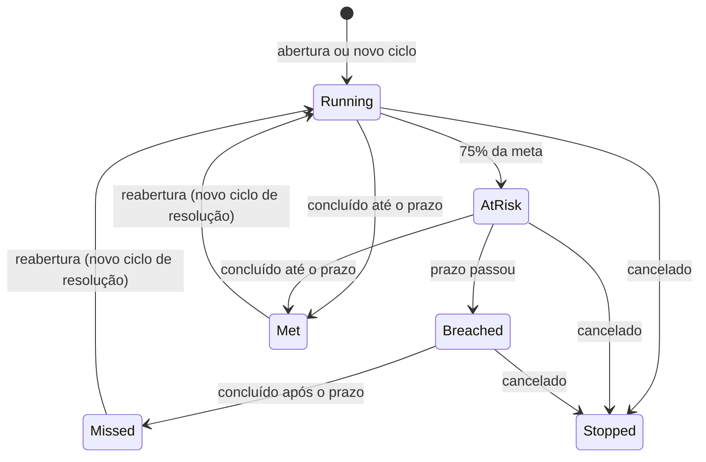

# Especificação refinada — SLA do chamado e API de detalhes

> **Fonte da spec 005.** Especificação de Rafael Santos ("SPEC — Backend: Gestão de SLA e API de Detalhes do Ticket"), refinada no chat em 2026-10-24 contra a `origin/main` `5ca764b`, a spec 004 e a fonte `specs/_fontes/prompt-sla.md`. Cópia do Claude Doc https://claude.ai/artifact/M9CGvGP3ZA4uWuSrCPPiD2; o diagrama de estados foi convertido para Mermaid. As decisões D-01 a D-08 da seção 7 viraram as DP-15 a DP-21 do `SPEC-TICKEST.md`, aceitas por Rafael Santos em 2026-10-24 ("Aceito todas"); a D-07 (403 no acesso negado) e a D-08 (`SlaStatus` segue o ciclo 1) não estavam nessa lista e são perguntadas na descoberta da spec 005.

## Controle e diagnóstico

Versão 2.0. **A auditoria pedida no item 2 da versão 1.0 já está feita aqui**; o desenvolvedor parte deste diagnóstico.

### O que já existe

| Item da versão 1.0 | Situação | Evidência |
| --- | --- | --- |
| Endpoint de detalhes (RF-01) | **Implementado e funcional** | `GET tickets/{ticketId:guid}` → `GetTicketByIdQueryHandler`; acesso pelo `TicketAccessGuard.EnsureCanViewAsync` (solicitante, responsável ou `tickets:manage`) |
| SLA no detalhe | Parcial | `TicketResponse` já devolve `DueAtUtc`, `SlaWarningAtUtc`, `ResolvedAtUtc` e `SlaStatus`, calculado no servidor por `TicketSla.GetStatus` |
| Política de SLA (RF-02) | Fixa em código | `TicketSla.ResolutionTime`: Urgente 4 h, Alta 8 h, Média 24 h, Baixa 72 h, **horas corridas**, alerta em 75% (RN-01) |
| Primeira resposta | Não existe | Só há prazo de resolução |
| Horas úteis e calendário | Em especificação | Spec 004 (calendário "Expediente", seg–sex 08–18, `America/Sao_Paulo`, feriados nacionais) |
| Pausa | Não existe | Nenhum status do chamado representa espera pelo solicitante (estados: Aberto, Em andamento, Resolvido, Fechado, Cancelado) |
| Reabertura | Parcial | `Met`/`Missed` ficam congelados na primeira resolução (RN-03) |
| Mudança de prioridade ou setor | Não acontece | A prioridade e o setor não são editáveis depois da abertura (`UpdateTicketCommand` só muda descrição e status) |
| Prazos preservados (RF-04) | Implementado | `DueAtUtc` e `SlaWarningAtUtc` gravados na abertura (RN-02) |
| Resumo e filtros | Implementado | `GET tickets/sla-summary` e `TicketSlaFilters` (mesma regra em SQL), com `ServerNowUtc` |

**Causa raiz do "corrigir a API de detalhes":** nenhum defeito foi encontrado no backend; a rota responde e é coberta por testes. Se o front relata falha, a causa está na chamada (rota, id ou tratamento de 403/404) e é investigada no repositório Angular. O que falta de fato é o **conteúdo de SLA** do contrato: primeira resposta, horas úteis, metas e estados por objetivo.

### Lacunas e ambiguidades corrigidas

| # | Lacuna ou risco na versão 1.0 | Tratamento nesta versão |
| --- | --- | --- |
| L-01 | Pede "projetar uma política" sem dizer qual; o projeto já tem um desenho aprovado (`prompt-sla.md`, decisões da spec 004) | Esta spec segue esse desenho: plano gravado no chamado, cronômetros por objetivo, calendário útil |
| L-02 | Tudo numa entrega só (política configurável, associação, cálculo, job, contrato) | Três entregas com dependência explícita (seção 1.3) |
| L-03 | "Primeira resposta" sem definição | Primeira mensagem de um atendente que não seja o solicitante (RF-05.2, D-02) |
| L-04 | "Regras de pausa" sem status que as acione | Sem pausa na Entrega 1; status "Aguardando solicitante" fica como decisão (D-03) |
| L-05 | Reabertura sem regra | Novo ciclo do objetivo de resolução; o resultado do ciclo anterior é preservado (RF-05.6, D-04) |
| L-06 | "Não aplicar retroativamente" sem regra para os chamados existentes | Chamados existentes mantêm o prazo antigo em horas corridas, sem primeira resposta (RF-06, D-05) |
| L-07 | Recálculo por prioridade/setor exigido, mas esses campos não mudam | Regra definida para quando passarem a mudar; nenhuma rota nova (RF-05.8) |
| L-08 | "Identificador inválido" sem status definido | Id que não é GUID não casa com a rota → 404; ver RF-01.2 |
| L-09 | Acesso negado devolve 403, o que confirma a existência do chamado | Mantido 403 (ids são GUID, enumeração inviável), registrado como decisão (D-07) |
| L-10 | Estado oficial calculado onde? | Sempre no servidor, com um único `UtcNow` por requisição e `serverNowUtc` na resposta (RF-07.4) |
| L-11 | Política configurável sem permissão definida | Nova permissão administrativa `sla:manage` (Entrega 3) |

## 1. Escopo, atores e definições

### 1.1 Convenções

DEVE / NÃO DEVE = obrigatório. DEVERIA = recomendado; desvio justificado na spec. PODE = opcional. Código em inglês; mensagens e textos em português do Brasil. Todos os instantes são UTC no banco e na API; o fuso do calendário só é usado no cálculo.

### 1.2 Atores

| Ator | Permissões relevantes | Papel no SLA |
| --- | --- | --- |
| Solicitante (Colaborador) | participante do chamado | Abre o chamado e vê o SLA do próprio chamado. Sua mensagem nunca conta como resposta. |
| Atendente | `tickets:manage` | Responde e resolve; sua primeira mensagem cumpre a primeira resposta. |
| Administrador | `tickets:manage`, `sla:manage` (Entrega 3) | Configura políticas (Entrega 3) e vê o SLA de todos os chamados. |
| Sistema | — | Resolve a política, cria e atualiza cronômetros, calcula estados com o relógio do servidor. |

### 1.3 Entregas

| Entrega | Conteúdo | Spec no repositório | Depende de |
| --- | --- | --- | --- |
| 1 — Núcleo | Política padrão em código; cronômetros de primeira resposta e resolução em horas úteis; transições; chamados existentes; contrato de SLA no detalhe e rota dedicada | 005 | Spec 004 entregue |
| 2 — Monitoramento | Job que materializa a violação (`BreachedOnUtc`) e dispara eventos | 006 (reservada) | Entrega 1 |
| 3 — Políticas configuráveis | CRUD de políticas, associação por setor e departamento, precedência, auditoria das alterações | Nova spec | Entrega 1 |

O estado oficial (no prazo, em risco, vencido) é calculado na leitura e NÃO depende do job da Entrega 2.

### 1.4 Definições

- **Política de SLA:** conjunto de metas por prioridade e o calendário em que são contadas.
- **Plano de SLA:** cópia da política aplicada, gravada no chamado na abertura (snapshot). Mudanças na política NÃO alteram planos já gravados.
- **Objetivo (métrica):** `FirstResponse` (primeira resposta) ou `Resolution` (resolução).
- **Cronômetro:** registro de um objetivo num ciclo do chamado, com meta, prazo, tempo consumido e desfecho.
- **Ciclo:** número sequencial do cronômetro do mesmo objetivo; a resolução abre o ciclo 2 na primeira reabertura, e assim por diante.
- **Minuto útil:** minuto dentro da grade do calendário, fora de feriados (spec 004).
- **Estado do objetivo:** `Running`, `AtRisk`, `Breached` (vencido e ainda aberto), `Met`, `Missed`, `Stopped`, `NotApplicable`.

## 2. Requisitos funcionais

### RF-01 — Detalhes do chamado (Entrega 1)

- RF-01.1: `GET tickets/{ticketId:guid}` DEVE continuar sendo a rota de detalhes, com o mesmo controle de acesso (`TicketAccessGuard.EnsureCanViewAsync`).
- RF-01.2: Respostas: 200 com `TicketResponse`; 401 sem autenticação; 403 para quem não é solicitante, responsável nem tem `tickets:manage`; 404 para chamado inexistente ou excluído; 404 para id que não é GUID (a rota não casa); 500 só para falha inesperada, em Problem Details sem detalhes internos.
- RF-01.3: O `TicketResponse` DEVE manter todos os campos atuais (compatibilidade) e ganhar o bloco `sla` (RF-07).
- RF-01.4: A rota DEVE fazer no máximo uma ida ao banco para os cronômetros do chamado, além das consultas atuais.

### RF-02 — Política padrão (Entrega 1)

- RF-02.1: Na Entrega 1, a política é única, definida em código e devolvida por `ISlaPlanResolver.ResolveAsync(contexto do chamado)`. A assinatura NÃO DEVE mudar na Entrega 3, quando a implementação passa a ler o banco.
- RF-02.2: A política padrão usa o calendário "Expediente" da spec 004 e estas metas, em minutos úteis:

| Prioridade | Primeira resposta | Resolução |
| --- | --- | --- |
| Urgente | 30 | 240 |
| Alta | 120 | 600 |
| Média | 240 | 1.200 |
| Baixa | 600 | 3.000 |

- RF-02.3: O alerta "em risco" DEVE disparar quando o objetivo tiver consumido 75% da meta em tempo útil.

### RF-03 — Plano gravado na abertura (Entrega 1)

- RF-03.1: Na abertura, o sistema DEVE resolver a política e gravar no chamado o plano: id e nome da política (nulo na padrão em código), versão, calendário, metas de cada objetivo e regra de reabertura.
- RF-03.2: Na mesma transação da abertura, o sistema DEVE criar os cronômetros `FirstResponse` ciclo 1 e `Resolution` ciclo 1, iniciados no `CreatedAtUtc`, com `DueOnUtc` calculado pelo calendário do plano.
- RF-03.3: Mudança posterior na política NÃO DEVE alterar planos nem prazos já gravados.
- RF-03.4: Os campos atuais `DueAtUtc` e `SlaWarningAtUtc` DEVEM ser preenchidos com o prazo e o alerta do cronômetro `Resolution` ciclo 1 (decisão DEC-3 da spec 004).

### RF-04 — Associação de políticas (Entrega 3)

- RF-04.1: Uma política PODE ter uma condição de setor ou de departamento, nunca as duas; sem condição, vale para todos.
- RF-04.2: Precedência entre políticas ativas que se aplicam ao chamado: (1) condição de setor igual ao setor do chamado; (2) condição de departamento igual ao departamento do setor; (3) a política padrão. Empate no mesmo nível: menor `Order`, depois a mais antiga.
- RF-04.3: DEVE existir exatamente uma política padrão ativa; ela NÃO PODE ser desativada nem perder a marcação sem que outra a receba na mesma operação. Por isso, todo chamado novo sempre tem plano.
- RF-04.4: Dois setores ou dois departamentos iguais em políticas ativas do mesmo `Order` DEVEM ser recusados (409 `SlaPolicies.AmbiguousCondition`).
- RF-04.5: Campos: nome (3 a 100, único sem diferenciar maiúsculas), descrição (até 500), ativo, padrão, `Order` (0 a 1.000), calendário, metas por prioridade e objetivo (1 a 525.600 minutos; a primeira resposta NÃO PODE ser maior que a resolução da mesma prioridade).
- RF-04.6: Políticas NÃO DEVEM ser excluídas fisicamente; só desativadas. Cada alteração incrementa a versão.

### RF-05 — Cálculo e transições (Entrega 1)

- RF-05.1: Todo cálculo DEVE ocorrer no servidor, com um único `IDateTimeProvider.UtcNow` por requisição, usando o `BusinessCalendar` da spec 004. O relógio do navegador NUNCA decide estado.
- RF-05.2: **Primeira resposta:** a primeira mensagem publicada por um usuário diferente do solicitante e que, no instante da publicação, tenha `tickets:manage` DEVE concluir o cronômetro `FirstResponse` (`CompletedOnUtc` = instante da mensagem). Mensagem do solicitante NÃO conta. Editar ou excluir essa mensagem depois NÃO reabre o cronômetro.
- RF-05.3: **Resolução:** a transição para Resolvido DEVE concluir o cronômetro `Resolution` do ciclo corrente. Se o `FirstResponse` ainda estiver correndo, ele DEVE ser concluído no mesmo instante (resolver é responder).
- RF-05.4: **Cancelamento:** DEVE parar (`StoppedOnUtc`) todos os cronômetros abertos; o estado deles passa a `NotApplicable` e não conta como violação.
- RF-05.5: **Fechado** e **Em andamento** NÃO DEVEM afetar cronômetros.
- RF-05.6: **Reabertura** (Resolvido ou Cancelado → Aberto): DEVE abrir um novo ciclo de `Resolution`, iniciado no instante da reabertura, com a meta integral do plano. O resultado dos ciclos anteriores NÃO DEVE mudar. O `FirstResponse` não reabre.
- RF-05.7: **Pausa:** não há pausa na Entrega 1, porque nenhum status representa espera (D-03). Quando houver, o tempo pausado NÃO DEVE contar como consumido e pausar ou retomar NÃO DEVE alterar o resultado de ciclos encerrados.
- RF-05.8: **Mudança de prioridade, setor ou departamento** (quando forem editáveis): o sistema DEVE resolver o plano de novo e redefinir a meta dos cronômetros abertos, preservando o tempo já consumido; cronômetros encerrados NÃO mudam. Nenhuma rota de edição desses campos é criada por esta spec.
- RF-05.9: Regras de cálculo: `DueOnUtc` = soma de minutos úteis da meta ao início; consumido = segundos úteis entre o início e o menor entre agora e o encerramento; restante = meta − consumido, nunca negativo; concluído exatamente no `DueOnUtc` = cumprido.

### RF-06 — Chamados existentes (Entrega 1)

- RF-06.1: A migration DEVE criar, para cada chamado existente, o cronômetro `Resolution` ciclo 1 com o plano "Legado (horas corridas)": calendário 24x7, meta igual às horas atuais da prioridade e `DueOnUtc` igual ao `DueAtUtc` já gravado. Nenhum prazo existente muda.
- RF-06.2: Chamados resolvidos ganham o cronômetro concluído em `ResolvedAtUtc`; cancelados sem resolução, parado. Chamados existentes NÃO ganham `FirstResponse`; o estado desse objetivo é `NotApplicable`.
- RF-06.3: A migration DEVE ser idempotente (índice único por chamado, objetivo e ciclo; `ON CONFLICT DO NOTHING`) e NÃO DEVE gravar política nem calendário no banco (DEC-7 da spec 004).

### RF-07 — Contrato de SLA (Entrega 1)

- RF-07.1: O detalhe do chamado e a rota `GET tickets/{ticketId}/sla` DEVEM devolver o bloco `sla` da seção 4.3.
- RF-07.2: O bloco DEVE trazer o estado oficial de cada objetivo, calculado pelo servidor; o front NÃO DEVE precisar de regra própria para saber se está vencido.
- RF-07.3: O resumo (`GET tickets/sla-summary`), os filtros por situação e o campo `SlaStatus` atuais DEVEM continuar funcionando, alimentados pelo cronômetro `Resolution` ciclo 1.
- RF-07.4: A resposta DEVE incluir `serverNowUtc`, o instante usado no cálculo, para o front exibir contagens sem depender do relógio local.

## 3. Estados de um objetivo

Cada cronômetro (objetivo × ciclo) passa pelos estados abaixo. Os três de cima são calculados na leitura a partir de `serverNowUtc`; os três de baixo são finais e gravados.



| Estado | Condição | Conta como violação |
| --- | --- | --- |
| `Running` | aberto e consumo < 75% da meta | Não |
| `AtRisk` | aberto, consumo ≥ 75% e agora < prazo | Não |
| `Breached` | aberto e agora ≥ prazo | Sim (ainda pode ser concluído, como `Missed`) |
| `Met` | concluído em instante ≤ prazo | Não |
| `Missed` | concluído em instante > prazo | Sim |
| `Stopped` | parado por cancelamento | Não; fica fora dos indicadores |
| `NotApplicable` | não há cronômetro para o objetivo (ex.: primeira resposta de chamado anterior à mudança) | Não |

## 4. Permissões, dados e contratos

### 4.1 Matriz de permissões

Toda verificação DEVE ocorrer no backend; a interface só esconde ações.

| Operação | Solicitante | Responsável | `tickets:manage` | `sla:manage` | Outros |
| --- | --- | --- | --- | --- | --- |
| Ver detalhe e SLA do chamado | Sim | Sim | Sim | — | 403 |
| Concluir a primeira resposta (por mensagem) | Não conta | Conta, se tiver `tickets:manage` | Conta | — | — |
| Alterar prazo ou estado de SLA manualmente | Não | Não | Não | Não | Não (não existe rota) |
| Listar, criar, editar, ativar ou desativar política (Entrega 3) | Não | Não | Não | Sim | 403 |

### 4.2 Imutabilidade

| Dado | Regra |
| --- | --- |
| Plano gravado no chamado | Imutável; só a nova resolução de RF-05.8 o substitui, com registro de auditoria |
| `StartedAtUtc`, `CompletedOnUtc`, `StoppedOnUtc` de um cronômetro | Gravados uma vez; nunca alterados |
| Cronômetro encerrado (`Met`, `Missed`, `Stopped`) | Não muda por reabertura, edição ou exclusão de mensagem |
| Tempo consumido | Só cresce |
| Política (Entrega 3) | Cada alteração incrementa a versão; nunca excluída fisicamente |
| Auditoria | Append-only, pelo `AuditLoggingInterceptor` existente |

### 4.3 Contrato do bloco `sla`

Usado em `GET tickets/{ticketId}` (campo `sla` do `TicketResponse`) e em `GET tickets/{ticketId}/sla` (corpo inteiro). Enums seguem a serialização já usada pela API.

```json
{
  "serverNowUtc": "2026-10-26T14:15:00Z",
  "plan": {
    "policyId": null,
    "policyName": "Padrão",
    "policyVersion": 1,
    "calendarId": "00000000-0000-0000-0000-000000000001",
    "calendarName": "Expediente",
    "isLegacy": false
  },
  "objectives": [
    {
      "metric": "FirstResponse",
      "cycle": 1,
      "state": "Met",
      "targetMinutes": 30,
      "startedAtUtc": "2026-10-26T11:10:00Z",
      "warningAtUtc": "2026-10-26T11:32:30Z",
      "dueAtUtc": "2026-10-26T11:40:00Z",
      "completedAtUtc": "2026-10-26T11:25:00Z",
      "stoppedAtUtc": null,
      "consumedMinutes": 15,
      "remainingMinutes": 15,
      "isCurrentCycle": true
    },
    {
      "metric": "Resolution",
      "cycle": 1,
      "state": "AtRisk",
      "targetMinutes": 240,
      "startedAtUtc": "2026-10-26T11:10:00Z",
      "warningAtUtc": "2026-10-26T14:10:00Z",
      "dueAtUtc": "2026-10-26T15:10:00Z",
      "completedAtUtc": null,
      "stoppedAtUtc": null,
      "consumedMinutes": 185,
      "remainingMinutes": 55,
      "isCurrentCycle": true
    }
  ]
}
```

Regras do contrato:
- `objectives` DEVE trazer todos os ciclos, ordenados por objetivo e ciclo, e sempre um item de ciclo corrente para `FirstResponse` e `Resolution`; sem cronômetro, o item vem com `state` = `NotApplicable` e datas nulas.
- `consumedMinutes` e `remainingMinutes` são minutos úteis do calendário do plano, calculados em `serverNowUtc`; `remainingMinutes` nunca é negativo.
- `GET tickets/{ticketId}/sla`: mesmas regras de acesso e erros do RF-01.2.

### 4.4 Persistência (PostgreSQL)

| Estrutura | Entrega | Detalhe |
| --- | --- | --- |
| `tickets.sla_plan` | 1 | `jsonb` (owned JSON), obrigatório depois da migration |
| `ticket_sla_timers` | 1 | `id`, `ticket_id` (FK), `metric` (texto), `cycle`, `target_minutes`, `calendar_id`, `started_at_utc`, `warning_on_utc`, `due_on_utc`, `consumed_seconds`, `running_since_utc`, `completed_on_utc`, `stopped_on_utc`; índice único (`ticket_id`, `metric`, `cycle`) |
| `ticket_sla_timers.breached_on_utc`, `next_action_on_utc` e índice filtrado | 2 | Materializados pelo job |
| `sla_policies` e metas | 3 | Auditadas; `is_default` com índice único parcial (`WHERE is_default AND is_active`) |
| `tickets.due_at_utc`, `sla_warning_at_utc` | — | Mantidos, alimentados pelo `Resolution` ciclo 1 |

Nenhuma migration de SLA grava política ou calendário (DEC-7 da spec 004).

## 5. Requisitos não funcionais

- RNF-01 Auditoria: plano, cronômetros e políticas DEVEM ser `IAuditable` e passar pelo `AuditLoggingInterceptor`; a troca de plano (RF-05.8) e a conclusão de cada objetivo DEVEM ser rastreáveis pelo chamado, quem agiu e o instante.
- RNF-02 Consistência: abertura, mensagem, mudança de status e reabertura DEVEM gravar chamado e cronômetros no mesmo `SaveChangesAsync`, sob o `xmin` do chamado; conflito → 409 `Tickets.ConcurrencyConflict`.
- RNF-03 Idempotência: concluir um objetivo já concluído NÃO DEVE ter efeito; o índice único (chamado, objetivo, ciclo) impede ciclos duplicados; a migration de dados roda de novo sem efeito.
- RNF-04 Relógio: um único `IDateTimeProvider.UtcNow` por requisição; nenhum cálculo de calendário no SQL; testes com relógio controlado.
- RNF-05 Desempenho: o detalhe do chamado DEVE responder em até 200 ms no p95 com 20 cronômetros por chamado; o calendário vem do cache da spec 004.
- RNF-06 Segurança (OWASP): controle de acesso por recurso (A01) em toda rota de SLA; validação de entrada das políticas no servidor (A03, A04); erros em Problem Details sem detalhes internos (A05).
- RNF-07 Rate limit: rotas de leitura ficam no limite global por usuário (100 a cada 60 s); as de política (Entrega 3), também.
- RNF-08 LGPD: o SLA não cria dado pessoal novo; os cronômetros guardam só ids e instantes.
- RNF-09 Compatibilidade: campos atuais de `TicketResponse`, resumo e filtros DEVEM continuar com o mesmo significado até o front migrar para o bloco `sla`.
- RNF-10 Testes: cada critério da seção 6 DEVE ter teste automatizado, e os resultados reais (comando, quantidade, falhas) DEVEM ser registrados na spec antes de declarar a entrega concluída.

## 6. Critérios de aceitação

Horários em São Paulo; segunda-feira 26/10/2026 como referência.

```gherkin
Funcionalidade: SLA em horas úteis (Entrega 1)

  Cenário: CA-01 Abertura cria os dois objetivos
    Dado que agora é segunda 26/10/2026 08:10
    Quando um Colaborador abre um chamado Urgente
    Então o chamado grava o plano "Padrão" com calendário "Expediente"
    E existem FirstResponse 1 com prazo 08:40 e Resolution 1 com prazo 12:10
    E DueAtUtc e SlaWarningAtUtc são iguais ao prazo e ao alerta da resolução

  Cenário: CA-02 Abertura fora do expediente, antes de feriado
    Dado que agora é sexta 30/10/2026 17:50
    Quando um chamado Alta é aberto
    Então o prazo da primeira resposta é terça 03/11/2026 09:50

  Cenário: CA-03 Mensagem do solicitante não é resposta
    Quando o solicitante envia uma mensagem
    Então FirstResponse continua correndo

  Cenário: CA-04 Primeira resposta do atendente
    Quando um Atendente envia a primeira mensagem antes do prazo
    Então FirstResponse fica Met com completedAtUtc igual ao instante da mensagem
    E excluir essa mensagem depois não muda o estado

  Cenário: CA-05 Em risco e vencido calculados na leitura
    Dado um chamado Urgente aberto às 08:10
    Quando o detalhe é consultado às 11:15 e às 12:20
    Então Resolution vem AtRisk às 11:15 e Breached às 12:20, sem job rodando

  Cenário: CA-06 Resolução após o prazo
    Quando o chamado do CA-05 é resolvido às 12:30
    Então Resolution 1 fica Missed e SlaStatus continua Missed

  Cenário: CA-07 Reabertura abre novo ciclo
    Dado um chamado resolvido no prazo
    Quando é reaberto
    Então Resolution 1 continua Met
    E Resolution 2 começa no instante da reabertura com a meta integral

  Cenário: CA-08 Cancelamento para os objetivos
    Quando um chamado aberto é cancelado
    Então os cronômetros abertos ficam Stopped e não contam como violação

  Cenário: CA-09 Política alterada não muda chamados antigos
    Dado um chamado aberto com o plano "Padrão" versão 1
    Quando a política muda
    Então os prazos desse chamado continuam iguais

  Cenário: CA-10 Chamados existentes
    Dado um chamado aberto antes da migration, com DueAtUtc gravado
    Quando a migration roda duas vezes
    Então ele tem um único Resolution 1, com plano "Legado (horas corridas)" e o mesmo DueAtUtc
    E FirstResponse vem NotApplicable

  Cenário: CA-11 Acesso
    Dado um Colaborador que não participa do chamado
    Quando consulta GET tickets/{id} ou GET tickets/{id}/sla
    Então recebe 403, e um id inexistente recebe 404

Funcionalidade: Políticas configuráveis (Entrega 3)

  Cenário: CA-12 Precedência
    Dado as políticas ativas "Padrão", "Financeiro" (departamento) e "Folha" (setor Folha, do Financeiro)
    Quando um chamado é aberto no setor Folha e outro no setor Contas a Pagar
    Então o primeiro recebe "Folha" e o segundo "Financeiro"

  Cenário: CA-13 Padrão obrigatória
    Quando o Administrador tenta desativar a única política padrão
    Então recebe 409 e nada muda
```

O CA-02 confere o fim de semana e o feriado: 10 minutos na sexta até 18:00, segunda 02/11 é Finados, e os 110 minutos restantes contam a partir de terça 08:00.

## 7. Decisões

| ID | Questão | Opção adotada | Alternativa | Situação |
| --- | --- | --- | --- | --- |
| D-01 | Metas padrão | As da fonte aprovada (`prompt-sla.md`), em minutos úteis | Manter 4/8/24/72 horas corridas | Aceita (DP-16) |
| D-02 | O que é primeira resposta | Primeira mensagem de quem não é o solicitante e tem `tickets:manage`; resolver também conclui | Contar também a mudança para Em andamento ou a atribuição | Aceita (DP-15) |
| D-03 | Pausa | Sem pausa na Entrega 1; criar o status "Aguardando solicitante" numa spec própria | Pausar em Em andamento (não recomendado) | Aceita (DP-19) |
| D-04 | Reabertura | Novo ciclo de resolução com meta integral | Continuar o ciclo, somando o tempo já consumido | Aceita (DP-17) |
| D-05 | Chamados existentes | Prazo antigo em horas corridas, sem primeira resposta | Recalcular em horas úteis (aplicaria SLA retroativo) | Aceita (DP-18) |
| D-06 | O solicitante vê o nome da política e as metas? | Sim, todo participante vê o bloco `sla` inteiro | Ocultar `plan` para quem não tem `tickets:manage` | Aceita (DP-21) |
| D-07 | Acesso negado | 403, como hoje | 404, para não confirmar a existência do chamado | A confirmar na spec 005 |
| D-08 | `SlaStatus` legado | Segue o `Resolution` ciclo 1 (significado atual) | Seguir o ciclo corrente | A confirmar na spec 005 |
